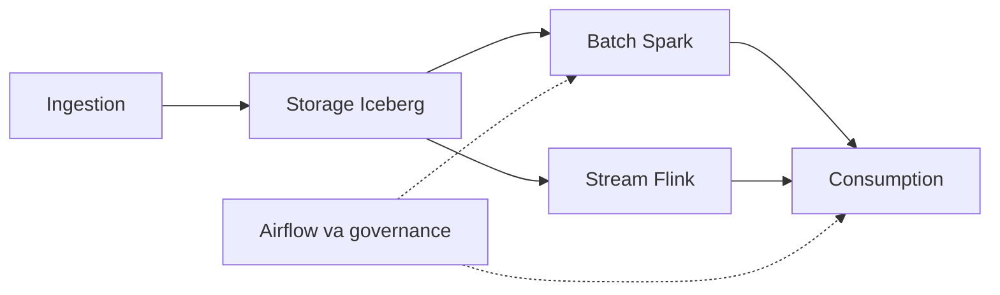

# CineStream

CineStream là nền tảng phim trên miền MovieLens, làm cho coursework EDAI K11. Thiết kế có ba tầng: nền tảng dữ liệu, nền tảng học máy, và trợ lý CineBot. Tầng dữ liệu đang chạy. Feast đã nối bảng feature offline với Redis. Kubeflow, MLflow, KServe và CineBot chưa có trong code.

## Mục lục

- [Domain](#domain)
- [Kiến trúc](#kien-truc)
- [Sơ đồ hệ thống](#so-do)
- [Chỗ chạy](#cho-chay)
- [Cây thư mục](#cay-thu-muc)
- [Quick start](#quick-start)
- [Docs](#docs)

<a id="domain"></a>

## Domain

Dữ liệu là dữ liệu giả lập do `generator/` sinh từ seed MovieLens. Mỗi vấn đề được tiêm với tỷ lệ cố định.

| Nguồn | Sinh bởi | Đường vào | Vấn đề mang theo |
|---|---|---|---|
| Parquet `users`, `movies`, `movie_genres`, `ratings`, `tags`, `watch_history` | [`generator/offline_generator.py`](generator/offline_generator.py) | DP1 đọc bucket MinIO `external-source-lake` | Skew Zipf trên `movie_id` (nhóm 1% phim đầu nhận 80% dòng ratings và watch). Schema phim đổi từ partition 45, thêm `content_rating`, `hdr_format`, `audio_spatial`. Duplicate khoảng 2,5% trên ratings và watch history |
| Heartbeat xem phim | [`generator/streaming_producer.py`](generator/streaming_producer.py) | Kafka `movie.playback.heartbeat` | Khoảng 6% message có `event_ts` lùi 10–35 phút. Duplicate khoảng 1,8% |
| Nhãn điểm cao | [`docs/ml/01_offline_prediction.md`](docs/ml/01_offline_prediction.md) | Một dòng là cặp `(user_id, movie_id)` tại mốc `T` | Dương khi rating sớm nhất trong `[T, T + 1 ngày)` có `rating_val >= 4.0`. Âm khi rating sớm nhất trong cửa sổ đó nhỏ hơn 4.0. Không có rating trong cửa sổ thì không tạo dòng. Chưa có model đã train |

<a id="kien-truc"></a>

## Kiến trúc

Một dòng một lớp, cùng thứ tự với [tour](docs/proof/00_system_tour.md). DP1–DP3 là job Spark trong lớp batch. Airflow kích DP1–DP4 ở lớp orchestration. Batch và stream là hai nhánh song song, cả hai ghi Iceberg.

| Lớp | Code | Việc | Proof đầu |
|---|---|---|---|
| Ingestion | [`generator/`](generator/) | Sinh Parquet ([`offline_generator.py`](generator/offline_generator.py)) và heartbeat ([`streaming_producer.py`](generator/streaming_producer.py)). Chỗ dừng: MinIO `s3://external-source-lake/` và Kafka `movie.playback.heartbeat` | [01](docs/proof/01_data_generator_proof.md) |
| Storage | [`storage/lakehouse/`](storage/lakehouse/) | DDL Iceberg, SCD2, compaction, quan hệ dim/fact. Warehouse `s3a://lakehouse/`. Bronze `raw_*`, silver `stg_*`, gold `dim_*` / `fact_*` / `obt_*` / `feat_*` trong [`gold_tables.sql`](storage/lakehouse/gold/gold_tables.sql) | [02](docs/proof/02_lakehouse_storage_proof.md) |
| Batch | [`transformation/batch/`](transformation/batch/), DAG DP1–DP3 | Spark đưa landing vào bronze, silver, gold và hai bảng `feat_*`. DP1 [`cinestream_dp1_raw_to_bronze.py`](orchestration/dags/cinestream_dp1_raw_to_bronze.py), DP2 [`cinestream_dp2_bronze_to_gold.py`](orchestration/dags/cinestream_dp2_bronze_to_gold.py), DP3 [`build_offline_features.py`](transformation/batch/jobs/build_offline_features.py) | [05 incremental](docs/proof/05_incremental_batch_proof.md) |
| Stream | [`streaming/flink/`](streaming/flink/) | Flink đọc Kafka, ghi `stg_playback_*` hoặc bảng `it_*`, DLQ ra Kafka. [`heartbeat_baseline_job.py`](streaming/flink/jobs/heartbeat_baseline_job.py), [`heartbeat_window_job.py`](streaming/flink/jobs/heartbeat_window_job.py) | [04](docs/proof/04_streaming_flink_proof.md) |
| Consumption | [`serving/`](serving/), [`ml/feast/`](ml/feast/) | ClickHouse nhận Gold đã publish. FastAPI [`app.py`](serving/api/app.py) đọc ClickHouse. Dashboard chỉ gọi FastAPI. Feast [`feature_store.yaml`](ml/feast/feature_store.yaml): offline, Redis db 1, sync cửa sổ từ Iceberg sang Redis db 2 | [06](docs/proof/06_consumption_serving_proof.md) |
| Orchestration | [`orchestration/`](orchestration/), [`governance/`](governance/) | Airflow kích DP1–DP4, kể cả DP4 [`cinestream_dp4_materialize_online.py`](orchestration/dags/cinestream_dp4_materialize_online.py). Catalog gốc [`inventory.py`](governance/inventory.py). Task `publish_datahub` chiếu `data_flow` và dict `validate_*` lên DataHub | [05 orchestration](docs/proof/05_orchestration_governance_proof.md) |

<a id="so-do"></a>

## Sơ đồ hệ thống

Cùng hình với [tour](docs/proof/00_system_tour.md). Batch và stream là hai nhánh song song: cả hai ghi Iceberg, stream đọc Kafka. Mũi tên đứt là Airflow kích batch và consumption, không phải bước tiếp theo của ClickHouse hay Redis. Cổng từng cụm nằm ở [Chỗ chạy](#cho-chay).



### Luồng theo lớp

| Lớp | Từ | Đến | Nội dung |
|---|---|---|---|
| Ingestion | [`offline_generator.py`](generator/offline_generator.py) | MinIO `s3://external-source-lake/` | Parquet `users`, `movies`, `movie_genres`, `ratings`, `tags`, `watch_history`. Scale 100 đã đo 27,5 GB |
| Ingestion | [`streaming_producer.py`](generator/streaming_producer.py) | Kafka `movie.playback.heartbeat` | Heartbeat xem phim |
| Storage | DDL [`storage/lakehouse/`](storage/lakehouse/) | Warehouse `s3a://lakehouse/` | Bronze `raw_*`, silver `stg_*`, gold `dim_*` / `fact_*` / `obt_*` / `feat_*`. `dim_users` và fact nằm ở [`gold_tables.sql`](storage/lakehouse/gold/gold_tables.sql) |
| Batch | Landing và bronze | Silver `stg_*`, rồi gold | Spark, DP1–DP3. Hai bảng `feat_user_movie_stats_daily` và `feat_movie_engagement_stats_daily`, cùng `obt_movie_engagement` |
| Stream | Kafka | Iceberg `stg_playback_*` hoặc bảng `it_*`, và Kafka DLQ | Flink ghi cửa sổ lên Iceberg. Feast đọc cửa sổ đó rồi sync sang Redis db 2 |
| Consumption | Gold đã publish | ClickHouse | Marker `published: true` được sync |
| Consumption | ClickHouse | [`serving/api/app.py`](serving/api/app.py), rồi dashboard | FastAPI đọc ClickHouse. Dashboard chỉ gọi FastAPI |
| Consumption | Export `feat_*` | Redis db 1 | Feast materialize batch. DP4 kích bước này |
| Consumption | Cửa sổ trên Iceberg | Redis db 2 | Feast sync. Db 1 và db 2 không dùng chung |
| Orchestration | Airflow | DP1–DP4 | Nét đứt: kích Spark, sync ClickHouse, materialize Feast |
| Orchestration | `validate_*` | DataHub | Task `publish_datahub` trên DP1–DP3 gửi `data_flow` và dict `validate_*`. Catalog gốc là [`inventory.py`](governance/inventory.py) |

<a id="cho-chay"></a>

## Chỗ chạy

Mọi dịch vụ chạy bằng Docker trên máy local. Repo không có cụm kind và không có tài nguyên Azure.

| Chỗ | Cổng và tài khoản | File |
|---|---|---|
| MinIO, Kafka, Iceberg REST, Spark master | Console `:9001` (`minioadmin` / `minioadmin`), API `:9000`, Kafka UI `:8085`, broker `:19092`, Iceberg REST `:8181`, Spark master `:18080` | [`infra/compose/docker-compose.yml`](infra/compose/docker-compose.yml) |
| Airflow | UI `:18082` (`airflow` / `airflow`) | [`infra/compose/docker-compose.airflow.yml`](infra/compose/docker-compose.airflow.yml), gộp với file gốc |
| Flink | UI `:18081` | [`infra/compose/docker-compose.streaming.yml`](infra/compose/docker-compose.streaming.yml) |
| DataHub | UI `:9002` (`datahub` / `datahub`), GMS `:18083` | [`infra/compose/docker-compose.datahub.yml`](infra/compose/docker-compose.datahub.yml) |
| Redis Feast | `:16379`, db 1 cho batch, db 2 cho cửa sổ | [`infra/compose/docker-compose.feast.yml`](infra/compose/docker-compose.feast.yml) |
| ClickHouse | HTTP `:18123`, native `:19000` (`default` / `cinestream`), database `cinestream_serving` | [`infra/compose/docker-compose.clickhouse.yml`](infra/compose/docker-compose.clickhouse.yml) |
| FastAPI | Host `:18083` | `make serving-api`, process trên máy |
| Dashboard | `:18084`, nginx `:18085` | `make serving-dashboard`, [`infra/compose/docker-compose.dashboard.yml`](infra/compose/docker-compose.dashboard.yml) |
| Lakehouse UI | `:8088` | `make lakehouse-ui`, hoặc [`infra/compose/docker-compose.lakehouse.yml`](infra/compose/docker-compose.lakehouse.yml) qua `make lakehouse-docker` |

Mỗi lệnh dưới đây bật một cụm. Repo không có một target gộp toàn bộ dịch vụ.

- `make up` đọc `infra/compose/docker-compose.yml` và bật MinIO, Kafka, Kafka UI, Iceberg REST. Spark master cùng file, cổng `:18080`, do `make airflow-up` bật.
- `make airflow-up`: Airflow `:18082` (`airflow` / `airflow`). DAG tạo ra ở trạng thái paused.
- `make stream-up`: Flink UI `:18081`.
- `make datahub-up`: UI `:9002` (`datahub` / `datahub`), GMS `:18083`.
- `make feast-redis-up`: Redis `:16379`.
- `make serving-up` rồi `make serving-api`: ClickHouse `:18123`, API host `:18083`.
- `make lakehouse-ui`: `:8088`.

DataHub GMS và FastAPI cùng cổng `18083`. Chạy `make datahub-up` thì tắt cụm đó trước khi chạy `make serving-api`, và ngược lại.

`make stream-job-run` nộp job lên cụm Flink và cần `CINESTREAM_ALLOW_STREAMING=true`. Ý nghĩa lệnh nằm ở Quick start, lớp Stream.

<a id="cay-thu-muc"></a>

## Cây thư mục

```
generator/            Ingestion. Parquet offline, heartbeat Kafka, injector skew / duplicate / schema / late arrival
storage/              Storage. DDL Iceberg bronze / silver / gold, SCD2, UI lakehouse, quan hệ dim-fact
transformation/       Batch. Job Spark: baseline, salting, AQE, bronze, silver, gold, feat_*
streaming/            Stream. Job Flink baseline và cửa sổ heartbeat
serving/              Consumption. ClickHouse, FastAPI, dashboard
ml/                   Consumption. Feast offline, Redis db 1, sync cửa sổ Iceberg sang Redis db 2
orchestration/        Orchestration. DAG Airflow DP1–DP4
governance/           Orchestration. Catalog inventory.py, hợp đồng, emit DataHub
infra/                Phụ lục đóng gói. docker-compose và Dockerfile multi-stage
tests/                Unit test và các kiểm tra theo phase
docs/proof/           Nhật ký từng lần chạy. Đọc từ 00_system_tour.md
make/                 Target Make. make help in menu
```

Parquet sinh ra nằm ở `data_generator/output/`.

<a id="quick-start"></a>

## Quick start

Cần Docker, Docker Compose và `uv`. Spark local trong [`make/spark.mk`](make/spark.mk) tự lấy Python 3.12. `make help` in menu lệnh. `make test` chỉ chạy `tests/unit/`.

Lệnh xếp theo sáu lớp. Cột **Việc** nói lệnh đó làm gì. DataHub GMS và FastAPI cùng cổng `18083`. Chạy `make datahub-up` thì tắt cụm đó trước khi chạy `make serving-api`, và ngược lại.

### Ingestion

Sinh Parquet và heartbeat. Chỗ dừng là đĩa local, MinIO `s3://external-source-lake/` và Kafka `movie.playback.heartbeat`. Proof: [01](docs/proof/01_data_generator_proof.md), [23](docs/proof/23_dataset_scale_100.md).

| Lệnh | Việc |
|---|---|
| `make demo-layer1` | Gói không cần Docker: sinh Parquet scale 0.1, kiểm generator, dry-run heartbeat, dry-run ánh xạ MinIO |
| `make gen-offline` | Sinh Parquet scale 0.1 với skew và duplicate, ra `data_generator/output/scale_0_1` |
| `python -m generator.offline_generator --scale-factor 0.1 --output-dir data_generator/output/scale_0_1` | Cùng việc sinh Parquet, gọi thẳng module. Lệnh đã ghi trong proof 01 |
| `make gen-offline-scale-1` | Sinh Parquet scale 1 ra `data_generator/output/scale_1_0` |
| `python -m generator.offline_generator --scale-factor 100 --allow-large-scale` | Sinh bộ scale 100. Lần đã đo là 27,5 GB. Số đo ở proof 23 |
| `make verify-generator` | Đếm file, đối chiếu schema từ partition 45 và phân phối skew |
| `make stream-dry` | In heartbeat ra terminal. Không mở Kafka |
| `python -m generator.streaming_producer --dry-run` | Cùng dry-run heartbeat, gọi thẳng module |
| `make minio-sync-dry` | In danh sách file sẽ lên bucket. Không tải |
| `make up` | Bật MinIO, Kafka, Kafka UI và Iceberg REST |
| `make minio-sync` | Tải Parquet lên `s3://external-source-lake/` |
| `make stream-kafka` | Đẩy heartbeat vào `movie.playback.heartbeat` trên broker `:19092`. Cần Kafka đang chạy |
| `python -m generator.streaming_producer --kafka-bootstrap localhost:19092 --topic movie.playback.heartbeat` | Cùng việc bắn heartbeat, gọi thẳng module |

### Storage

Khai báo và kiểm lakehouse Iceberg. Warehouse ghi thật là `s3a://lakehouse/`. Proof: [02](docs/proof/02_lakehouse_storage_proof.md), [19](docs/proof/19_dim_fact_relationship.md).

| Lệnh | Việc |
|---|---|
| `make demo-layer2` | Không cần Docker: liệt kê DDL, SCD2 trên 5 user, mô phỏng compaction mục tiêu 128 MB |
| `make lakehouse-check` | In bảng Bronze `raw_*`, Silver `stg_*`, Gold `dim_*` / `fact_*` / `obt_*` / `feat_*` đã khai báo |
| `make scd2-demo` | Đóng phiên bản gói cũ và mở phiên bản mới trên `dim_users` |
| `python -m storage.lakehouse.scd.apply_scd2` | Cùng bước SCD2, gọi thẳng module |
| `make test-scd2` | Chạy test SCD2 và in bảng trước, sau |
| `make compact-demo` | Mô phỏng gom file nhỏ về một file mục tiêu 128 MB |
| `python -m storage.lakehouse.maintenance.compaction --target-mb 128` | Cùng mô phỏng compaction, gọi thẳng module |
| `python -m storage.lakehouse.export_erd` | Xuất quan hệ `dim_users`, `dim_movies`, fact và OBT từ metadata Iceberg |
| `make lakehouse-ui` | Mở trang xem luồng tại `:8088` |
| `make lakehouse-docker` | Cùng trang UI, chạy trong Docker, cổng 8088 |

### Batch

Spark đưa landing vào bronze, silver, gold và hai bảng `feat_*`. Ba lệnh `spark-baseline`, `spark-optimized`, `spark-aqe` đọc `data_generator/output/scale_0_1` và chạy được khi chưa có Docker. `SPARK_HOLD=120` giữ Spark UI tại `:4040`. Proof: [05 incremental](docs/proof/05_incremental_batch_proof.md), [03](docs/proof/03_spark_optimizations_proof.md), [13](docs/proof/13_offline_features.md).

| Lệnh | Việc |
|---|---|
| `make spark-batch-it` | Test batch trên warehouse `file://`, namespace `it_*` |
| `python tests/unit/test_scd2_logic.py` | Test đóng và mở phiên bản SCD2 |
| `make spark-ingest-bronze SPARK_SRC=data_generator/output/scale_0_1 SPARK_RUN_ID=manual` | Đưa Parquet landing vào bronze. `SPARK_RUN_ID` không tham gia khóa chống trùng |
| `make spark-publish SPARK_EFFECTIVE_TS=2026-03-01T00:00:00+00:00` | Bronze sang silver rồi gold. `SPARK_EFFECTIVE_TS` là mốc đổi gói SCD2 |
| `make spark-build-gold` | Ghi silver, `dim_users` SCD2, fact và OBT vào warehouse `s3a://lakehouse/` |
| `make spark-schema-it` | So schema và partition trên warehouse `file://` |
| `SPARK_HOLD=120 make spark-baseline` | Join lệch khóa, để nguyên schema. Giữ UI `:4040` |
| `SPARK_HOLD=120 make spark-optimized` | Salting, gộp schema, khử trùng, broadcast thể loại |
| `SPARK_HOLD=120 make spark-aqe` | Chia partition lệch bằng Adaptive Query Execution |
| `make demo-layer3` | So baseline, salting và AQE trên nguồn local |
| `make spark-features-it` | Hai bảng `feat_*` trên warehouse `file://`, chỉ sự kiện trước mốc `T` |

### Stream

Flink đọc Kafka, ghi `stg_playback_*` hoặc bảng `it_*`, DLQ ra Kafka. Proof: [04](docs/proof/04_streaming_flink_proof.md), [21](docs/proof/21_flink_baseline_ui.md). Cửa sổ sang Redis db 2 nằm ở lớp Consumption, proof [17](docs/proof/17_feast_streaming.md).

| Lệnh | Việc |
|---|---|
| `make stream-test` | Test watermark, dedup và DLQ trên máy. Không cần cụm Flink |
| `make stream-verify` | Chứng minh event muộn vào DLQ. Đọc topic và bucket nếu cụm đang chạy |
| `make stream-up` | Bật JobManager và TaskManager. UI `:18081` |
| `make stream-checkpoints` | Liệt kê checkpoint trên volume `flink_checkpoints` |
| `make stream-job-stop` | Hủy job heartbeat đang chạy. Giữ offset Kafka |
| `uv run python -m streaming.flink.jobs.heartbeat_baseline_job --engine local --scenario proof` | Baseline theo processing time, chạy trên máy với scenario proof |
| `uv run python -m streaming.flink.jobs.heartbeat_window_job --engine local --scenario proof` | Cửa sổ tumbling, watermark, dedup và DLQ, chạy trên máy |
| `make stream-job-run` | Nộp job lên cụm Flink. Cần `CINESTREAM_ALLOW_STREAMING=true` |

### Consumption

ClickHouse nhận Gold đã publish. FastAPI đọc ClickHouse. Dashboard chỉ gọi FastAPI. Feast đọc export feature. Proof: [06](docs/proof/06_consumption_serving_proof.md), [07](docs/proof/07_analytics_dashboard.md), [15](docs/proof/15_feast_offline.md), [16](docs/proof/16_feast_online.md), [17](docs/proof/17_feast_streaming.md).

`make feast-online-it`, `make feast-airflow-it` và `make feast-streaming-it` tự gọi `make feast-redis-up`.

| Lệnh | Việc |
|---|---|
| `make serving-up` | Bật ClickHouse `:18123` và tạo database `cinestream_serving` |
| `make serving-it` | Sync snapshot Gold đã publish vào database kiểm tra |
| `make serving-it-api` | Test API và sync trên database kiểm tra |
| `make serving-it-audit` | Audit phục hồi trên database kiểm tra |
| `make serving-api` | FastAPI `:18083` đọc ClickHouse. Tắt DataHub GMS trước vì cùng cổng |
| `make serving-dashboard` | Dashboard `:18084` chỉ gọi FastAPI |
| `make serving-it-dashboard` | Đối chiếu số trên dashboard với FastAPI |
| `make serving-dashboard-up` | Nginx `:18085` đứng trước dashboard. FastAPI vẫn ở host `:18083` |
| `make serving-it-unified` | Batch `it_it_af_real` và trending `it_e2e` trên một API |
| `make serving-it-trending` | Test trending trên topic kiểm tra và database `it_trend` |
| `make serving-it-ops` | Sẵn sàng vận hành trending trên topic kiểm tra |
| `make serving-it-reliability` | Checkpoint, event muộn sau restore, và poll trên topic kiểm tra |
| `make serving-trending-approve` | Chặn poll production khi chưa có `CINESTREAM_ALLOW_STREAMING=true` |
| `make serving-trending-sync` | Poll cửa sổ production vào ClickHouse. Dừng bằng Ctrl-C |
| `make feast-offline-it` | Feast apply và point-in-time trên export Parquet. Bài này dừng trước Redis |
| `make feast-redis-up` | Redis `:16379`. Db 1 cho feature batch, db 2 cho cửa sổ |
| `make feast-online-it` | Materialize snapshot batch vào Redis db 1 |
| `make feast-airflow-it` | DP1–DP4 trên namespace kiểm tra, rồi materialize vào Redis db 1 |
| `make feast-streaming-it` | Đọc cửa sổ trên Iceberg và sync sang Redis db 2 |

### Orchestration

Airflow kích DP1–DP4. Governance đối chiếu inventory. DataHub chỉ nhận bản chiếu từ task `publish_datahub`. Proof Airflow: [05 orchestration](docs/proof/05_orchestration_governance_proof.md), [14](docs/proof/14_airflow_dp_e2e.md). Proof governance: [08](docs/proof/08_data_governance_lineage.md) đến [12](docs/proof/12_governance_dashboard.md), [18](docs/proof/18_datahub_lineage.md), [20 DataHub](docs/proof/20_datahub_lineage.md).

| Lệnh | Việc |
|---|---|
| `make airflow-up` | Bật MinIO, Iceberg REST, Spark và Airflow UI `:18082`. DAG tạo ra ở trạng thái paused |
| `make airflow-ps` | In trạng thái cụm kèm Airflow |
| `make airflow-it` | Test DAG và fixture nhỏ trên Spark, Iceberg REST, MinIO |
| `make airflow-dp-it` | Chạy DP1, DP2, DP3 trên namespace `it_af_dp` |
| `make airflow-it-real` | Cùng chuỗi trên Parquet thật, namespace `it_af_real` |
| `make governance-check` | Đối chiếu lineage, drift, hợp đồng và payload bằng bài test chỉ đọc |
| `PYTHONPATH=. uv run python -m governance.audit_readonly` | Đọc inventory và đối chiếu chỉ đọc. Lệnh trong proof 08 |
| `make governance-observe` | Đọc Iceberg REST, Airflow, ClickHouse, MinIO và ghi báo cáo quan sát |
| `PYTHONPATH=. uv run --extra minio python -m governance.collect` | Cùng việc thu thập quan sát, gọi thẳng module. Lệnh trong proof 09 |
| `make governance-dashboard-it` | API governance với FastAPI và trạng thái lỗi trên UI |
| `make datahub-up` | DataHub UI `:9002`, GMS `:18083`. Tắt FastAPI trước |
| `make datahub-down` | Tắt DataHub và giải phóng cổng `18083`. Giữ MinIO, Kafka, Iceberg |
| `PYTHONPATH=. python -m governance.datahub.emit --dag-id cinestream_dp1_raw_to_bronze --run-id proof-dp1 --gms-url http://localhost:18083 --result-json '{"ready": true, "datasets": [{"error_rate": 0}], "violations": []}'` | Task `publish_datahub`: gửi `data_flow` và dict `validate_*` lên GMS. DP2 và DP3 dùng cùng module. Payload IT nằm ở proof 18 |

### Phụ lục đóng gói

Không phải một lớp dữ liệu. Hai lần inspect image Spark, Flink, Airflow và Lakehouse UI. Tag đã đo là `:single-stage` và `:multi-stage`. Proof: [20 docker](docs/proof/20_docker_multistage.md), [22](docs/proof/22_multistage_images.md).

| Lệnh | Việc |
|---|---|
| `docker image inspect --format '{{.Size}}' <image>` | Đọc tổng byte các layer, trường `Size` |
| `docker images` | Cột hiển thị gộp layer dùng chung. Đọc cùng `Size`, hai cột là hai lần đo khác nhau |

<a id="docs"></a>

## Docs

Đọc từ [tour](docs/proof/00_system_tour.md). Các file số là nhật ký một lần chạy. Có hai file `05` và hai file `20`.

### Ingestion

- [`docs/proof/01_data_generator_proof.md`](docs/proof/01_data_generator_proof.md): generator scale 0.1.
- [`docs/proof/23_dataset_scale_100.md`](docs/proof/23_dataset_scale_100.md): dataset scale-factor 100, 27,5 GB đã đo.

### Storage

- [`docs/proof/02_lakehouse_storage_proof.md`](docs/proof/02_lakehouse_storage_proof.md): lakehouse Iceberg.
- [`docs/proof/19_dim_fact_relationship.md`](docs/proof/19_dim_fact_relationship.md): quan hệ dim và fact.

### Batch

- [`docs/proof/05_incremental_batch_proof.md`](docs/proof/05_incremental_batch_proof.md): batch lakehouse tăng dần.
- [`docs/proof/03_spark_optimizations_proof.md`](docs/proof/03_spark_optimizations_proof.md): baseline, salting, AQE, schema, dedup.
- [`docs/proof/13_offline_features.md`](docs/proof/13_offline_features.md): feature offline và ba DAG.

### Stream

- [`docs/proof/04_streaming_flink_proof.md`](docs/proof/04_streaming_flink_proof.md): cửa sổ tumbling Flink.
- [`docs/proof/21_flink_baseline_ui.md`](docs/proof/21_flink_baseline_ui.md): baseline và job cửa sổ trên cùng JobManager.

### Consumption

- [`docs/proof/06_consumption_serving_proof.md`](docs/proof/06_consumption_serving_proof.md): ClickHouse cho Gold đã publish.
- [`docs/proof/07_analytics_dashboard.md`](docs/proof/07_analytics_dashboard.md): dashboard analytics.
- [`docs/proof/15_feast_offline.md`](docs/proof/15_feast_offline.md): Feast offline và point-in-time.
- [`docs/proof/16_feast_online.md`](docs/proof/16_feast_online.md): materialize snapshot sang Redis db 1.
- [`docs/proof/17_feast_streaming.md`](docs/proof/17_feast_streaming.md): Feast đọc cửa sổ trên Iceberg và sync sang Redis db 2.

### Orchestration

- [`docs/proof/05_orchestration_governance_proof.md`](docs/proof/05_orchestration_governance_proof.md): Airflow và governance.
- [`docs/proof/14_airflow_dp_e2e.md`](docs/proof/14_airflow_dp_e2e.md): DP1–DP3 trên Spark và Iceberg, namespace `it_af_dp`.
- [`docs/proof/08_data_governance_lineage.md`](docs/proof/08_data_governance_lineage.md): governance và lineage.
- [`docs/proof/09_governance_observability.md`](docs/proof/09_governance_observability.md): drift metadata và quan sát pipeline.
- [`docs/proof/10_governance_findings_triage.md`](docs/proof/10_governance_findings_triage.md): phân loại finding.
- [`docs/proof/11_schema_contract_validation.md`](docs/proof/11_schema_contract_validation.md): hợp đồng schema.
- [`docs/proof/12_governance_dashboard.md`](docs/proof/12_governance_dashboard.md): governance dashboard.
- [`docs/proof/18_datahub_lineage.md`](docs/proof/18_datahub_lineage.md): DataHub chiếu DP1–DP3.
- [`docs/proof/20_datahub_lineage.md`](docs/proof/20_datahub_lineage.md): lineage và assertion DP1–DP3 trên GMS.

### Phụ lục đóng gói

- [`docs/proof/20_docker_multistage.md`](docs/proof/20_docker_multistage.md): kích thước image trước và sau multi-stage.
- [`docs/proof/22_multistage_images.md`](docs/proof/22_multistage_images.md): số byte image multi-stage.

### Thiết kế học máy

- [`docs/ml/01_offline_prediction.md`](docs/ml/01_offline_prediction.md): nhãn điểm cao sau một mốc thời gian.
- [`docs/ml/02_feast_offline.md`](docs/ml/02_feast_offline.md): Feast offline cho hai bảng feature.

`docs/spec/` và `docs/domain/` (`movie_lens/`, `ecommerce/`) là bản thiết kế. Lệnh để chạy nằm ở Quick start và ở từng file `docs/proof/`.
