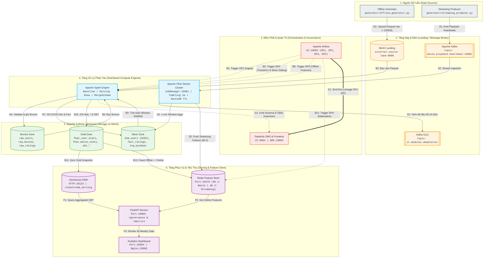

# CineStream

CineStream là nền tảng phim trên miền MovieLens, làm cho coursework EDAI K11. Thiết kế có ba tầng: nền tảng dữ liệu, nền tảng học máy, và trợ lý CineBot. Tầng dữ liệu đang chạy. Feast đã nối bảng feature offline với Redis. Kubeflow, MLflow, KServe và CineBot chưa có trong code.

## Mục lục

- [Domain](#domain)
- [Kiến trúc](#kien-truc)
- [Sơ đồ hệ thống](#so-do)
- [Chỗ chạy](#cho-chay)
- [Cây thư mục](#cay-thu-muc)
- [Quick start](#quick-start)
- [Docs](#docs)

<a id="domain"></a>

## Domain

Dữ liệu là dữ liệu giả lập do `generator/` sinh từ seed MovieLens. Mỗi vấn đề được tiêm với tỷ lệ cố định.

| Nguồn | Sinh bởi | Đường vào | Vấn đề mang theo |
|---|---|---|---|
| Parquet `users`, `movies`, `movie_genres`, `ratings`, `tags`, `watch_history` | [`generator/offline_generator.py`](generator/offline_generator.py) | DP1 đọc bucket MinIO `external-source-lake` | Skew Zipf trên `movie_id` (nhóm 1% phim đầu nhận 80% dòng ratings và watch). Schema phim đổi từ partition 45, thêm `content_rating`, `hdr_format`, `audio_spatial`. Duplicate khoảng 2,5% trên ratings và watch history |
| Heartbeat xem phim | [`generator/streaming_producer.py`](generator/streaming_producer.py) | Kafka `movie.playback.heartbeat` | Khoảng 6% message có `event_ts` lùi 10–35 phút. Duplicate khoảng 1,8% |
| Nhãn điểm cao | [`docs/ml/01_offline_prediction.md`](docs/ml/01_offline_prediction.md) | Một dòng là cặp `(user_id, movie_id)` tại mốc `T` | Dương khi rating sớm nhất trong `[T, T + 1 ngày)` có `rating_val >= 4.0`. Âm khi rating sớm nhất trong cửa sổ đó nhỏ hơn 4.0. Không có rating trong cửa sổ thì không tạo dòng. Chưa có model đã train |

<a id="kien-truc"></a>

## Kiến trúc

Bảng dưới chỉ gồm bước đang có code. Mỗi bước trỏ tới file thực thi.

| Bước | Thành phần | Việc của bước |
|---|---|---|
| 01 · DP1 | Spark ingest | Parquet trên MinIO vào bronze Iceberg. DAG [`orchestration/dags/cinestream_dp1_raw_to_bronze.py`](orchestration/dags/cinestream_dp1_raw_to_bronze.py) |
| 02 · DP2 | Spark silver và gold | Bronze sang silver, dim/fact và OBT. DAG [`orchestration/dags/cinestream_dp2_bronze_to_gold.py`](orchestration/dags/cinestream_dp2_bronze_to_gold.py) |
| 03 · DP3 | Feature offline | Hai bảng `feat_*` với `event_timestamp` trước mốc `T`. Job [`transformation/batch/jobs/build_offline_features.py`](transformation/batch/jobs/build_offline_features.py) |
| 04 | Flink | Baseline theo processing time, và job cửa sổ với watermark, dedup, DLQ: [`streaming/flink/jobs/heartbeat_baseline_job.py`](streaming/flink/jobs/heartbeat_baseline_job.py), [`streaming/flink/jobs/heartbeat_window_job.py`](streaming/flink/jobs/heartbeat_window_job.py) |
| 05 | Airflow | Điều phối DP1–DP4. DP4 materialize feature batch. Cụm [`infra/compose/docker-compose.airflow.yml`](infra/compose/docker-compose.airflow.yml), DAG [`orchestration/dags/cinestream_dp4_materialize_online.py`](orchestration/dags/cinestream_dp4_materialize_online.py) |
| 06 | DataHub | Catalog gốc là [`governance/inventory.py`](governance/inventory.py). GMS chỉ nhận cạnh `data_flow` và kết quả `validate_*` do [`governance/datahub/emit.py`](governance/datahub/emit.py) đẩy lên |
| 07 | Feast | Offline store DuckDB trên export Parquet, [`ml/feast/feature_store.yaml`](ml/feast/feature_store.yaml). Materialize batch vào Redis db 1. Sync cửa sổ Flink vào Redis db 2 |
| 08 | ClickHouse và FastAPI | Gold đã publish nằm trên ClickHouse. API đọc serving, [`serving/api/app.py`](serving/api/app.py) |

<a id="so-do"></a>

## Sơ đồ hệ thống

Mỗi thành phần là một đơn vị triển khai độc lập (Deployable Unit) với thông tin container/cổng tương ứng. Các mũi tên thể hiện hướng đi của dữ liệu, kèm mô tả nội dung truyền tải và số thứ tự luồng:
- **[B1–B13] Luồng Batch:** Dữ liệu ngoại tuyến qua Medallion Lakehouse, tính toán feature offline và đồng bộ phục vụ.
- **[S1–S5] Luồng Streaming:** Dữ liệu nhịp tim thời gian thực qua Kafka, Flink gán watermark, tách DLQ và sync online feature.
- **[G1–G2] Luồng Governance:** Tự động phát sinh metadata, lineage và kiểm định chất lượng (assertions) lên DataHub.
- **[P1–P3] Luồng Serving:** Truy vấn phục vụ phân tích dữ liệu và hiển thị trên Dashboard.



### Bảng chi tiết các luồng dữ liệu (Data Flows)

| Luồng | Loại luồng | Thành phần kích hoạt | Chi tiết dữ liệu và đích đến |
|---|---|---|---|
| **B1–B4** | **DP1: Raw $\rightarrow$ Bronze** | Generator / Airflow DP1 | Generator nạp Parquet thô vào MinIO `external-source-lake`. Spark nạp dữ liệu vào Iceberg `bronze` và kiểm định schema contract. |
| **B5–B7** | **DP2: Bronze $\rightarrow$ Silver** | Airflow DP2 | Spark xử lý Skew salting `movie_id` và schema evolution; ghi `dim_users` (SCD Type 2), `fact_ratings`, `fact_watch_sessions`. |
| **B8–B10** | **DP3: Silver $\rightarrow$ Gold** | Airflow DP3 | Spark tính toán 2 bảng đặc trưng `feat_user_movie_stats_daily` và `feat_movie_engagement_stats_daily` cùng bảng OBT. |
| **B11–B13** | **DP4 & Serving Sync** | Airflow DP4 / Serving Job | Snapshot Gold được publish sang ClickHouse. DAG DP4 chạy Feast Materialize từ Offline Parquet sang Redis Online Store (db 1). |
| **S1–S5** | **Streaming Heartbeats** | Producer / Flink | Heartbeats đẩy vào Kafka. Flink gán watermark, trễ 10–35m chuyển vào Dead Letter Queue (DLQ). Dữ liệu hợp lệ ghi Silver và sync vào Redis (db 2). |
| **G1–G2** | **Governance & Lineage** | Airflow / DataHub Emitter | Sau khi chạy DP1–DP3, `governance/datahub/emit.py` gửi dataflow lineage và assertion test results lên DataHub GMS (`:18083`). |
| **P1–P3** | **Serving & Consumption** | Client / FastAPI | FastAPI đọc dữ liệu tổng hợp từ ClickHouse và Redis, cung cấp REST API cho Dashboard analytics (`:18084`). |

<a id="cho-chay"></a>

## Chỗ chạy

Mọi dịch vụ chạy bằng Docker trên máy local. Repo không có cụm kind và không có tài nguyên Azure.

| Chỗ | Cổng và tài khoản | File |
|---|---|---|
| MinIO, Kafka, Iceberg REST, Spark master | Console `:9001` (`minioadmin` / `minioadmin`), API `:9000`, Kafka UI `:8085`, broker `:19092`, Iceberg REST `:8181`, Spark master `:18080` | [`infra/compose/docker-compose.yml`](infra/compose/docker-compose.yml) |
| Airflow | UI `:18082` (`airflow` / `airflow`) | [`infra/compose/docker-compose.airflow.yml`](infra/compose/docker-compose.airflow.yml), gộp với file gốc |
| Flink | UI `:18081` | [`infra/compose/docker-compose.streaming.yml`](infra/compose/docker-compose.streaming.yml) |
| DataHub | UI `:9002` (`datahub` / `datahub`), GMS `:18083` | [`infra/compose/docker-compose.datahub.yml`](infra/compose/docker-compose.datahub.yml) |
| Redis Feast | `:16379`, db 1 cho batch, db 2 cho cửa sổ | [`infra/compose/docker-compose.feast.yml`](infra/compose/docker-compose.feast.yml) |
| ClickHouse | HTTP `:18123`, native `:19000` (`default` / `cinestream`), database `cinestream_serving` | [`infra/compose/docker-compose.clickhouse.yml`](infra/compose/docker-compose.clickhouse.yml) |
| FastAPI | Host `:18083` | `make serving-api`, process trên máy |
| Dashboard | `:18084`, nginx `:18085` | `make serving-dashboard`, [`infra/compose/docker-compose.dashboard.yml`](infra/compose/docker-compose.dashboard.yml) |
| Lakehouse UI | `:8088` | `make lakehouse-ui`, hoặc [`infra/compose/docker-compose.lakehouse.yml`](infra/compose/docker-compose.lakehouse.yml) qua `make lakehouse-docker` |

Mỗi lệnh dưới đây bật một cụm. Repo không có một target gộp toàn bộ dịch vụ.

- `make up` đọc `infra/compose/docker-compose.yml` và bật MinIO, Kafka, Kafka UI, Iceberg REST. Spark master cùng file, cổng `:18080`, do `make airflow-up` bật.
- `make airflow-up`: Airflow `:18082` (`airflow` / `airflow`). DAG tạo ra ở trạng thái paused.
- `make stream-up`: Flink UI `:18081`.
- `make datahub-up`: UI `:9002` (`datahub` / `datahub`), GMS `:18083`.
- `make feast-redis-up`: Redis `:16379`.
- `make serving-up` rồi `make serving-api`: ClickHouse `:18123`, API host `:18083`.
- `make lakehouse-ui`: `:8088`.

DataHub GMS và FastAPI cùng cổng `18083`. Chạy `make datahub-up` thì tắt cụm đó trước khi chạy `make serving-api`, và ngược lại.

`make stream-job-run` nộp job lên cụm Flink và cần `CINESTREAM_ALLOW_STREAMING=true`. Quick start không gồm lệnh này.

<a id="cay-thu-muc"></a>

## Cây thư mục

```
generator/            Parquet offline, heartbeat Kafka, injector skew / duplicate / schema / late arrival
transformation/       Job Spark: baseline, salting, AQE, bronze, silver, gold, feature offline
streaming/            Job Flink baseline và cửa sổ heartbeat
storage/              DDL Iceberg bronze / silver / gold, UI lakehouse, xuất quan hệ dim-fact
serving/              ClickHouse, FastAPI, dashboard
orchestration/        DAG Airflow DP1–DP4
governance/           Catalog inventory.py và emit DataHub
ml/                   Feast offline, materialize Redis db 1, sync cửa sổ sang Redis db 2
infra/                docker-compose và Dockerfile multi-stage
tests/                Unit test và các kiểm tra theo phase
docs/proof/           Bằng chứng từng phase
make/                 Target Make. make help in menu
```

Parquet sinh ra nằm ở `data_generator/output/`.

<a id="quick-start"></a>

## Quick start

Cần Docker, Docker Compose và `uv`. Spark local trong [`make/spark.mk`](make/spark.mk) tự lấy Python 3.12. `make help` in menu lệnh.

### Không cần Docker

`make demo-layer1` sinh Parquet scale 0.1, kiểm generator, dry-run heartbeat và dry-run ánh xạ MinIO. Ba lệnh Spark đọc `data_generator/output/scale_0_1`. `SPARK_HOLD=120` giữ Spark UI tại `:4040`.

```bash
make demo-layer1
SPARK_HOLD=120 make spark-baseline
SPARK_HOLD=120 make spark-optimized
SPARK_HOLD=120 make spark-aqe
make stream-test
make governance-check
make test
```

`make test` chỉ chạy `tests/unit/`.

### Có Docker

Mỗi phase một cụm và một proof.

Dữ liệu nhỏ:

```bash
make gen-offline
make verify-generator
```

Scale 100 là lệnh riêng, khoảng 27,5 GB trên đĩa. Số đo và lệnh nằm ở [`docs/proof/23_dataset_scale_100.md`](docs/proof/23_dataset_scale_100.md).

Lakehouse, namespace `it_af_dp`:

```bash
make airflow-up
make airflow-dp-it
```

Proof: [`docs/proof/14_airflow_dp_e2e.md`](docs/proof/14_airflow_dp_e2e.md).

Spark đã đo trên `data_generator/output/scale_0_1`: [`docs/proof/03_spark_optimizations_proof.md`](docs/proof/03_spark_optimizations_proof.md). Ba target ở phase không cần Docker là lệnh tương ứng.

Flink local, `--engine local` chạy trên máy:

```bash
uv run python -m streaming.flink.jobs.heartbeat_baseline_job --engine local --scenario proof
uv run python -m streaming.flink.jobs.heartbeat_window_job --engine local --scenario proof
```

Ảnh UI cụm: [`docs/proof/21_flink_baseline_ui.md`](docs/proof/21_flink_baseline_ui.md).

DataHub. Bật cụm, rồi chạy lệnh emit trong proof. GMS chiếm cổng `18083`.

```bash
make datahub-up
```

Proof: [`docs/proof/20_datahub_lineage.md`](docs/proof/20_datahub_lineage.md).

Feast. `make feast-online-it`, `make feast-airflow-it` và `make feast-streaming-it` tự gọi `make feast-redis-up`.

```bash
make feast-offline-it
make feast-online-it
make feast-airflow-it
make feast-streaming-it
```

Proof: [`docs/proof/15_feast_offline.md`](docs/proof/15_feast_offline.md), [`docs/proof/16_feast_online.md`](docs/proof/16_feast_online.md), [`docs/proof/17_feast_streaming.md`](docs/proof/17_feast_streaming.md).

Image multi-stage và quan hệ dim/fact: [`docs/proof/20_docker_multistage.md`](docs/proof/20_docker_multistage.md), [`docs/proof/19_dim_fact_relationship.md`](docs/proof/19_dim_fact_relationship.md).

<a id="docs"></a>

## Docs

Một dòng một file đã chạy.

- [`docs/proof/01_data_generator_proof.md`](docs/proof/01_data_generator_proof.md): generator scale 0.1.
- [`docs/proof/02_lakehouse_storage_proof.md`](docs/proof/02_lakehouse_storage_proof.md): lakehouse Iceberg.
- [`docs/proof/03_spark_optimizations_proof.md`](docs/proof/03_spark_optimizations_proof.md): baseline, salting, AQE, schema, dedup.
- [`docs/proof/04_streaming_flink_proof.md`](docs/proof/04_streaming_flink_proof.md): cửa sổ tumbling Flink.
- [`docs/proof/05_incremental_batch_proof.md`](docs/proof/05_incremental_batch_proof.md): batch lakehouse tăng dần.
- [`docs/proof/05_orchestration_governance_proof.md`](docs/proof/05_orchestration_governance_proof.md): Airflow và governance.
- [`docs/proof/06_consumption_serving_proof.md`](docs/proof/06_consumption_serving_proof.md): ClickHouse cho Gold đã publish.
- [`docs/proof/07_analytics_dashboard.md`](docs/proof/07_analytics_dashboard.md): dashboard analytics.
- [`docs/proof/08_data_governance_lineage.md`](docs/proof/08_data_governance_lineage.md): governance và lineage.
- [`docs/proof/09_governance_observability.md`](docs/proof/09_governance_observability.md): drift metadata và quan sát pipeline.
- [`docs/proof/10_governance_findings_triage.md`](docs/proof/10_governance_findings_triage.md): phân loại finding.
- [`docs/proof/11_schema_contract_validation.md`](docs/proof/11_schema_contract_validation.md): hợp đồng schema.
- [`docs/proof/12_governance_dashboard.md`](docs/proof/12_governance_dashboard.md): governance dashboard.
- [`docs/proof/13_offline_features.md`](docs/proof/13_offline_features.md): feature offline và ba DAG.
- [`docs/proof/14_airflow_dp_e2e.md`](docs/proof/14_airflow_dp_e2e.md): DP1–DP3 trên Spark và Iceberg, namespace `it_af_dp`.
- [`docs/proof/15_feast_offline.md`](docs/proof/15_feast_offline.md): Feast offline và point-in-time.
- [`docs/proof/16_feast_online.md`](docs/proof/16_feast_online.md): materialize snapshot sang Redis db 1.
- [`docs/proof/17_feast_streaming.md`](docs/proof/17_feast_streaming.md): cửa sổ Flink sang Feast và Redis db 2.
- [`docs/proof/18_datahub_lineage.md`](docs/proof/18_datahub_lineage.md): DataHub chiếu DP1–DP3.
- [`docs/proof/19_dim_fact_relationship.md`](docs/proof/19_dim_fact_relationship.md): quan hệ dim và fact.
- [`docs/proof/20_datahub_lineage.md`](docs/proof/20_datahub_lineage.md): lineage và assertion DP1–DP3 trên GMS.
- [`docs/proof/20_docker_multistage.md`](docs/proof/20_docker_multistage.md): kích thước image trước và sau multi-stage.
- [`docs/proof/21_flink_baseline_ui.md`](docs/proof/21_flink_baseline_ui.md): baseline và job cửa sổ trên cùng JobManager.
- [`docs/proof/22_multistage_images.md`](docs/proof/22_multistage_images.md): số byte image multi-stage.
- [`docs/proof/23_dataset_scale_100.md`](docs/proof/23_dataset_scale_100.md): dataset scale-factor 100, khoảng 27,5 GB.
- [`docs/ml/01_offline_prediction.md`](docs/ml/01_offline_prediction.md): nhãn điểm cao sau một mốc thời gian.
- [`docs/ml/02_feast_offline.md`](docs/ml/02_feast_offline.md): Feast offline cho hai bảng feature.

`docs/spec/` và `docs/domain/` (`movie_lens/`, `ecommerce/`) là bản thiết kế. Lệnh để chạy nằm ở Quick start và ở từng file `docs/proof/`.
