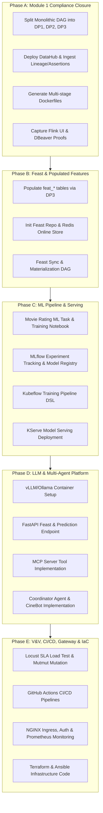

# 03 — Implementation Roadmap: Cinestream Coursework Completion

> **Strategy:** Dependency-aware, phased execution prioritizing mandatory rubric items, resolving critical gaps, and avoiding unnecessary premature complexity.

## 1. Roadmap Overview & Phasing Logic

---

## 2. Phase-by-Phase Execution Plan

### Phase A: Module 1 Rubric Closure & Proof Remediation
- **Objective:** Attain 100% verified status on Module 1 (DE) by resolving DAG consolidation, deploying DataHub, adding multi-stage Docker builds, and capturing missing UI proofs.
- **Rubric Rows Covered:** M1-R4, M1-R16, M1-R17, M1-R18, M1-R22–R33, M1-R37 (Total: 34 Rubric Points).
- **Existing Components Reused:** `cinestream_daily_batch_lakehouse.py`, `governance/extract.py`, `streaming/flink/jobs/heartbeat_window_job.py`.
- **New Components Required:**
  - Separate DAGs: `cinestream_dp1_ingest.py`, `cinestream_dp2_transform.py`, `cinestream_dp3_features.py`.
  - Docker Compose service for DataHub GMS & Frontend (`infra/compose/docker-compose.datahub.yml`).
  - Multi-stage refactoring of `infra/docker/Dockerfile.*`.
  - Unoptimized baseline Flink job script.
- **Mandatory Execution Proof:**
  - Airflow UI screenshot displaying all 3 distinct DAGs running successfully.
  - DataHub Web UI screenshot (`http://localhost:9002`) showing pipeline-to-table lineage graphs and data assertions.
  - Flink Web UI screenshot showing late data side-outputting to DLQ.
  - DBeaver ERD diagram export showing relational constraints.
  - `docker images` size comparison table demonstrating multi-stage optimization.
- **Acceptance Criteria:** Module 1 verified score reaches >= 95/100.
- **Dependencies:** None.
- **Estimated Complexity:** **M (Medium)** — ~3 days.

---

### Phase B: Feature Store Foundation (Feast & Redis)
- **Objective:** Populate offline feature tables in Lakehouse Gold and establish Feast offline + online store.
- **Rubric Rows Covered:** M2-R11, M2-R12, M2-R16, M2-R17, M2-R22 (Total: 16 Rubric Points).
- **Existing Components Reused:** `storage/lakehouse/gold/gold_tables.sql` (`feat_user_movie_stats_daily`), ClickHouse sync.
- **New Components Required:**
  - Feature population logic in Spark batch DP3.
  - Feast repository directory `feature_store/` with `feature_store.yaml`.
  - Entities: `user_id`, `movie_id`. Feature Views: `user_movie_stats`, `movie_engagement_stats`.
  - Redis container in `docker-compose.yml`.
  - Incremental materialization Airflow DAG task.
- **Mandatory Execution Proof:**
  - Parquet data populated in `gold/feat_*`.
  - `feast apply` and `feast materialize` execution logs.
  - Redis CLI verification showing online feature keys.
- **Acceptance Criteria:** Online feature retrieval latency < 15ms via Feast SDK.
- **Dependencies:** Phase A (DP3 DAG separated).
- **Estimated Complexity:** **M (Medium)** — ~2 days.

---

### Phase C: Machine Learning Training & Serving Pipeline
- **Objective:** Implement end-to-end ML lifecycle: feature retrieval -> model training -> MLflow versioning -> KServe deployment.
- **Rubric Rows Covered:** M2-R13, M2-R14, M2-R15 (Total: 6 Rubric Points).
- **Existing Components Reused:** Feast Feature Views, Docker runtime.
- **New Components Required:**
  - Model training script/notebook (LightGBM Movie Rating Predictor).
  - MLflow server in docker-compose; tracking hooks logging metrics, hyperparameters, and model artifacts.
  - Kubeflow Pipeline DSL script (`kfp`) executing: (1) Feast extract, (2) Train/Test split, (3) Model train, (4) Evaluate & log to MLflow.
  - KServe Custom Predictor manifest / Docker container serving model.
- **Mandatory Execution Proof:**
  - Kubeflow pipeline execution graph screenshot.
  - MLflow Registry UI screenshot showing registered model with `production` tag.
  - `curl` request to KServe endpoint returning prediction response.
- **Acceptance Criteria:** Model accuracy/RMSE logged in MLflow; KServe serving live predictions.
- **Dependencies:** Phase B (Feast features populated).
- **Estimated Complexity:** **L (Large)** — ~4 days.

---

### Phase D: LLM Platform & Multi-Agent Architecture
- **Objective:** Deploy LLM inference engine, configure Agent Gateway, and implement CineBot with MCP tools.
- **Rubric Rows Covered:** M2-R3–R8, M2-R18–R27 (Total: 34 Rubric Points).
- **Existing Components Reused:** Serving FastAPI app, Feast Online Store, KServe endpoint.
- **New Components Required:**
  - LLM Inference Server (vLLM or lightweight Ollama serving a 3B/7B model e.g., Qwen2.5/Llama3).
  - Global model configuration YAML (`model_config.yaml`).
  - Agent Gateway (Envoy / LiteLLM proxy / AgentGateway) with rate limiting.
  - MCP Tool Server exposing `get_user_watch_features` (from Feast) and `predict_movie_preference` (from KServe).
  - Coordinator Agent managing conversational interactions and delegating to tools.
  - Agent Registry service & Web UI.
- **Mandatory Execution Proof:**
  - LLM throughput/TTFT benchmark report.
  - Trace log showing Coordinator Agent invoking MCP tool -> retrieving Feast feature -> returning final recommendation.
  - Agent Registry UI screenshot.
- **Acceptance Criteria:** Agent successfully answers: *"Gợi ý cho tôi phim hành động phù hợp dựa trên lịch sử xem gần đây"*.
- **Dependencies:** Phase B (Feast) and Phase C (KServe).
- **Estimated Complexity:** **XL (Extra Large)** — ~5 days.

---

### Phase E: Verification, CI/CD, Routing, Observability & IaC
- **Objective:** Satisfy all remaining DevOps, SRE, and advanced quality criteria.
- **Rubric Rows Covered:** M2-R28–R57 (Total: 40 Rubric Points).
- **Existing Components Reused:** Entire application stack.
- **New Components Required:**
  - Test suite expansion: `pytest-cov` (>90% report), Mutmut mutation testing (>80%), Hypothesis property-based tests.
  - Locust load testing script (`locustfile.py`) and generated HTML SLA report.
  - GitHub Actions CI/CD workflows (`.github/workflows/ci.yml`).
  - NGINX Ingress Controller with basic auth & self-signed HTTPS certificate.
  - Prometheus + Grafana dashboards monitoring compute, API metrics, and LLM token usage.
  - Terraform scripts (`infra/terraform/`) and Ansible playbooks (`infra/ansible/`).
  - HashiCorp Vault secrets management configuration.
- **Mandatory Execution Proof:**
  - HTML coverage report (>90%) and mutmut score (>80%).
  - Locust load test HTML report showing latency SLA.
  - GitHub Actions green build and deploy pipeline screenshot.
  - Grafana dashboard screenshot displaying system + LLM token metrics.
- **Acceptance Criteria:** Full automated test & deployment pipeline functional.
- **Dependencies:** Phases A–D.
- **Estimated Complexity:** **L (Large)** — ~4 days.