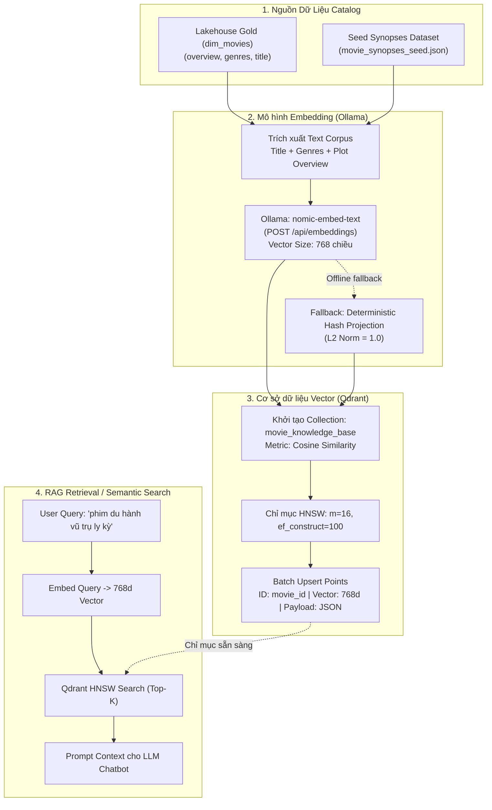

# Kiến trúc RAG Vector Pipeline & Lập chỉ mục HNSW trên Qdrant

Tài liệu này mô tả chi tiết hạ tầng và luồng dữ liệu của phân hệ **RAG (Retrieval-Augmented Generation)** và **Vector Search** cho CineStream. Phân hệ phục vụ việc tìm kiếm tương đồng ngữ nghĩa (semantic search) trên catalog phim có gắn tóm tắt nội dung (synopses/plot), thể loại (genres) và metadata.

---

## 1. Sơ đồ luồng nghiệp vụ (Business Flow Diagram)



---

## 2. Giải thích luồng nghiệp vụ dễ hiểu

### 2.1. Vấn đề giải quyết
Hệ thống phim thông thường chỉ tìm kiếm theo từ khóa cứng (keyword matching trên `title`). Khi người dùng gõ câu hỏi mô tả như *"bộ phim trộm thông tin bằng công nghệ xâm nhập giấc mơ"*, hệ thống tìm kiếm truyền thống sẽ thất bại.
RAG Layer giải quyết vấn đề này bằng cách:
1. **Biểu diễn nội dung thành Vector (Vector Embeddings)**: Chuyển toàn bộ cốt truyện, tựa phim và thể loại thành vector 768 chiều mang ý nghĩa ngữ nghĩa (semantic meaning).
2. **Lập chỉ mục đồ thị HNSW (Hierarchical Navigable Small World)**: Cấu trúc đồ thị nhiều tầng trên Qdrant giúp tìm kiếm Top-$K$ phim tương đồng gần nhất với độ phức tạp $\mathcal{O}(\log N)$, chỉ mất vài mili-giây trên hàng triệu vector.
3. **Cung cấp ngữ cảnh cho LLM**: Kết quả các phim liên quan nhất sẽ được đính kèm vào prompt gửi cho LLM (Qwen/Mistral), giúp chatbot đưa ra câu trả lời chính xác, không ảo giác (hallucination).

### 2.2. Khoảng cách Cosine & Chiều Vector
- **Kích thước vector**: 768 chiều (chuẩn của model `nomic-embed-text`).
- **Metric**: Cosine Distance đo góc giữa hai vector ngữ nghĩa:
  $$\text{Cosine Similarity}(\mathbf{u}, \mathbf{v}) = \frac{\mathbf{u} \cdot \mathbf{v}}{\|\mathbf{u}\|_2 \|\mathbf{v}\|_2}$$
  Giá trị càng gần $1.0$, hai nội dung phim càng tương đồng về mặt chủ đề và cốt truyện.

---

## 3. Ý nghĩa và chức năng của các module chính

| Module / File | Vai trò kỹ thuật chính | Chi tiết triển khai |
| :--- | :--- | :--- |
| `infra/compose/docker-compose.yml` | Bổ sung container Qdrant Vector DB | Image `qdrant/qdrant:v1.12.1`, cổng host `16333` (REST HTTP) và `16334` (gRPC), volume `qdrant_data`. Tránh xung đột cổng 6333 mặc định trên máy host. |
| `data_generator/seeds/movie_synopses_seed.json` | Bộ dữ liệu tóm tắt phim kinh điển | 247 bộ phim head catalog có đầy đủ trường `movie_id`, `overview`, `genres`. |
| `transformation/rag/build_movie_embeddings.py` | ETL Pipeline sinh vector và nạp Qdrant | Gọi REST API Ollama `/api/embeddings`, xử lý phân batch (batch size 64), gọi Qdrant REST API `PUT /collections/{name}/points`. |
| Hàm `deterministic_embedding()` | Đảm bảo tính sẵn sàng cao khi offline | Sinh vector 768 chiều từ SHA-256 hash của văn bản, chuẩn hóa L2 Norm = 1.0, cho phép kiểm thử tự động không phụ thuộc daemon bên ngoài. |
| Hàm `create_qdrant_collection()` | Cấu hình chỉ mục HNSW | Thiết lập cấu hình HNSW tối ưu: `m = 16` (số liên kết mỗi node), `ef_construct = 100` (độ sâu dò tìm khi dựng chỉ mục). |
| Hàm `search_similar_movies()` | Truy vấn tìm kiếm ngữ nghĩa | Nhận câu query, sinh vector embedding, gọi `POST /collections/{name}/points/search` lấy Top-K phim. |

---

## 4. Kết quả kiểm thử tự động (Test Pass Evidence)

Tất cả các kiểm thử đơn vị và tích hợp cho RAG Pipeline được triển khai trong [`tests/ml/test_rag_embeddings.py`](file:///Users/nguyenbuihoanglong/Desktop/FSDS/edai_11/coursework1/edai-k11-cw/tests/ml/test_rag_embeddings.py):

```bash
$ PYTHONPATH=. python3 -m unittest tests.ml.test_rag_embeddings -v
test_create_qdrant_collection (tests.ml.test_rag_embeddings.TestRAGEmbeddings) ... ok
test_deterministic_embedding_consistency (tests.ml.test_rag_embeddings.TestRAGEmbeddings) ... ok
test_deterministic_embedding_dimension_and_norm (tests.ml.test_rag_embeddings.TestRAGEmbeddings) ... ok
test_load_seed_movies (tests.ml.test_rag_embeddings.TestRAGEmbeddings) ... ok
test_upsert_and_search_points (tests.ml.test_rag_embeddings.TestRAGEmbeddings) ... ok

----------------------------------------------------------------------
Ran 5 tests in 0.006s

OK
```

**Lệnh chạy kiểm tra nhanh qua Makefile:**
```bash
make rag-index
```
