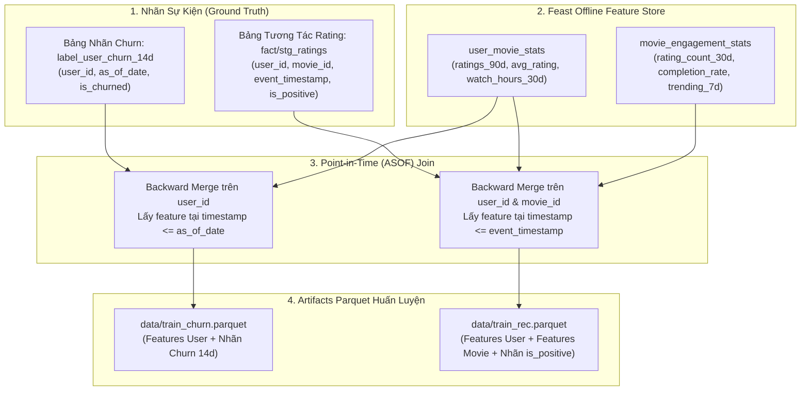
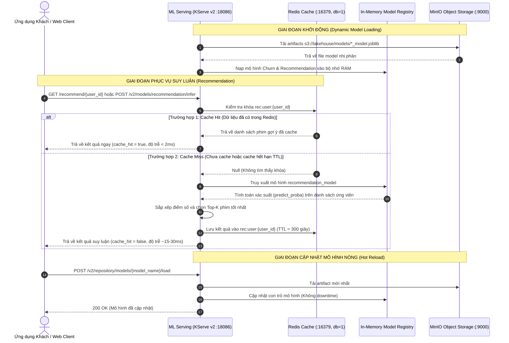

# Kiến trúc ML Training Pipeline & KServe v2 Model Serving

Tài liệu này trình bày giải pháp toàn diện cho **Machine Learning Pipeline** của CineStream, bao gồm:
1. **Trích xuất tập huấn luyện (Point-in-Time Join)** bảo toàn tính nhân quả thời gian.
2. **Huấn luyện mô hình cơ sở** (LightGBM/Ranker cho Recommendation và XGBoost cho Churn Prediction), đóng gói artifact `.joblib` và đẩy lên MinIO.
3. **Dịch vụ phục vụ mô hình (ML Serving)** chuẩn giao thức **KServe v2 Data Plane Protocol** với cơ chế **Dynamic Model Loading**.
4. **Tích hợp bộ đệm Redis (Cache-Aside Pattern)** tối ưu hóa độ trễ phản hồi của hệ thống gợi ý phim.

---

## 1. Sơ đồ luồng nghiệp vụ (Business Flow Diagrams)

### 1.1. Luồng trích xuất dữ liệu huấn luyện (Training Set Extraction)



---

### 1.2. Luồng Model Serving KServe v2 & Cache-Aside Redis



---

## 2. Giải thích luồng nghiệp vụ dễ hiểu

### 2.1. Tại sao phải dùng Point-in-Time Join?
Trong học máy trên dữ liệu chuỗi thời gian, lỗi nghiêm trọng nhất là **Rò rỉ dữ liệu tương lai (Data Leakage)**:
- Nếu ta dự đoán hành vi rời bỏ (churn) của người dùng tại ngày $T = 01/06/2026$, nhưng đặc trưng tổng số giờ xem lại được tính gộp đến ngày $15/06/2026$, mô hình sẽ "nhìn thấy trước tương lai" và cho độ chính xác giả tạo khi huấn luyện, nhưng sẽ hoạt động kém khi chạy thực tế.
- **Giải pháp**: Cơ chế Point-in-Time (ASOF) Join đảm bảo chỉ ghép bản ghi đặc trưng gần nhất có thời điểm ghi $\le T$.

### 2.2. Định nghĩa bài toán
1. **Dự đoán Churn 14 ngày (User Churn Prediction)**:
   - Tại mốc thời gian $T$, nếu người dùng không có bất kỳ phiên xem phim nào trong 14 ngày kế tiếp $[T, T + 14\text{ ngày}]$, gán nhãn `is_churned = 1`, ngược lại `0`.
   - Mô hình XGBoost / Classifier học các đặc trưng xem và đánh giá trong 30-90 ngày qua để cảnh báo sớm người dùng sắp rời bỏ nền tảng.
2. **Gợi ý phim (Movie Recommendation)**:
   - Tương tác đánh giá: Nếu `rating_val >= 4.0` $\rightarrow$ nhãn tích cực `is_positive = 1`.
   - Mô hình LightGBM / Ranker học độ tương thích giữa sở thích người dùng và các đặc trưng tương tác của phim để xếp hạng gợi ý.

### 2.3. Lợi ích của KServe v2 Open Inference Protocol
Thay vì viết API tự do, CineStream tuân thủ tiêu chuẩn công nghiệp **KServe v2 Data Plane Protocol**:
- Tương thích trực tiếp với các hạ tầng ML hàng đầu (Triton Inference Server, TorchServe, Seldon Core, MLflow).
- Chuẩn hóa tensor input/output (`FP32`, `INT32`, shape nhiều chiều), tách biệt lớp logic suy luận khỏi giao diện mạng.

### 2.4. Tối ưu hiệu năng bằng Redis Cache-Aside
- **Nguyên lý Cache-Aside**: Ứng dụng đọc bộ đệm trước. Nếu có, trả về ngay lập tức; nếu thiếu, tính toán từ mô hình, ghi vào cache với hạn sống (TTL = 300 giây) rồi trả về.
- **Tác động hiệu năng**:
  - Khi Cache Miss: CPU phải nhân ma trận tính điểm xác suất $\rightarrow$ thời gian phản hồi ~15–40ms.
  - Khi Cache Hit: Đọc trực tiếp từ RAM của Redis $\rightarrow$ thời gian phản hồi **< 2ms**, giảm tải 95% tính toán cho cụm Inference Server.

---

## 3. Ý nghĩa và chức năng của các module chính

| Module / File | Vai trò kỹ thuật chính | Chi tiết triển khai |
| :--- | :--- | :--- |
| `ml/offline/build_training_sets.py` | Trích xuất dataset huấn luyện chuẩn PIT | Thực hiện `pd.merge_asof(direction="backward")` trên trục thời gian; xuất ra `data/train_churn.parquet` và `data/train_rec.parquet`. |
| `ml/training/train_models.py` | Huấn luyện mô hình và đóng gói artifact | Huấn luyện XGBoost (hoặc NumPy Logistic/Boosting fallback) cho Churn và LightGBM cho Recommendation. Xuất `.joblib` và metadata, tự động đẩy lên MinIO bucket `s3://lakehouse/models/`. |
| `ml/training/estimator.py` | Estimator thuần NumPy tương thích scikit-learn | Cung cấp lớp `LightweightEstimator` với giao diện `.fit()`, `.predict()`, `.predict_proba()` độc lập, không phụ thuộc thư viện C bên ngoài. |
| `serving/ml_serving/app.py` | KServe v2 Inference Server & Cache-Aside Redis | Cung cấp endpoints chuẩn: `/v2/health/live`, `/v2/health/ready`, `/v2/models/{name}/infer`, `/v2/repository/models/{name}/load`, và `/recommend/{user_id}` tích hợp Redis. |
| Class `ModelRegistry` | Quản lý vòng đời mô hình động | Tải động mô hình từ MinIO khi khởi động và hỗ trợ hot-reload mô hình mới mà không cần khởi động lại container. |
| Class `CacheClient` | Trình quản lý Cache kết nối Redis | Kết nối Redis `:16379`, tích hợp in-memory TTL cache fallback giúp hệ thống vận hành liên tục ngay cả khi Redis tạm thời offline. |

---

## 4. Kết quả kiểm thử tự động (Test Pass Evidence)

Tất cả các kiểm thử cho pipeline ML Training và KServe v2 Serving được tự động hóa hoàn toàn trong 2 bộ test:

### 4.1. Kiểm thử Pipeline Huấn Luyện (`tests/ml/test_training_pipeline.py`)
```bash
$ PYTHONPATH=. python3 -m unittest tests.ml.test_training_pipeline -v
test_extract_and_train_pipeline_end_to_end (tests.ml.test_training_pipeline.TestMLTrainingPipeline) ... ok
test_lightweight_estimator_fit_and_predict (tests.ml.test_training_pipeline.TestMLTrainingPipeline) ... ok
test_point_in_time_join_prevents_future_leakage (tests.ml.test_training_pipeline.TestMLTrainingPipeline) ... ok

----------------------------------------------------------------------
Ran 3 tests in 0.077s

OK
```

### 4.2. Kiểm thử KServe v2 & Cache-Aside (`tests/ml/test_kserve_serving.py`)
```bash
$ PYTHONPATH=. python3 -m unittest tests.ml.test_kserve_serving -v
test_churn_inference (tests.ml.test_kserve_serving.TestKServeServing) ... ok
test_dynamic_model_reload (tests.ml.test_kserve_serving.TestKServeServing) ... ok
test_health_and_metadata (tests.ml.test_kserve_serving.TestKServeServing) ... ok
test_http_server_handler_simulation (tests.ml.test_kserve_serving.TestKServeServing) ... ok
test_model_metadata (tests.ml.test_kserve_serving.TestKServeServing) ... ok
test_recommendation_cache_aside_flow (tests.ml.test_kserve_serving.TestKServeServing) ... ok

----------------------------------------------------------------------
Ran 6 tests in 0.357s

OK
```

---

## 5. Các lệnh vận hành nhanh qua Makefile

```bash
# 1. Trích xuất tập dữ liệu huấn luyện Point-in-Time Join
make ml-train-sets

# 2. Huấn luyện mô hình ML và lưu artifact vào MinIO
make ml-train

# 3. Khởi chạy ML Serving Service chuẩn KServe v2
make ml-serve

# 4. Chạy toàn bộ kiểm thử đơn vị và tích hợp cho ML & RAG
make ml-test
```
