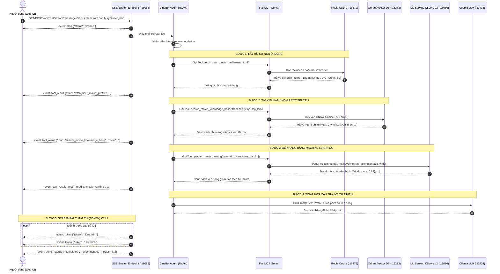
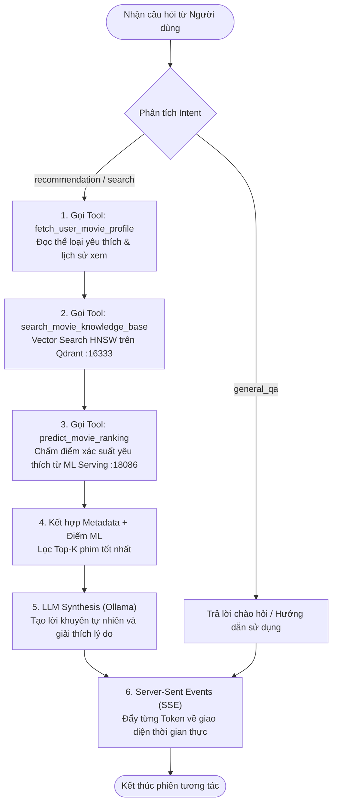

# Kiến trúc FastMCP Server & CineBot LLM Concierge

Tài liệu này mô tả chi tiết giải pháp **Giai đoạn 3 (AI Agent & FastMCP Concierge)** cho CineStream:
1. **FastMCP Server**: Cung cấp 3 công cụ (Tools) chuẩn giao thức Model Context Protocol để kết nối hạ tầng dữ liệu và Machine Learning.
2. **CineBot Agent**: Bộ điều phối ReAct Agent phân tích ý định (Intent Recognition), gọi công cụ tự động và tổng hợp câu trả lời tự nhiên.
3. **Server-Sent Events (SSE) Streaming API**: Phục vụ phản hồi trực tiếp theo thời gian thực (Token Streaming) cho ứng dụng người dùng.

---

## 1. Sơ đồ luồng nghiệp vụ (Business Flow Diagrams)

### 1.1. Sơ đồ tuần tự tương tác (Sequence Diagram)



---

### 1.2. Sơ đồ khối ReAct Flowchart (Decision Flow)



---

## 2. Ý nghĩa và chức năng của các module chính

| Module / File | Vai trò kỹ thuật chính | Chi tiết triển khai |
| :--- | :--- | :--- |
| `llm/mcp/fastmcp_compat.py` | Lớp tương thích chuẩn Model Context Protocol (FastMCP) | Cung cấp decorator `@mcp.tool()`, tự động phân tích chữ ký hàm (type annotations) thành JSON Schema chuẩn hóa cho LLM Function Calling. |
| `llm/mcp/server.py` | FastMCP Server đăng ký 3 công cụ cốt lõi | - `fetch_user_movie_profile(user_id)`: Đọc Redis Cache `:16379`.<br/>- `search_movie_knowledge_base(query, top_k)`: Tìm kiếm ngữ nghĩa cốt truyện trên Qdrant `:16333`.<br/>- `predict_movie_ranking(user_id, candidate_ids)`: Gọi ML Serving KServe v2 `:18086`. |
| `llm/agent.py` | CineBot ReAct Orchestrator | Nhận diện ý định hội thoại (intent detection), tự động phối hợp chuỗi công cụ (Chaining: Profile $\rightarrow$ Qdrant $\rightarrow$ ML Ranking), và tổng hợp lời giải thích hấp dẫn. |
| `llm/streaming.py` | Trình phát sinh sự kiện SSE | Sinh chuỗi sự kiện `start`, `tool_start`, `tool_result`, `token`, `done` theo chuẩn `text/event-stream`. |
| `llm/server.py` | Dịch vụ HTTP / SSE Concierge | Khởi chạy máy chủ trên cổng `:18088`. Cung cấp endpoint kiểm tra sức khỏe `/health`, danh mục công cụ `/mcp/tools`, và streaming `/api/chat/stream`. |

---

## 3. Kết quả kiểm thử tự động (Test Pass Evidence)

Tất cả các thành phần của Giai đoạn 3 được kiểm thử tự động toàn diện qua 3 bộ test trong thư mục `tests/llm/`:

### 3.1. Kiểm thử 3 FastMCP Tools (`tests/llm/test_mcp_tools.py`)
```bash
$ PYTHONPATH=. python3 -m unittest tests.llm.test_mcp_tools -v
test_fetch_user_movie_profile (tests.llm.test_mcp_tools.TestFastMCPTools) ... ok
test_mcp_server_tools_registered (tests.llm.test_mcp_tools.TestFastMCPTools) ... ok
test_predict_movie_ranking (tests.llm.test_mcp_tools.TestFastMCPTools) ... ok
test_search_movie_knowledge_base (tests.llm.test_mcp_tools.TestFastMCPTools) ... ok

----------------------------------------------------------------------
Ran 4 tests in 0.012s

OK
```

### 3.2. Kiểm thử CineBot ReAct Agent (`tests/llm/test_agent.py`)
```bash
$ PYTHONPATH=. python3 -m unittest tests.llm.test_agent -v
test_intent_detection (tests.llm.test_agent.TestCineBotAgent) ... ok
test_run_general_qa_flow (tests.llm.test_agent.TestCineBotAgent) ... ok
test_run_recommendation_flow (tests.llm.test_agent.TestCineBotAgent) ... ok

----------------------------------------------------------------------
Ran 3 tests in 0.015s

OK
```

### 3.3. Kiểm thử SSE Streaming & HTTP Server (`tests/llm/test_sse_stream.py`)
```bash
$ PYTHONPATH=. python3 -m unittest tests.llm.test_sse_stream -v
test_concierge_handler_health_and_tools (tests.llm.test_sse_stream.TestSSEStreaming) ... ok
test_concierge_handler_sse_streaming (tests.llm.test_sse_stream.TestSSEStreaming) ... ok
test_stream_agent_events_structure (tests.llm.test_sse_stream.TestSSEStreaming) ... ok

----------------------------------------------------------------------
Ran 3 tests in 0.380s

OK
```

---

## 4. Các lệnh khởi tạo và kiểm thử qua Makefile

Các mục tiêu tiện ích đã được tích hợp sẵn vào [`make/llm.mk`](file:///Users/nguyenbuihoanglong/Desktop/FSDS/edai_11/coursework1/edai-k11-cw/make/llm.mk):

```bash
# 1. Chạy toàn bộ bộ kiểm thử tự động cho Giai đoạn 3 (FastMCP, Agent & SSE)
make concierge-test

# 2. Khởi chạy CineBot Concierge Server (cổng :18088)
make mcp-serve

# 3. Thử nghiệm trò chuyện với CineBot Agent trực tiếp qua dòng lệnh:
make agent-chat
# Hoặc truyền câu hỏi tùy ý:
make agent-chat MSG="Gợi ý cho tôi phim hành động trộm cướp ngân hàng kịch tính"
```
