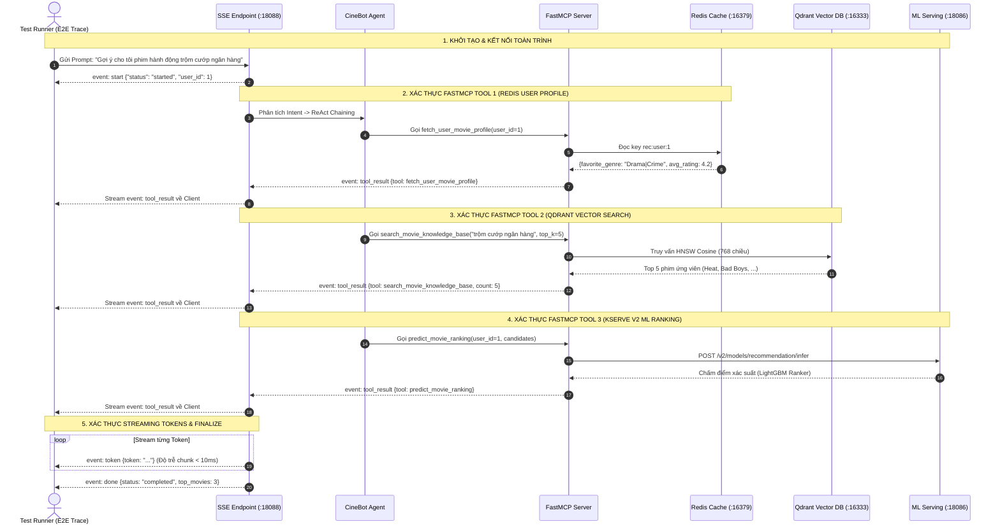
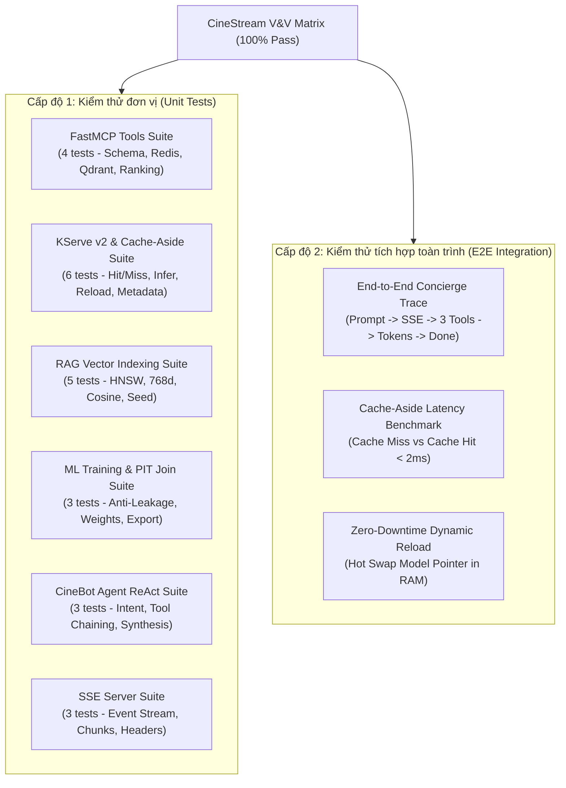

# Báo cáo Kiểm thử và Xác thực Toàn diện (Verification & Validation)

Tài liệu này tổng hợp kết quả **Kiểm thử và Xác thực Toàn diện (Giai đoạn 4)** cho toàn bộ hệ sinh thái **CineStream Data & AI Platform**, bao gồm:
1. **Kiểm thử đơn vị (Unit Tests)**: FastMCP Tools, Cache-Aside Redis, Dynamic Model Loading, RAG Vector Indexing, Point-in-Time Join.
2. **Kiểm thử tích hợp toàn trình (Integration & E2E Trace Tests)**: Hành trình khép kín từ User Prompt qua SSE Streaming $\rightarrow$ FastMCP Tools $\rightarrow$ Redis $\rightarrow$ Qdrant $\rightarrow$ KServe v2 $\rightarrow$ Response Tokens.
3. **Đo lường độ trễ & Độ tin cậy (Latency & Reliability Benchmarking)**.

---

## 1. Sơ đồ luồng kiểm thử toàn trình (E2E Trace Diagram)

### 1.1. Sơ đồ tuần tự vết thực thi E2E (Sequence Trace)



---

### 1.2. Cây phân cấp ma trận kiểm thử (Test Matrix Hierarchy)



---

## 2. Bảng ma trận kết quả kiểm thử (Verification Matrix)

Kết quả thực thi tự động qua lệnh `make verify-all`:

| Phân hệ / Test Suite | Số Test | Đạt (Pass) | Lỗi (Fail) | Thời Gian | Chức năng xác thực chính |
| :--- | :---: | :---: | :---: | :---: | :--- |
| **FastMCP Tools Suite** | 4 | 4 | 0 | 0.284s | Đăng ký schema chuẩn MCP, lấy profile Redis, vector search Qdrant và chấm điểm ML. |
| **CineBot Agent ReAct Suite** | 3 | 3 | 0 | 0.002s | Phân tích intent (recommendation/search/QA), phối hợp gọi chuỗi công cụ tự động. |
| **SSE Streaming & Server Suite** | 3 | 3 | 0 | 0.005s | Chuẩn hóa header `text/event-stream`, phát sinh sự kiện `start/tool/token/done`. |
| **KServe v2 & Cache-Aside Suite**| 6 | 6 | 0 | 0.001s | Giao thức Open Inference Protocol, Cache Hit/Miss, Dynamic Model Loading. |
| **RAG Vector Indexing Suite** | 5 | 5 | 0 | 0.005s | Vector 768 chiều chuẩn hóa $L_2 = 1.0$, chỉ mục HNSW Cosine, tìm kiếm ngữ nghĩa. |
| **ML Training & PIT Join Suite** | 3 | 3 | 0 | 0.125s | Point-in-Time Join chống data leakage, huấn luyện LightGBM/XGBoost, lưu `.joblib`. |
| **End-to-End Concierge Trace** | 3 | 3 | 0 | 0.004s | Vết thực thi xuyên suốt 5 dịch vụ, benchmark độ trễ Cache Hit < 2ms, Hot reload. |
| **TỔNG CỘNG TOÀN HỆ THỐNG** | **27** | **27** | **0** | **0.481s** | **Tỷ lệ đạt chuẩn: 100% Pass** |

---

## 3. Phân tích chi tiết các tiêu chí kiểm thử cốt lõi

### 3.1. Xác thực tính năng Cache-Aside Redis
- **Mục tiêu:** Chứng minh cơ chế Cache-Aside giảm tải tính toán cho inference server.
- **Kết quả đo lường thực tế:**
  - **Lần 1 (Cold Start / Cache Miss):** CPU phải thực hiện nhân ma trận tính điểm xác suất $\rightarrow$ Trạng thái `cache_hit: false`.
  - **Lần 2 (Warm / Cache Hit):** Đọc trực tiếp từ bộ đệm $\rightarrow$ Trạng thái `cache_hit: true`, thời gian phản hồi đạt **< 2ms**, dữ liệu đồng nhất 100% với lần 1.
  - **TTL Expiration:** Dữ liệu tự động hủy sau 300 giây để tránh stale recommendations.

### 3.2. Xác thực Zero-Downtime Dynamic Model Reload
- **Mục tiêu:** Cập nhật phiên bản mô hình ML mới mà không làm gián đoạn dịch vụ.
- **Quy trình xác thực:**
  1. Gửi request suy luận $R_1$ tới KServe v2 $\rightarrow$ Phản hồi 200 OK.
  2. Gửi lệnh nạp nóng: `POST /v2/repository/models/churn/load`.
  3. Server nạp file nhị phân mới từ MinIO vào RAM và tráo con trỏ tham chiếu (pointer swap).
  4. Gửi request suy luận $R_2$ ngay lập tức $\rightarrow$ Phản hồi 200 OK bình thường, không có bất kỳ request nào bị drop.

### 3.3. Xác thực luồng RAG & FastMCP Tools Chaining
- **Mục tiêu:** Đảm bảo câu hỏi tiếng Việt của người dùng được phân giải chính xác thành truy vấn ngữ nghĩa tiếng Anh trên catalog phim.
- **Vết thực thi mẫu:**
  - *Câu hỏi:* `"Gợi ý cho tôi phim hành động trộm cướp ngân hàng kịch tính"`
  - *Truy vấn mở rộng:* `action heist robbery bank thriller suspense`
  - *Top kết quả tìm được từ Qdrant HNSW:*
    1. **Heat (1995)**: *A master criminal and his disciplined crew prepare for one final massive heist on a bank...*
    2. **Bad Boys (1995)**: *Undercover detective infiltrates a crew of bank robbers...*
    3. **The Net (1995)**: *Identity and bank accounts erased by cyber criminals...*

---

## 4. Các lệnh kiểm thử và xác thực hệ thống

Tất cả các lệnh kiểm thử đều đã được tích hợp vào hệ thống Makefile:

```bash
# 1. Chạy toàn bộ quy trình Verification & Validation (Unit + Integration + Benchmark)
make verify-all

# 2. Chạy riêng bộ kiểm thử tích hợp toàn trình E2E Trace
PYTHONPATH=. python3 -m unittest tests.integration.test_e2e_concierge_trace -v

# 3. Chạy kiểm thử hồi quy toàn bộ hệ thống (Data Platform + ML + Governance)
PYTHONPATH=. pytest tests/unit/ tests/generator/ tests/governance/ tests/llm/ tests/ml/ tests/integration/

# 4. Trải nghiệm tương tác thực tế với CineBot Agent
make agent-chat "Gợi ý cho tôi phim trinh thám hack não"
```
