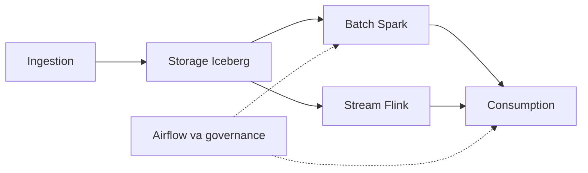
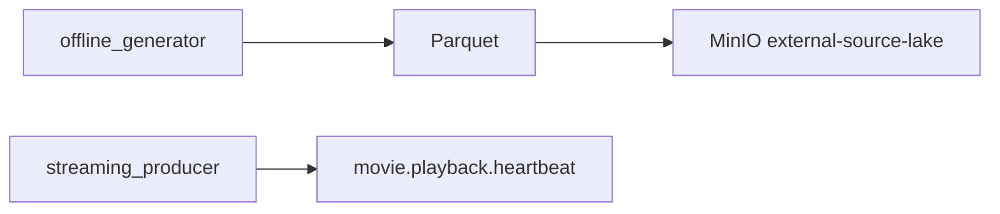
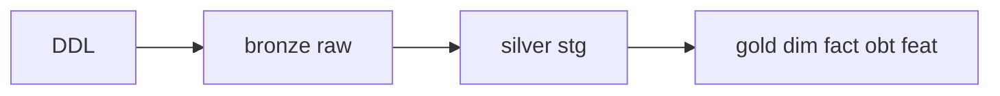
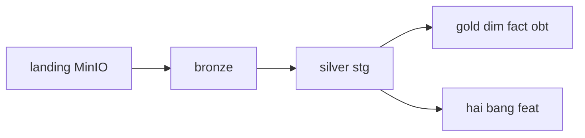
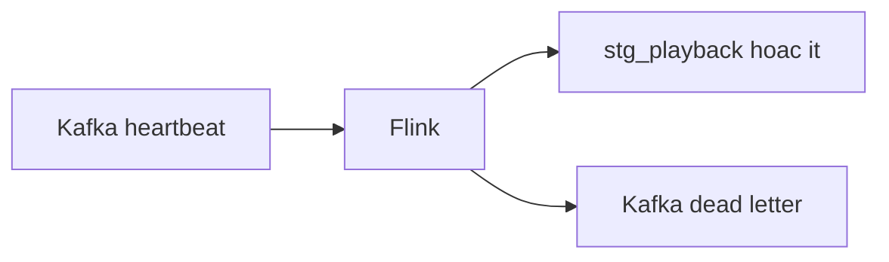
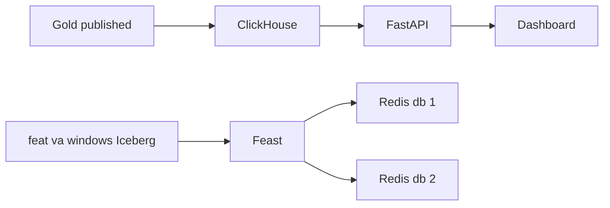
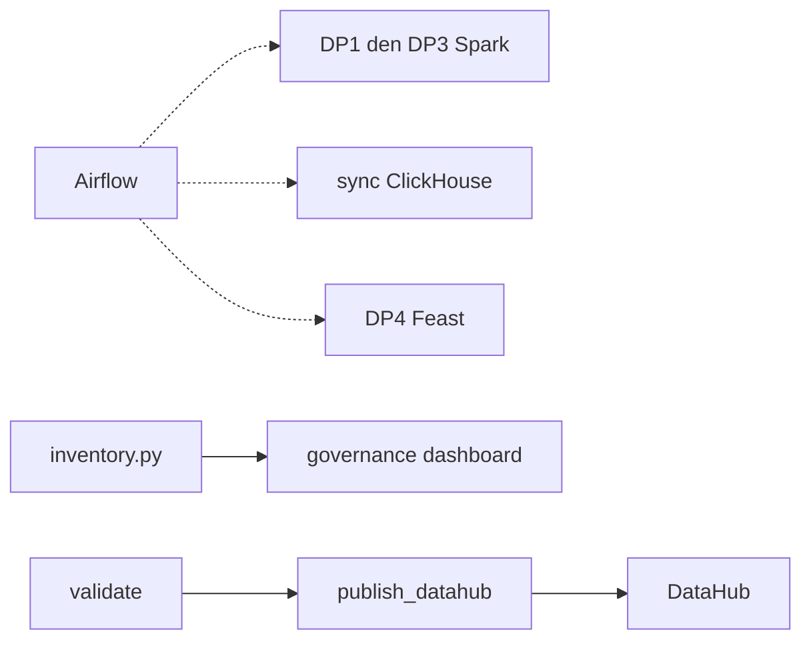

# 00 — Tour hệ thống

Đọc file này từ đầu đến cuối. Các file số là nhật ký của một lần chạy. Số trên tên file không phải thứ tự đọc: có hai file `05` và hai file `20`.

Đường dữ liệu có năm lớp, rồi control plane đọc cuối: ingestion, storage, batch, stream, consumption, orchestration. Chặng sau bắt đầu khi chặng trước đã có chỗ dữ liệu dừng. Lệnh dưới đây là lệnh đã ghi trong từng proof. Scale 100 đã đo 27,5 GB. Đọc số đo ở file 23. Chỉ chạy lại lệnh đó khi cần tái lập đúng thư mục.

Batch và stream là hai nhánh song song. Cả hai ghi Iceberg. Stream đọc Kafka và không chờ Gold. Đọc batch trước stream vì dễ theo.

Orchestration là control plane. Airflow kích DP1–DP4. Governance (`governance/inventory.py`, hợp đồng, DataHub) quan sát cùng các pipeline. DataHub chỉ là bản chiếu của cạnh `data_flow` thuộc DP1–DP3 và dict mà `validate_*` đã trả. Mũi tên điều khiển là nét đứt, không phải bước tiếp theo của ClickHouse hay Redis.

## Sơ đồ cả hệ thống



## Ingestion

`generator/` ghi Parquet và heartbeat. Dừng khi Parquet nằm ở `data_generator/output/` hoặc MinIO `s3://external-source-lake/`, và heartbeat nằm trên Kafka `movie.playback.heartbeat`.



```bash
python -m generator.offline_generator --scale-factor 0.1 --output-dir data_generator/output/scale_0_1
python -m generator.offline_generator --scale-factor 100 --allow-large-scale
make up
make minio-sync
python -m generator.streaming_producer --dry-run
python -m generator.streaming_producer --kafka-bootstrap localhost:19092 --topic movie.playback.heartbeat
```

Đọc: [01](01_data_generator_proof.md), [23](23_dataset_scale_100.md).

## Storage

DDL Iceberg, SCD2, compaction và quan hệ dim/fact. Warehouse `s3a://lakehouse/`. Bronze `raw_*`, silver `stg_*`, gold `dim_*` / `fact_*` / `obt_*` / `feat_*`. `dim_users` và fact khai báo trong `storage/lakehouse/gold/gold_tables.sql`.



```bash
make demo-layer2
python -m storage.lakehouse.export_erd
```

Đọc: [02](02_lakehouse_storage_proof.md), [19](19_dim_fact_relationship.md).

## Batch

Spark đưa landing vào bronze, silver, gold và hai bảng `feat_*`. Nhánh này ghi Iceberg. Stream là nhánh kia, đọc ở mục sau.

Test batch dùng catalog `file://`, namespace `it_*`. `make spark-build-gold` ghi warehouse `s3a://lakehouse/`.



```bash
make spark-batch-it
make spark-ingest-bronze SPARK_SRC=data_generator/output/scale_0_1 SPARK_RUN_ID=manual
make spark-publish SPARK_EFFECTIVE_TS=2026-03-01T00:00:00+00:00
make spark-baseline
make spark-optimized
make spark-aqe
make spark-build-gold
make spark-features-it
```

Đọc: [05 incremental](05_incremental_batch_proof.md), [03](03_spark_optimizations_proof.md), [13](13_offline_features.md).

## Stream

Flink đọc Kafka, ghi `stg_playback_heartbeats` và `stg_playback_windows`, hoặc bảng `it_*` trong bài UI. DLQ ra Kafka. Job trong file 04 dùng topic `movie.playback.heartbeat`. Bài UI trong file 21 dùng topic `it.module1.heartbeat` và bảng `it_baseline_*`, `it_opt_*`.

Cửa sổ sang Redis db 2 là bàn giao sang consumption: [17](17_feast_streaming.md).



```bash
make stream-test
make stream-verify
uv run python -m streaming.flink.jobs.heartbeat_baseline_job --engine local --scenario proof
uv run python -m streaming.flink.jobs.heartbeat_window_job --engine local --scenario proof
```

Đọc: [04](04_streaming_flink_proof.md), [21](21_flink_baseline_ui.md).

## Consumption

ClickHouse nhận Gold đã publish. FastAPI đọc ClickHouse. Dashboard chỉ gọi FastAPI. Feast đọc export feature: offline, Redis db 1 cho batch, Redis db 2 cho cửa sổ đã nằm trên Iceberg. Hai database Redis không dùng chung.

Lần dashboard dùng database `it_it_af_real` và `it_e2e`. Run DP ngày 2026-10-23 ghi namespace `it_af_dp` và database `it_af_dp_ch`. Bài offline ngày 2026-10-25 chưa ghi Redis. Materialize nằm ở file 16 và 17.



```bash
make serving-it
make serving-it-dashboard
make feast-offline-it
make feast-redis-up
make feast-online-it
make feast-airflow-it
make feast-streaming-it
```

Đọc: [06](06_consumption_serving_proof.md), [07](07_analytics_dashboard.md), [15](15_feast_offline.md), [16](16_feast_online.md), [17](17_feast_streaming.md).

## Orchestration

Đọc cuối. Airflow trước, governance sau trong cùng mục. Nét đứt ở sơ đồ trên là Airflow kích batch và consumption.

GMS trong proof DataHub nghe cổng `18083`. API serving trong file 07 cũng ghi cổng đó trên một lần chạy khác.



```bash
make airflow-up
make airflow-it
make airflow-dp-it
make governance-check
make governance-dashboard-it
make datahub-up
```

Lệnh emit nằm trong [20 DataHub](20_datahub_lineage.md). Lệnh payload IT nằm trong [18](18_datahub_lineage.md). Phần DAG của feature offline nằm trong [13](13_offline_features.md).

Đọc Airflow: [05 orchestration](05_orchestration_governance_proof.md), [14](14_airflow_dp_e2e.md).

Đọc governance: [08](08_data_governance_lineage.md), [09](09_governance_observability.md), [10](10_governance_findings_triage.md), [11](11_schema_contract_validation.md), [12](12_governance_dashboard.md), [18](18_datahub_lineage.md), [20 DataHub](20_datahub_lineage.md).

## Phụ lục đóng gói

Không phải một lớp dữ liệu. File 20 docker và file 22 là hai lần inspect image. Cột `docker images` của lần trước nằm ở file 20 docker. Giải thích `Size` và layer dùng chung nằm ở file 22.

Đọc: [20 docker](20_docker_multistage.md), [22](22_multistage_images.md).
