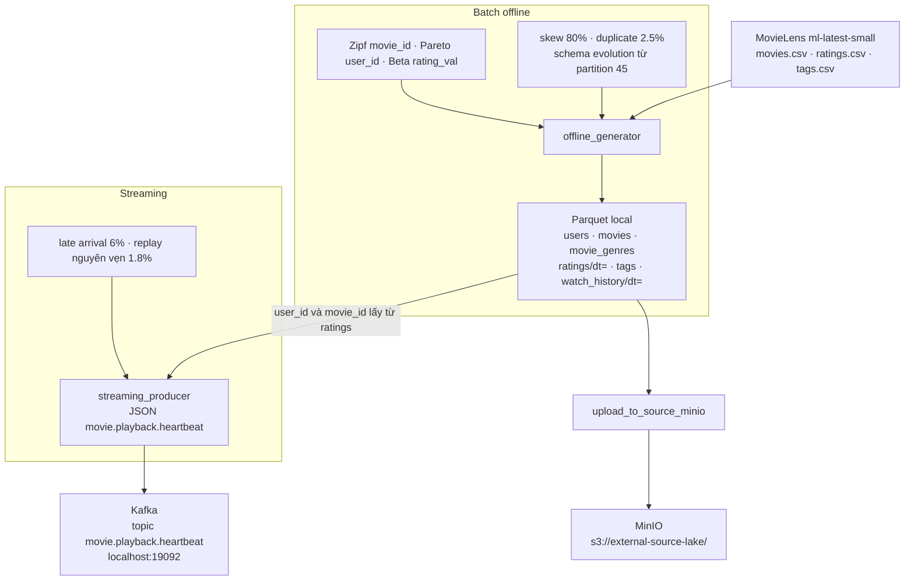

# 01 — Data Generator Proof (scale-factor 0.1)

Bằng chứng số liệu cho Layer `generator/`, đo trên artifact
`data_generator/output/scale_0_1/` sinh từ seed
`data_generator/data_offline/ml-latest-small/` với `--random-seed 42`.

`--scale-factor 100` là đúng volume đặc tả (~101 GB Parquet: 100000 phim,
5000000 user). Lần chạy này dùng `0.1`, tức **0.1%** volume đó, để kiểm
tra phân phối và tiêm lỗi trước khi phóng to.

## Kiến trúc hệ thống

Dừng ở Layer `generator/`. Parquet ghi ra đĩa, rồi mới được đẩy sang MinIO hoặc Kafka. Không có Bronze, Spark hay Flink trong giai đoạn này.



`movies/partition_00001`–`00044` giữ schema cũ. Từ `partition_00045` thêm `content_rating`, `hdr_format`, `audio_spatial`. `streaming_producer` đọc phân phối trong `ratings/` đã sinh; không có thư mục đó thì phát user `1..500` và movie `1..100` đều nhau. Topic `movie.user.clickstream` được tạo lúc khởi động Kafka, producer hiện tại không ghi topic đó.

Lệnh tái lập offline:

```bash
python -m generator.offline_generator --scale-factor 0.1 --output-dir data_generator/output/scale_0_1
```

Seed đã đọc: 9.742 phim, 100.836 rating, 3.683 tag, 610 user. Phim đông nhất
trong seed chỉ chiếm 0,33% rating; sau khi áp Zipf/skew, `movie_id=42` chiếm ~80%.

## 1. Khối lượng đã ghi

| Bảng | Dòng | File Parquet | Bytes |
|---|---:|---:|---:|
| `users` | 5000 | 1 | 81518 |
| `movies` | 100 | 100 | 288204 |
| `movie_genres` | 300 | 1 | 1786 |
| `ratings` | 256410 | 5 | 3936683 |
| `tags` | 30000 | 4 | 600460 |
| `watch_history` | 820513 | 5 | 22894421 |
| **Tổng** |  | **116** | **27803072** |

`ratings` và `watch_history` có 5 partition `dt=` thay vì 4 ngày gốc vì một nửa
bản duplicate bị đẩy sang ngày kế tiếp.

## 2. Skew, duplicate, rating, thể loại

Đo trên file Parquet sau khi tiêm lỗi. Nhóm bom tấn ở scale này chỉ có 1 phim
(1% của 100), nên `movie_id=42` (*Dead Presidents (1995)*, đúng id trong seed)
nhận trọn `--skew-ratio 0.8`. Sàn 4% của phim neo chỉ chia phần còn lại khi
nhóm đầu có từ 2 phim (danh mục đầy đủ `movie_id ∈ [1, 1000]`).

| Kiểm chứng | Đo được | Mục tiêu |
|---|---:|---:|
| Duplicate `ratings` | 2.4999% (6410 / 256410) | 2.50% |
| Duplicate `watch_history` | 2.5000% (20513 / 820513) | 2.50% |
| `movie_id=42` trên ratings + watch | 79.94% (860922 / 1076923) | 80% |
| Top 5 `movie_id` cộng dồn | 91.12% | lệch mạnh |
| Super-user 5% (`user_id` 1..250) → ratings | 39.97% | 40% |
| Super-user → tags | 40.02% | 40% |
| Super-user → watch | 40.01% | 40% |
| `rating_val` trung bình | 3.876 | ~3.875 (Beta(6, 2)) |
| `rating_val` trong [3.5, 4.5] | 77.25% | lệch về 3.5–4.5 |
| `<= 2` sao | 1.64% | rất ít |
| Action + Comedy trong `movie_genres` | 70.00% (300 dòng) | 70% |

Top 5 trên 1076923 dòng ratings + watch:

| Hạng | movie_id | Title | Dòng | Share | Cộng dồn |
|---:|---:|---|---:|---:|---:|
| 1 | 42 | Dead Presidents (1995) | 860922 | 79.94% | 79.94% |
| 2 | 1 | Toy Story (1995) | 64828 | 6.02% | 85.96% |
| 3 | 2 | Jumanji (1995) | 27556 | 2.56% | 88.52% |
| 4 | 3 | Grumpier Old Men (1995) | 16358 | 1.52% | 90.04% |
| 5 | 4 | Waiting to Exhale (1995) | 11636 | 1.08% | 91.12% |

Một cặp retry trong ratings giữ khóa nghiệp vụ và lệch đúng +3 giây:
`user_id=1403`, `movie_id=42`, `rating_val=4.5`, `rating_id` 235717 → 252003,
`rating_ts` `2026-01-01T14:42:07` → `2026-01-01T14:42:10`.

## 3. Cardinality của `movie_id` và `user_id`

Cardinality ở đây là số giá trị duy nhất. Tỷ lệ cardinality = số giá trị duy nhất
chia cho số dòng ratings + watch (1076923).

| Cột | Cardinality đo được | Có mặt trong dimension | Tỷ lệ distinct / dòng | Cardinality ở scale 100 |
|---|---:|---:|---:|---:|
| `movie_id` | 100 | 100 / 100 phim | 0.0093% (100 / 1076923) | 100000 |
| `user_id` | 5000 | 5000 / 5000 user | 0.464% (5000 / 1076923) | 5000000 |

Cả 100 phim và cả 5000 user đều xuất hiện trong `ratings` và trong `watch_history`.
`tags` (30000 dòng) chạm 100 phim và 4230 user.

Hai con số này mô tả hai việc khác nhau:

- **High cardinality của khóa** là kích thước miền giá trị. Ở scale 0.1 miền đó
  là 100 phim và 5000 user, đúng 0.1% của 100000 phim và 5000000 user trong đặc tả.
- **Tỷ lệ distinct/dòng rất thấp trên `movie_id`** là hệ quả của skew: cùng một
  khóa bị lặp hàng trăm nghìn lần. Đó là điều làm một task Spark bị lệch khi join
  theo `movie_id`.

## 4. Schema evolution

100 file `movies/partition_XXXXX.parquet`. Mốc `--schema-evolution-from-partition 45`.

| Thế hệ | File | Cột trong footer Parquet |
|---|---|---|
| Cũ | `partition_00001` … `partition_00044` (44 file) | `movie_id`, `title`, `release_year`, `runtime_minutes`, `original_language`, `budget`, `director_id`, `created_ts` |
| Mới | `partition_00045` … `partition_00100` (56 file) | các cột trên, cộng `content_rating`, `hdr_format`, `audio_spatial` |

Ba cột mới không có trong footer của file cũ. Chúng không được ghi dưới dạng null.

## 5. Streaming dry-run

Không cần Kafka. Lệnh:

```bash
python -m generator.streaming_producer --dry-run
```

Mặc định phát 1000 message JSON topic `movie.playback.heartbeat` rồi dừng.
Kết quả đã chạy (seed 42, catalog lấy từ ratings offline):

| Kiểm chứng | Đo được | Mục tiêu |
|---|---:|---:|
| Late arrival | 6.0000% (60 / 1000) | 6% |
| Độ lùi `event_ts` | 10.17–34.98 phút | 10–35 phút |
| Duplicate | 1.8000% (18 / 1000) | 1.8% |
| Replay delay (không sleep khi dry-run) | 204–1485 ms | 200–1500 ms |
| JSON bản replay | giống hệt message gốc (`json_identical=true`) | nguyên vẹn `heartbeat_id` |

Mẫu late: `heartbeat_id=41`, `event_ts` lùi 28.05 phút so với đồng hồ producer.
Mẫu duplicate: hai dòng JSON liên tiếp cùng `heartbeat_id=84`, cùng `session_id`,
`current_position_seconds`, `event_ts`.

Phát thật khi broker đã bật:

```bash
python -m generator.streaming_producer --kafka-bootstrap localhost:19092 --topic movie.playback.heartbeat
```

Cần `pip install kafka-python`. Dry-run không cần gói này.

## 6. MinIO nguồn ngoài

116 object Parquet map sang `s3://external-source-lake/` giữ nguyên key tương đối
(`users/`, `movies/`, `ratings/dt=...`, `watch_history/dt=...`, `tags/`, `movie_genres/`).
Tổng 27,803,072 byte. Spark đọc lại chính các key này bằng `s3a://external-source-lake/`.

```bash
make up
make minio-sync
```

`make up` bật MinIO tại http://localhost:9000 (console http://localhost:9001, `minioadmin` / `minioadmin`).
`make minio-sync` tải `data_generator/output/scale_0_1/` lên bucket. Dry-run, không mở cổng:

```bash
make minio-sync-dry
```

## 7. Ý nghĩa các trường do generator sinh

`movie_id` và `user_id` là khóa nghiệp vụ dùng chung. `movie_id` chạy liền `1..N`. Id nào có trong seed MovieLens thì lấy title và thể loại từ seed. `user_id` chạy `1..số user`. User có id nhỏ nhất, chiếm 5% danh sách, là nhóm super-user.

`event_date` là ngày của sự kiện, đồng thời là thư mục partition `dt=YYYY-MM-DD`. Timestamp ghi giờ UTC, đơn vị giây.

### `users`

Một dòng là một người đăng ký.

| Trường | Ý nghĩa |
|---|---|
| `user_id` | Khóa người dùng. |
| `signup_ts` | Thời điểm đăng ký, từ 2018 trở đi. |
| `country` | Quốc gia tài khoản: US, VN, KR, JP, FR, GB, DE, BR. |
| `subscription_tier` | Gói cước tại lúc sinh: Free, Standard hoặc VIP. Bản generator này chưa ghi lịch sử đổi gói. Việc đó thuộc SCD Type 2 ở Gold. |
| `preferred_language` | Ngôn ngữ giao diện: en, fr, ja, ko, es, hi. |
| `age_group` | Nhóm tuổi: 18-24, 25-34, 35-44, 45-54, 55+. |
| `gender` | female, male, other hoặc unspecified. |

### `movies`

Một dòng là một phim. File partition 1–44 không có ba cột cuối. Từ partition 45, ba cột đó có trong footer Parquet.

| Trường | Ý nghĩa |
|---|---|
| `movie_id` | Khóa phim. `42` là phim bị ghim nhiều lượt xem và rating nhất ở scale nhỏ. |
| `title` | Tên phim kèm năm trong ngoặc. Lấy từ seed nếu id tồn tại. Id trống trong seed được đặt tên `Synthetic Feature {id}`. |
| `release_year` | Năm phát hành, đọc từ title. |
| `runtime_minutes` | Thời lượng phim, 80–180 phút. |
| `original_language` | Ngôn ngữ gốc của phim, cùng bộ mã với `preferred_language`. |
| `budget` | Ngân sách sản xuất, đơn vị USD. Phim 42 được nâng ngân sách so với phim thường. |
| `director_id` | Khóa đạo diễn tổng hợp, từ 1 đến 20000. |
| `created_ts` | Lúc bản ghi danh mục được tạo trong hệ thống, từ 2010. |
| `content_rating` | Phân loại độ tuổi: G, PG-13, R, NC-17. Chỉ có từ partition 45. |
| `hdr_format` | Định dạng hình: HDR10, Dolby_Vision hoặc SDR. Chỉ có từ partition 45. |
| `audio_spatial` | `true` nếu bản phim có âm thanh không gian. Chỉ có từ partition 45. |

### `movie_genres`

Một dòng là một thể loại của một phim. Đúng 70% dòng là Action hoặc Comedy. Phần còn lại là các thể loại MovieLens khác (Drama, Horror, …).

| Trường | Ý nghĩa |
|---|---|
| `movie_id` | Phim mang thể loại đó. |
| `genre_name` | Một thể loại. Nhiều dòng cùng `movie_id` là một phim nhiều thể loại. |

### `ratings`

Một dòng là một lượt chấm điểm. Khoảng 2.5% dòng là bản sao: cùng `user_id`, `movie_id`, `rating_val`, nhưng `rating_id` mới và `rating_ts` lệch vài giây.

| Trường | Ý nghĩa |
|---|---|
| `rating_id` | Khóa kỹ thuật của lần ghi. Bản duplicate có id mới. |
| `user_id` | Người chấm. Phân phối Pareto: 5% user tạo khoảng 40% dòng. |
| `movie_id` | Phim được chấm. Phân phối Zipf/skew: nhóm bom tấn nhận khoảng 80% dòng. |
| `rating_val` | Điểm nửa sao từ 0.5 đến 5.0, lấy từ Beta(6, 2) rồi làm tròn. Khối lượng nằm ở 3.5–4.5. |
| `rating_ts` | Lúc user gửi điểm. |
| `review_text` | Câu nhận xét ngắn, chọn từ một tập mẫu cố định. |
| `event_date` | Ngày của `rating_ts`, dùng để chia partition. |

### `tags`

Một dòng là một nhãn chữ user gắn cho một phim. Từ vựng `tag_name` lấy từ `tags.csv` của seed.

| Trường | Ý nghĩa |
|---|---|
| `tag_id` | Khóa kỹ thuật của lần gắn thẻ. |
| `user_id` | Người gắn. Cùng luật super-user với rating. |
| `movie_id` | Phim được gắn. Cùng luật phổ biến với rating. |
| `tag_name` | Nhãn chữ, ví dụ một từ hoặc cụm từ có sẵn trong seed. |
| `tag_ts` | Lúc gắn nhãn. |
| `event_date` | Ngày của `tag_ts`. |

### `watch_history`

Một dòng là một phiên xem. Cùng tỷ lệ duplicate với ratings: `session_id` mới, `start_ts` và `end_ts` dịch cùng một lượng, thời lượng xem giữ nguyên.

| Trường | Ý nghĩa |
|---|---|
| `session_id` | Khóa phiên xem. Bản duplicate có id mới. |
| `user_id` | Người xem. |
| `movie_id` | Phim được xem. |
| `start_ts` | Lúc bắt đầu phiên. |
| `end_ts` | Lúc kết thúc, bằng `start_ts` cộng thời lượng xem. |
| `watch_duration_seconds` | Số giây đã xem. Bằng thời lượng phim nhân `completion_rate`. |
| `completion_rate` | Tỷ lệ xem hết, từ hơn 0 đến 1. |
| `device_type` | Thiết bị: web, mobile, smart_tv, tablet. |
| `resolution` | Độ phân giải đã phát: 480p, 720p, 1080p, 4k. |
| `event_date` | Ngày của `start_ts`. |

### `movie.playback.heartbeat`

Không ghi Parquet. Đây là JSON streaming. Một dòng là một nhịp báo tiến độ, mỗi nhịp cách nhau 10 giây trong cùng phiên. 6% nhịp có `event_ts` lùi 10–35 phút. 1.8% nhịp là bản phát lại nguyên vẹn.

| Trường | Ý nghĩa |
|---|---|
| `heartbeat_id` | Khóa nhịp. Bản duplicate giữ nguyên id này. |
| `session_id` | Phiên xem, dạng `ses-000001`. Các nhịp cùng phiên dùng chung id. |
| `user_id` | Người đang xem, lấy theo phân phối user trong ratings offline. |
| `movie_id` | Phim đang xem, lấy theo phân phối phim trong ratings offline. |
| `event_ts` | Lúc nhịp xảy ra, UTC. Nhịp đúng giờ lệch dưới 2 giây so với đồng hồ producer. Nhịp muộn bị lùi 10–35 phút. |
| `current_position_seconds` | Vị trí đang phát trong phim. Nhịp đầu là 0, nhịp sau tăng 10 giây. |
| `playback_speed` | Tốc độ phát: 0.5, 1.0, 1.25, 1.5 hoặc 2.0. |
| `bitrate_kbps` | Bitrate phiên phát: 800, 1500, 3000, 4500 hoặc 8000. |
