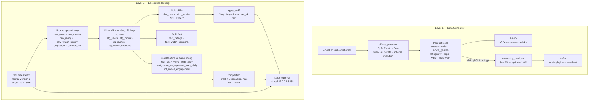
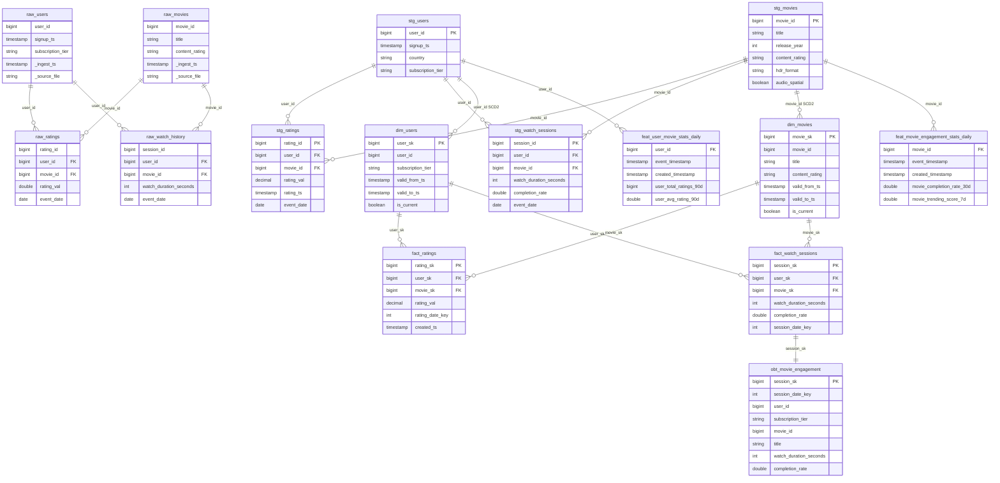

# 02 — Lakehouse Storage Proof (Layer 2)

Bằng chứng cho Layer `storage/`: DDL Medallion trên Apache Iceberg, SCD Type 2
trên mẫu 5 user, và mô phỏng bin-packing gom file nhỏ về mục tiêu 128MB.

## Kiến trúc hệ thống

Gồm Layer `generator/` và Layer `storage/`. Generator ghi Parquet local, đẩy lên MinIO `s3://external-source-lake/` và Kafka. Lakehouse khai báo bảng Iceberg Bronze → Silver → Gold, rồi chứng minh SCD Type 2 và compaction trên mẫu. Job Spark ở Layer 3 đọc bucket đó qua `s3a://external-source-lake/`, rồi ghi Silver/Gold qua Iceberg REST catalog vào `s3a://lakehouse/` (`metadata.json` và `snap-*.avro`). `tags` vẫn chỉ ở generator; `movie_genres` được broadcast trong job salting.



Ba cột schema mới của `movies` được khai báo nullable trên `raw_movies` và `stg_movies`, để file Parquet thế hệ cũ đọc ra NULL. `apply_scd2` chạy trên `dim_users` trong bộ nhớ, mẫu 5 user. `compaction.py` chỉ in kế hoạch gom file, không ghi lại Parquet.

Lệnh tái lập trên terminal:

```bash
make demo-layer2
```

Tương đương ba lệnh:

```bash
python -m storage.lakehouse.scd.apply_scd2
python tests/unit/test_scd2_logic.py
python -m storage.lakehouse.maintenance.compaction --target-mb 128
```

Xem cùng số liệu trên trang local: `make lakehouse-ui` rồi mở http://127.0.0.1:8088.
Trang đã được mở và đối chiếu: ba zone đủ tên bảng, bảng trước có 5 dòng
`is_current = true`, bảng sau đóng gói Free của user 101 và mở VIP ở `user_sk = 6`.

## 1. Ba zone đã khai báo

DDL nằm ở `storage/lakehouse/bronze/raw_tables.sql`, `silver/stg_tables.sql`
và `gold/gold_tables.sql`. Mọi bảng đặt `write.target-file-size-bytes = 134217728`
(128MB) và `format-version = 2`.

| Zone | Bảng | Vai trò |
|---|---|---|
| Bronze | `raw_users`, `raw_movies`, `raw_ratings`, `raw_watch_history` | Append-only, có `_ingest_ts` và `_source_file` |
| Silver | `stg_users`, `stg_movies`, `stg_ratings`, `stg_watch_sessions` | Đã khử trùng, đã ép kiểu, schema phim đã hợp nhất |
| Gold | `dim_users`, `dim_movies` | SCD Type 2 |
| Gold | `fact_ratings`, `fact_watch_sessions` | Một dòng cho mỗi rating hoặc phiên xem hợp lệ |
| Gold | `feat_user_movie_stats_daily`, `feat_movie_engagement_stats_daily` | Có `event_timestamp` và `created_timestamp` |
| Gold | `obt_movie_engagement` | Bảng phẳng cho dashboard |

`raw_ratings` và `raw_watch_history` phân vùng theo `event_date`. Ba cột
`content_rating`, `hdr_format`, `audio_spatial` có mặt trên Bronze và Silver
dưới dạng nullable, để file Parquet thế hệ cũ đọc ra NULL sau khi hợp schema.

## Sơ đồ ERD

Iceberg DDL không có `FOREIGN KEY`. Đường nối dưới đây là grain mà job Gold dùng khi join. Bronze và Silver nối theo khóa tự nhiên `user_id`, `movie_id`. Gold fact nối theo surrogate `user_sk`, `movie_sk` của phiên bản SCD2 đang hiệu lực tại thời điểm sự kiện. `obt_movie_engagement` cùng grain với `fact_watch_sessions` nhưng đã phẳng hóa `user_id`, `subscription_tier`, `movie_id`, `title`.



Một `user_id` có nhiều dòng `dim_users` vì SCD2. Fact chỉ trỏ tới đúng một `user_sk`: phiên bản có `valid_from_ts <= event_ts` và `valid_to_ts` null hoặc lớn hơn mốc sự kiện. `stg_ratings.rating_id` là dòng giữ lại sau `row_number`, không còn bản trùng khóa `(user_id, movie_id, rating_val)`.

## 2. SCD Type 2 trên 5 user

Khoảng hiệu lực là nửa mở: `valid_from_ts <= t < valid_to_ts`. Dòng đang dùng
có `valid_to_ts = NULL`. Đổi gói không sửa đè dòng cũ: dòng đó bị đóng
(`is_current = false`) và một dòng mới nhận `user_sk` kế tiếp. `user_id` và
`country` được copy sang phiên bản mới.

Năm user đổi gói cùng lúc vào **2026-06-01**.

**Trước** — 5 dòng, tất cả đang mở từ 2026-01-01:

| user_sk | user_id | country | tier | valid_from | valid_to | is_current |
|---:|---:|---|---|---|---|---|
| 1 | 101 | VN | Free | 2026-01-01 | NULL | true |
| 2 | 102 | US | Standard | 2026-01-01 | NULL | true |
| 3 | 103 | KR | VIP | 2026-01-01 | NULL | true |
| 4 | 104 | JP | Free | 2026-01-01 | NULL | true |
| 5 | 105 | FR | Standard | 2026-01-01 | NULL | true |

**Sau** — 10 dòng, mỗi `user_id` còn đúng một dòng hiện tại:

| user_sk | user_id | country | tier | valid_from | valid_to | is_current |
|---:|---:|---|---|---|---|---|
| 1 | 101 | VN | Free | 2026-01-01 | 2026-06-01 | false |
| 6 | 101 | VN | VIP | 2026-06-01 | NULL | true |
| 2 | 102 | US | Standard | 2026-01-01 | 2026-06-01 | false |
| 7 | 102 | US | VIP | 2026-06-01 | NULL | true |
| 3 | 103 | KR | VIP | 2026-01-01 | 2026-06-01 | false |
| 8 | 103 | KR | Free | 2026-06-01 | NULL | true |
| 4 | 104 | JP | Free | 2026-01-01 | 2026-06-01 | false |
| 9 | 104 | JP | Standard | 2026-06-01 | NULL | true |
| 5 | 105 | FR | Standard | 2026-01-01 | 2026-06-01 | false |
| 10 | 105 | FR | Premium | 2026-06-01 | NULL | true |

User 101 trong tháng 3/2026 vẫn là Free (`user_sk = 1`). Từ 2026-06-01 là VIP
(`user_sk = 6`).

`python tests/unit/test_scd2_logic.py` in bảng trên và qua 5 test:

| Test | Kết quả |
|---|---|
| 5 lần đổi gói giữ lịch sử, mỗi user một dòng hiện tại | PASS |
| Đổi sang đúng gói đang mở thì không sinh phiên bản mới | PASS |
| Đổi lần hai (VIP rồi Premium) nối thành 3 phiên bản | PASS |
| `user_id` chưa có trong chiều bị từ chối | PASS |
| List đầu vào không bị sửa | PASS |

## 3. Compaction 128MB

`compaction.py` mô phỏng First Fit Decreasing. File lớn hơn mục tiêu đứng một
mình; file nhỏ được nhét vào bin đã mở đầu tiên còn đủ chỗ. Script không ghi
lại Parquet.

Bộ giảng dạy 16 file, tổng **309MB**, mục tiêu **128MB**:

| Bin | Dung lượng | Số file | File |
|---|---:|---:|---|
| 00 | 128MB | 4 | part-000 (60), part-001 (50), part-007 (15), part-012 (3) |
| 01 | 128MB | 5 | part-002 (40), part-003 (40), part-004 (30), part-008 (10), part-009 (8) |
| 02 | 53MB | 7 | part-005, part-006, part-010, part-011, part-013, part-014, part-015 |

16 file đầu vào thành 3 file sau gom. Hai bin chạm đúng 128MB.

## 4. Cách xem lại

| Việc | Lệnh |
|---|---|
| In SCD2 và compaction trên terminal | `make demo-layer2` |
| Chỉ chạy test SCD2 | `make test-scd2` |
| Mở trang đã đối chiếu | `make lakehouse-ui` |
| Cùng trang trong Docker, cổng 8088 | `make lakehouse-docker` |

Image UI là `infra/docker/Dockerfile.lakehouse-ui`. Service `lakehouse-ui` nằm
trong `infra/compose/docker-compose.lakehouse.yml`, tách khỏi cụm MinIO, Kafka
và Spark.
