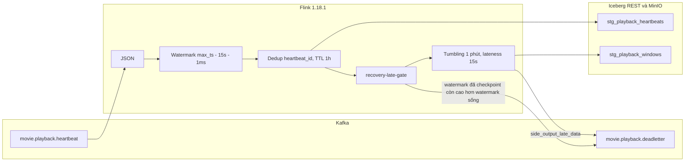

# Layer 4 — Flink tumbling window

Tài liệu ghi phần đã có trong source và phần đã đo trên cụm local. Nhãn:

| Nhãn | Nghĩa |
|---|---|
| Implemented | Có trong job PyFlink 1.18.1 hiện tại |
| Verified | Đã đo bằng test |
| Known Limitation | Đã đo, và đó là giới hạn còn lại |
| Not Verified | Chưa đo được trong lần chạy này |
| Future Work | Chưa làm |

Một heartbeat quá cleanup là một `dead_letter`, `reason=window_past_cleanup`.

## Kiến trúc

Implemented. Job mặc định parallelism 1.

`stg_watch_sessions` là bảng phiên của batch Spark. Job không ghi bảng đó và không `ALTER` hay `DROP` bảng production. `CREATE TABLE IF NOT EXISTS` không sửa bảng đã có.

Ví dụ cửa sổ `[0, 60s)`. Heartbeat tại 0s, 20s, 50s và 10s thuộc cửa sổ này. Event 80s đẩy watermark lên `64999`, cửa sổ đóng lần đầu. Event 5s sau đó vẫn vào cùng dòng vì cleanup là `74999`. Event 0s khi watermark đã `314999` là dead letter, không vào aggregate.

Watermark Flink phát ra là `max_ts - 15s - 1ms` trên từng subtask, rồi lấy min các subtask còn hoạt động. Cổng recovery khóa hằng `0`, nên watermark nó thấy là min đó, cùng giá trị cửa sổ tumbling nhận. Cổng không suy watermark từ max event time.

Trên đường đang chạy, `side_output_late_data` quyết định heartbeat quá hạn. Sau restore, generator không có max timestamp và `currentWatermark` không nằm trong checkpoint, nên watermark sống về `Long.MIN_VALUE` và side output không phát lại. Cổng dùng `aligned_watermark` đã checkpoint: chỉ tăng, bỏ `Long.MIN_VALUE`, và timer processing time 1 giây ghi nhận cả lúc không có event mới. Nếu watermark đã lưu vẫn cao hơn watermark sống và heartbeat đã quá cleanup, cổng viết một dead letter và không đưa heartbeat vào cửa sổ.

## Thành phần

| Thành phần | Mục đích | Trạng thái |
|---|---|---|
| Event time từ `event_ts` | Cửa sổ theo thời điểm xem, không theo lúc record tới Flink | Implemented |
| Watermark 15 giây | Chừa chỗ cho heartbeat tới lệch thứ tự trước khi đóng cửa sổ | Implemented |
| Allowed lateness 15 giây | Sau main firing, heartbeat còn hạn cleanup upsert cùng `(movie_id, window_start)` | Implemented |
| Dedup `heartbeat_id`, TTL 1 giờ | Cùng id không đếm hai lần trong replay và restart. Hết TTL thì id được nhận lại. Trần state, không phải SLA | Implemented |
| RocksDB incremental | State dedup và watermark cổng sống qua TaskManager chết. Barrier mặc định 10 giây, exactly-once, `RETAIN_ON_CANCELLATION` | Implemented |
| Iceberg heartbeat append | Một dòng mỗi id đã qua dedup. Seek ở `playback_position_seconds`. Watch duration là delta, mặc định 10 giây | Implemented |
| Iceberg window upsert | Khóa `(movie_id, window_start)` không enforced, format v2, `write.upsert.enabled=true` | Implemented |
| Kafka DLQ transactional | `exactly-once`, `transaction.timeout.ms=600000`, cùng statement set với Iceberg | Implemented |

Watched time cộng `watched_delta_seconds`. Không có thì cộng 10 giây. `current_position_seconds` không cộng vào thời lượng xem.

## Lỗi đã xử lý

| Việc | Nguyên nhân | Cách xử lý | Trạng thái |
|---|---|---|---|
| Ghi MinIO | `HadoopFileIO` cần JAR S3A, image Flink gốc không có | Image thêm Hadoop AWS/common và AWS SDK. Không thêm Hive | Implemented |
| Checkpoint `LinkageError` | `add_jars` nạp Iceberg lần nữa, trùng Histogram Dropwizard | Iceberg chỉ ở `/opt/flink/lib`. Plugin Graphite đã gỡ | Implemented |
| Timestamp `Long.MIN_VALUE` | `with_idleness()` làm rơi timestamp assigner | Assigner gắn sau idleness. Source dùng `no_watermarks()` | Implemented |
| DLQ không vào graph | `sink_to` DataStream không được statement set kéo theo | DLQ là bảng Kafka tạm, `INSERT` cùng Iceberg | Implemented |
| Side output sai coder | Tuple side output bị đảo | Yield `(OutputTag, value)` | Implemented |
| Replay không phát lại dead letter | Watermark không nằm trong checkpoint. Transaction Kafka đang mở bị abort | Cổng recovery phát lại dead letter ở checkpoint sau | Implemented |
| Parallelism 2 loại nhầm heartbeat còn hạn | `max_event_ts - 15s - 1` cao hơn min watermark các subtask | `aligned_watermark` thay cho max event time | Implemented, Verified |

UID `recovery-late-gate` giữ nguyên. State đổi tên từ `max_event_ts` sang `aligned_watermark`. Không có savepoint production.

Trước khi đổi, job `cde98db33694ccb71a323bc12c5595f2` có cửa sổ tại `-15001` trong khi max event time suy ra `314999`. Heartbeat tại 5 giây, sau restore, có trong `read_committed` dù cửa sổ chưa đóng.

## Môi trường và cách chạy lại

Verified cho cụm đã dùng khi đo. Flink 1.18.1, Iceberg 1.6.1, RocksDB, một TaskManager 2 slot. Checkpoint `file:///opt/flink/checkpoints`. UI `http://localhost:18081`. Broker trong mạng là `kafka:29092`, trên host là `localhost:19092`. Iceberg REST `127.0.0.1:8181`, MinIO `127.0.0.1:9000`.

Lệnh có trong repo:

| Lệnh | Việc nó làm |
|---|---|
| `make stream-test` | `unittest discover` trên `tests/streaming`. Không cần cụm |
| `make stream-verify` | Chạy engine local `--scenario proof`, rồi `python -m streaming.flink.verify` |
| `make stream-up` / `make stream-down` | Bật hoặc tắt JobManager và TaskManager |
| `make stream-job-run` | Submit job production lên topic `movie.playback.heartbeat` |

`streaming.flink.verify` in offset topic DLQ, tối đa 3 message, và vài prefix metadata trên bucket `lakehouse`. Consumer này không đặt `isolation_level`, nên không phải bằng chứng `read_committed`.

Lần đo 15 test dùng pytest trên `tests/streaming`. Lệnh pytest không có trong Makefile. `make stream-test` chưa được gọi lại trong lần đo đó.

Suite parallelism 1 và 2 nằm ở `streaming.flink.it_parallel_recovery`, có cờ `--from-case`. Không có target Make cho module này. Docstring `it_phase2.py` có một lệnh `uv run` cho chính module đó, không phải lệnh của suite parallelism. Bài đo không dùng `make stream-job-run`.

Cách bài đo đọc DLQ và Iceberg nằm trong helper, không có lệnh Make riêng: Kafka consumer với `read_committed` và `read_uncommitted`; Spark `REFRESH TABLE` rồi đọc `.snapshots`.

## Integration tests

Verified. Topic `it.p2.*`, bảng `cinestream.silver.it_p2_*`. Offset production trước và sau vẫn 208 / 229 / 163. Snapshot `stg_watch_sessions` vẫn `1975472564804901513`, append. Hai bảng silver streaming production chưa tồn tại.

| Scenario | Parallelism | Expected | Actual | Status |
|---|---|---|---|---|
| Đúng giờ, lệch thứ tự, allowed late, dedup | 1 | `[00:00, 00:01)` là 5 / 50 / 5 | 5 / 50 / 5 | Pass |
| Hai lần kill, heartbeat 8 và 11 quá hạn | 1 | Mỗi id một bản committed | Committed `[8, 11]`. Uncommitted mỗi id hai lần | Pass |
| Partition chậm, heartbeat tại 5 giây | 2 | Không vào DLQ. Cửa sổ nhận heartbeat | Watermark `-15001`. DLQ rỗng. Cửa sổ sau đó 2 / 20 / 2 | Pass |
| Subtask idle rồi heartbeat quá hạn, watermark đã checkpoint | 2 | Một dead letter. Cửa sổ giữ 1 / 10 / 1 | Committed `[3]` một lần. Uncommitted `[3, 3]`. Cửa sổ 1 / 10 / 1 | Pass |
| Duplicate, lệch thứ tự, allowed late, too-late trên đường đang chạy | 2 | Hai dòng cửa sổ. DLQ một bản | 5 / 50 / 5 và 3 / 30 / 3. Committed heartbeat 12 một lần | Pass |
| Watermark vượt cleanup sau checkpoint cuối | 2 | Gap: replay vào cửa sổ, không có DLQ committed | DLQ committed rỗng. Cửa sổ 2 / 20 / 2 | Known Limitation |

`read_uncommitted` còn bản của transaction bị abort. `read_committed` không tính các bản đó.

### Evidence

| Scenario | Job | Checkpoint | Snapshot |
|---|---|---|---|
| Parallelism 1 và hai lần kill | `8d1420066dd7fe59446ac8bd1b8f9ec4` | Restore `chk-4` (82376 byte), rồi `chk-6` (80371 byte) | Cửa sổ `4836744667291463079`, overwrite |
| Partition chậm | `1905e8d82dcba306262bf6fd56ca1fe6` | Giữ `chk-1` (119573 byte). Checkpoint đang chạy fail. Sau restore committed id 3 | Cửa sổ `1792118595722442453`, overwrite |
| Idle rồi too-late | `7c73db73bb722f1c33cfafa87b701c34` | `chk-4` (122841 byte, 112 ms). Checkpoint 5 fail, state size 0. DLQ commit ở checkpoint 6 | Cửa sổ `1389855237356219058`, overwrite |
| Hợp đồng parallelism 2 | `dae5f6465da6c675508290f4dfe1dab2` | Không kill | Cửa sổ `4211150728522201537`, overwrite |
| Checkpoint gap | `b4fb8d1c0f00c28aab58ab39551090a9` | Giữ checkpoint 2 | Không có snapshot riêng trong file kết quả |

Lúc idle được nhả, source subtask 0 ở `Long.MIN_VALUE`, subtask 1 ở `314999`, rồi cửa sổ và cổng lên `314999`. Lúc partition chậm, cửa sổ và cổng ở `-15001`.

## Benchmark

Verified, một lần, không lặp. 300 heartbeat, event time cách nhau 1 giây, partition `index % 3`. Checkpoint 10 giây, idle timeout 30 giây. Đo từ lúc bắt đầu gửi đến khi Spark thấy đủ 300 `heartbeat_id`. Events/s là 300 chia cho khoảng đó. Duration checkpoint là các checkpoint `COMPLETED` trong history Flink REST ngay lúc đủ 300 dòng. Một TaskManager `cinestream-taskmanager-1`, 2 slot. Cả hai subtask parallelism 2 nằm trên TaskManager đó.

| | Parallelism 1 | Parallelism 2 |
|---|---|---|
| Thời gian gửi | 0.545 giây | 0.516 giây |
| Tới khi đủ heartbeat trong Iceberg | 9.888 giây | 6.909 giây |
| Events/s tới Iceberg | 30.34 | 43.42 |
| Checkpoint completed trong cửa sổ đo | 179 ms | 410 ms |
| Dòng cửa sổ đã đóng | 4 | 4 |
| Snapshot heartbeat | `8687685325905836756`, append | `2494848728927448033`, append |

Nhận định từ một cặp số này: parallelism 2 tới Iceberg sớm hơn khoảng 30 phần trăm và cao hơn khoảng 43 phần trăm events/s. Mẫu checkpoint lại dài hơn. Chưa đủ để nói parallelism 2 luôn nhanh hơn. Counter `numRecordsIn` lúc lấy mẫu là 0, không dùng để chia tải. Lag Kafka không lấy được.

## Checkpoint gap và exactly-once

Known Limitation. Cổng chỉ biết watermark đã vào checkpoint. Heartbeat trở nên quá cleanup sau checkpoint cuối được replay vào cửa sổ. Job `b4fb8d1c0f00c28aab58ab39551090a9`: checkpoint 2 còn `Long.MIN_VALUE`, lúc gửi thì cửa sổ đã `314999`, kill trước checkpoint kế, DLQ committed rỗng và cửa sổ thành 2 / 20 / 2.

Khi watermark cao đã nằm trong checkpoint, như `chk-4` của job idle, replay tạo một dead letter và cửa sổ không đổi.

Kafka và Iceberg mỗi bên commit khi checkpoint của sink đó xong. Abort transaction Kafka không xóa snapshot Iceberg đã commit. Không có một giao dịch phân tán cho cả hai.

TTL dedup là processing time. Checkpoint nằm trên đĩa container, không phải kho phân tán. Không có savepoint cho graph sliding window cũ.

## Acceptance criteria

| Tiêu chí | Trạng thái |
|---|---|
| Một cửa sổ tumbling 1 phút, không sliding | Pass |
| Parallelism 1: aggregate, dedup, late, DLQ sau hai lần restore | Pass |
| Parallelism 2, ít nhất 3 partition | Pass |
| Partition chậm không loại nhầm heartbeat còn hạn | Pass |
| Subtask idle rồi watermark tiến lên | Pass |
| Too-late thành DLQ committed sau khi watermark đã checkpoint | Pass |
| Không trùng dead letter trong `read_committed` ở các ca đã kill | Pass |
| Dòng Iceberg đúng sau recovery | Pass |
| Checkpoint hoàn tất, checkpoint đang chạy lúc kill thì fail | Pass |
| Offset và snapshot production không đổi | Pass |
| Phân loại muộn đúng cả khi watermark đổi sau checkpoint cuối | Known Limitation |
| Một giao dịch nguyên tử Kafka và Iceberg | Known Limitation |
| Parallelism 2 luôn nhanh hơn | Not Verified |
| Lag Kafka và số record từng subtask | Not Verified |

## Coursework readiness

Streaming layer đủ để nộp ở parallelism 1 và 2 cho các ca đã đo: tumbling, dedup, allowed lateness, DLQ committed, và restore khi watermark đã checkpoint.

Giới hạn cần chấp nhận: khoảng giữa checkpoint cuối và lúc watermark vượt cleanup; exactly-once từng sink chứ không phải một commit chung; checkpoint trên đĩa local; TTL một giờ theo processing time. Benchmark chỉ là một lần chạy.

## Future Work

1. Nối aggregate tumbling sang Gold và Consumption. Streaming hiện dừng ở hai bảng silver.
2. Benchmark lặp lại và workload dài hơn nếu cần kết luận về parallelism.
3. Đưa checkpoint sang MinIO và thu hẹp checkpoint gap, không quay lại max event time toàn cục.
