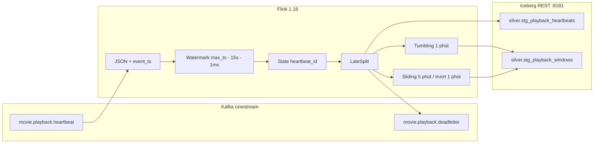
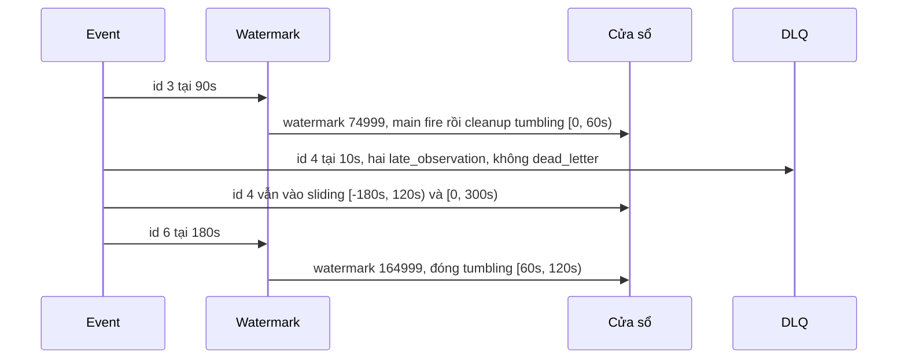

# Layer 4 — Flink, watermark và late data

Job đọc `movie.playback.heartbeat`, gán event-time từ `event_ts`, giữ độ lệch 15 giây, rồi cho mỗi cửa sổ thêm 15 giây allowed lateness. Heartbeat đã khử trùng `heartbeat_id` được append vào `cinestream.silver.stg_playback_heartbeats`. Aggregate theo phim nằm ở `cinestream.silver.stg_playback_windows` (upsert). `cinestream.silver.stg_watch_sessions` là bảng phiên của batch Spark. Job streaming không ghi vào đó.

Kafka DLQ nhận hai loại bản ghi trên cùng topic `movie.playback.deadletter`:

- `late_observation`: một cửa sổ đã qua cleanup.
- `dead_letter`: mọi cửa sổ được gán cho heartbeat đó đều đã qua cleanup. Một heartbeat chỉ có một dead letter.

## 1. Luồng



`LateSplit` đứng sau dedup và trước hai cửa sổ. Mọi heartbeat đã khử trùng vẫn đi tiếp tới cửa sổ và bảng heartbeat. Side output chỉ thêm JSON chẩn đoán. Cửa sổ không dùng `side_output_late_data`. Allowed lateness vẫn bật trên tumbling và sliding để late firing cập nhật aggregate.

Trong mạng `cinestream_default` broker là `kafka:29092`. Cổng 9092 của container là listener EXTERNAL, advertised `localhost:19092`. Client trên host dùng `localhost:19092`. UI JobManager để ở `http://localhost:18081` vì 8081 đang bị schema-registry chiếm.

Producer Layer 1 ghi `event_ts`, không ghi `event_timestamp`. Job đọc `event_ts` và chấp nhận `event_timestamp` nếu có. Độ trễ late data của producer là 10–35 phút. Allowed lateness của job là 15 giây, nên heartbeat muộn của producer đã qua cleanup của mọi cửa sổ chứa nó và thành một `dead_letter`. Event đúng giờ lệch 0–1 giây nằm trong watermark 15 giây.

`with_idleness(30s)` gắn trước timestamp assigner. `with_idleness()` trả strategy mới và xóa assigner. Assigner đọc `event_ts_ms` phải gắn sau. Source im hơn 30 giây thì watermark ngừng tiến.

## 2. Watermark và lateness theo cửa sổ

Flink `BoundedOutOfOrdernessWatermarks.onPeriodicEmit` đặt

```text
watermark = max_event_ts - 15_000 - 1
```

Event được so với watermark **trước** khi đồng hồ cập nhật. Watermark chu kỳ không nhảy ngay trong cùng một record. Cửa sổ `[start, end)` có `maxTimestamp = end - 1`.

| Mốc | Điều kiện |
|---|---|
| Main firing | `watermark >= end - 1` |
| Late firing | Event tới sau main firing, trước cleanup. Aggregate phát lại với toàn bộ phần tử còn trong state |
| Cleanup | `watermark >= (end - 1) + 15_000`. State cửa sổ bị xóa, không phát thêm |
| Loại khỏi một cửa sổ | Cleanup của **cửa sổ đó** đã qua. Timestamp nhỏ hơn watermark hiện tại chưa đủ để loại |

Tumbling 1 phút `[0, 60s)` có `maxTimestamp = 59999` và cleanup `74999`. Sliding 5 phút `[0, 300s)` có cleanup `314999`, nên ở watermark `164999` cửa sổ này vẫn mở. Flink gán cả cửa sổ `start` âm khi timestamp gần epoch. Chuỗi kiểm chứng dùng mốc 0 nên có `[-240s, 60s)` và `[-180s, 120s)`.

Với tumbling 1 phút và sliding 5 phút / trượt 1 phút, cửa sổ sliding sớm nhất kết thúc cùng tumbling chứa timestamp đó. Heartbeat bị tumbling cleanup thì cũng bị sliding sớm nhất cleanup. Các sliding sau vẫn có thể nhận. Vì vậy "chỉ sliding từ chối, tumbling còn nhận" không xảy ra với kích thước production. Unit test đổi tumbling thành 5 phút và sliding thành 1 phút để chứng minh trường hợp đó.

Mỗi heartbeat được nhận cộng `watched_delta_seconds` nếu payload có. Không có thì cộng `HEARTBEAT_STEP_SECONDS` (10). `current_position_seconds` là vị trí seek, giữ cột riêng, không cộng vào thời lượng xem. `active_users` là số `user_id` phân biệt. `total_watch_seconds` là tổng delta còn trong cửa sổ.

### Chuỗi proof

`proof_events()`, movie 42, vị trí 10, không có `watched_delta_seconds`. Watermark ghi bằng milli-giây.

```text
đến   id   event_ts   watermark trước   sau khi cập nhật   quyết định
1     1    0          (chưa có)         -15001             nhận, tumbling [0, 60s)
2     2    30s        -15001            14999              nhận, cùng cửa sổ
3     3    90s        14999             74999              nhận, tumbling [60s, 120s).
                                                            74999 vừa main-fire vừa cleanup [0, 60s)
4     4    10s        74999             74999              observation tumbling [0, 60s)
                                                            và sliding [-240s, 60s).
                                                            Sliding sau vẫn nhận. Không dead letter
5     5    70s        74999             74999              nhận, tumbling [60s, 120s)
6     2    30s        74999             74999              trùng heartbeat_id, bỏ, không vào DLQ
7     6    180s       74999             164999             nhận. Đóng tumbling [60s, 120s)
                                                            và sliding [-180s, 120s)
```



`heartbeat_id=4` vẫn có hàng trong bảng heartbeat. Nhánh heartbeat tách trước phép loại của từng cửa sổ.

### Late firing

Chuỗi `0`, `20s`, `80s` đẩy watermark lên `64999`. Tumbling `[0, 60s)` main-fire với 2 heartbeat (20 giây, 2 user) vì `64999 >= 59999`, và chưa cleanup vì `64999 < 74999`. Event sau tại `5s` vào cửa sổ đang mở và late-fire thành 3 heartbeat, 30 giây, 3 user. Iceberg upsert thay hàng logical cũ. Cleanup không phát thêm một aggregate rỗng.

## 3. DLQ

`LateSplit` không giữ state để ghép tumbling với sliding. Quyết định chỉ dùng timestamp và watermark lúc event tới.

| Trường hợp | Kết quả trên topic DLQ |
|---|---|
| Tumbling đã cleanup, còn sliding sau nhận | `late_observation` cho từng cửa sổ đã cleanup. Không có `dead_letter` |
| Sliding đã cleanup, tumbling còn mở | Chỉ xảy ra khi đổi kích thước cửa sổ. Một observation `sliding_5m`. Heartbeat vẫn nằm trong tumbling |
| Mọi cửa sổ được gán đều đã cleanup | Một `late_observation` cho mỗi cửa sổ, cộng một `dead_letter` (`reason=late_for_all_windows`, kèm `rejected_windows`) |

Payload giữ JSON gốc, `event_ts_ms`, `watermark_ms` và `reason` (`window_past_cleanup` hoặc `late_for_all_windows`). Side output PyFlink phải yield `(OutputTag, json)`. Đảo thứ tự thì chuỗi JSON bị đẩy ra luồng chính và coder bigint của event tuple ném `TypeError`.

Sink DLQ là bảng tạm `default_catalog.default_database.dlq_sink` (`format=raw`, `sink.delivery-guarantee=exactly-once`, prefix `cinestream-heartbeat-dlq`, `transaction.timeout.ms=600000`). `StatementSet.execute()` chỉ kéo lineage của `INSERT`, nên DLQ nằm trong cùng statement set với hai bảng Iceberg.

## 4. Grain

| Bảng | Một hàng là | Ghi bởi job streaming |
|---|---|---|
| `stg_playback_heartbeats` | Một heartbeat đã khử trùng `heartbeat_id` | Append. `watch_duration_seconds` = delta của nhịp |
| `stg_watch_sessions` | Một phiên xem của batch (completion × runtime) | Không |
| `stg_playback_windows` | Một aggregate `(movie_id, window_type, window_start)` | Upsert, format-version 2, primary key không enforced |

Cột heartbeat: `heartbeat_id`, `session_id`, `user_id`, `movie_id`, `event_ts`, `playback_position_seconds`, `watched_delta_seconds`, `watch_duration_seconds`, `event_date`, `dt`.

Cột cửa sổ: `movie_id`, `window_type`, `window_start`, `window_end`, `total_watch_seconds`, `heartbeat_count`, `active_users`. `window_type` là `tumbling_1m` hoặc `sliding_5m`.

## 5. Số đã đo

`make stream-test` chạy `unittest discover -s tests/streaming`. 10 test, không cần cụm.

Chuỗi proof, engine local (`HeartbeatWindowEngine`):

| Kết quả | Giá trị |
|---|---|
| Nhận vào ít nhất một cửa sổ | 6 |
| Trùng `heartbeat_id` (id 2) | 1, không vào DLQ |
| Dead letter | 0 |
| Observation của id 4 | tumbling `[0, 60s)`, sliding `[-240s, 60s)`, watermark 74999 |
| Watermark cuối | 164999 ms |
| Hàng heartbeat đã khử trùng | 6, gồm id 4 |
| Tumbling `[0, 60s)` đã đóng | id 1, 2. Count 2, 20 giây, 2 user |
| Tumbling `[60s, 120s)` đã đóng | id 3, 5. Count 2, 20 giây, 2 user |
| Sliding `[-240s, 60s)` đã đóng | id 1, 2. Count 2, 20 giây |
| Sliding `[-180s, 120s)` đã đóng | id 1, 2, 3, 4, 5. Count 5, 50 giây |
| Sliding `[0, 300s)` còn mở | id 1, 2, 3, 4, 5, 6. Count 6, 60 giây |

Seek: heartbeat vị trí 500, không có delta, cho `watch_duration_seconds = 10`. Payload có `watched_delta_seconds = 4` thì duration là 4. Cửa sổ không cộng 500.

Job Flink `c332a539c2e1fdeb94198468a703d482` trên topic và bảng tách biệt `it.p1c.heartbeat`, `it.p1c.deadletter`, `cinestream.silver.it_p1c_heartbeats`, `cinestream.silver.it_p1c_windows`:

| Kết quả | Giá trị |
|---|---|
| Main fire tumbling `[0, 60s)` | count 2, watch 20, users 2 |
| Late fire cùng key, trước cleanup | count 3, watch 30, users 3 |
| Sau heartbeat bị tumbling từ chối và heartbeat bị mọi cửa sổ từ chối | cùng một hàng, vẫn 3 / 30 / 3 |
| Lịch sử snapshot của key đó | 2, rồi 3, rồi 3 |
| Property bảng cửa sổ | `format-version=2`, `write.upsert.enabled=true` |
| Heartbeat id 2 | `playback_position_seconds=500`, `watch_duration_seconds=10` |
| DLQ `read_committed` | một `dead_letter` heartbeat 8. Tám `late_observation` |
| Checkpoint | 13 completed, 0 failed, 0 restored |
| Graph | có `late-split`, tumbling, sliding, committer heartbeat, committer cửa sổ, `dlq_sink` Writer và Committer |

Bảng production không đổi sau lần chạy đó: `movie.playback.heartbeat` offset 208 / 229 / 163, `stg_watch_sessions` snapshot `1975472564804901513`, 662.830 hàng.

`make stream-verify` in báo cáo engine local (`--engine local --scenario proof`) rồi đọc topic DLQ mặc định và metadata MinIO nếu cụm đang chạy. `stream-job-run` submit với topic và bảng mặc định, tức `movie.playback.heartbeat` và `stg_playback_heartbeats`.

Image `cinestream-flink:1.18.1`: PyFlink 1.18.1, Kafka SQL connector, Iceberg runtime 1.6.1, plugin RocksDB (`frocksdbjni`). Plugin Graphite đã bỏ khỏi `/opt/flink/plugins/metrics-graphite`. Job không `add_jars` iceberg hay kafka. JAR iceberg nằm sẵn trong `/opt/flink/lib`. Thêm bản thứ hai lên ChildFirstClassLoader làm `Histogram` của Dropwizard bị nạp hai lần và checkpoint ném `LinkageError`.

## 6. Checkpoint

Checkpoint mỗi 10 giây, pause tối thiểu 5 giây, timeout 60 giây, mode `EXACTLY_ONCE`, RocksDB incremental, thư mục `file:///opt/flink/checkpoints`. `execution.checkpointing.externalized-checkpoint-retention=RETAIN_ON_CANCELLATION`. `execution.checkpointing.tolerable-failed-checkpoints=3`.

Source Kafka, state `heartbeat_id`, state cửa sổ và hai sink nằm trong cùng barrier. Iceberg commit snapshot khi checkpoint thành công. Transaction Kafka DLQ commit cùng lúc. Checkpoint lỗi thì transaction Kafka abort.

Lần chạy `it.p1c` cho thấy checkpoint hoàn tất, Iceberg có snapshot và DLQ đọc được ở `read_committed`. Chưa có bài thử kill job rồi restore từ checkpoint, nên khôi phục exactly-once chưa được chứng minh bằng failover.

## 7. Chạy

```bash
make stream-test
make stream-verify
make stream-job-run
```

`stream-test` không cần cụm. `stream-job-run` build `infra/docker/Dockerfile.flink` (Flink 1.18.1, PyFlink 1.18.1, RocksDB, Kafka SQL connector, `iceberg-flink-runtime-1.18:1.6.1`) và submit vào JobManager. Image copy `streaming/` lúc build. Sửa code xong cần build lại. Catalog REST `http://iceberg-rest:8181`, S3 `http://minio:9000`, path-style.
