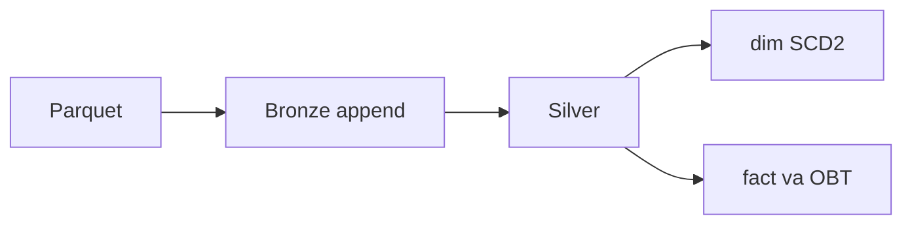

# 05 — Incremental batch lakehouse

**Phạm vi.** `make spark-batch-it` lúc 2026-10-17 18:02:54 UTC. Warehouse `file://`, namespace `it_*`. Không ghi bảng production.

**Trong phạm vi này.** `stg_playback_heartbeats` và `stg_playback_windows` không bị job này đọc hay ghi. Airflow bọc cùng job ở file 05 orchestration.

**Đọc tiếp.** [Tour](00_system_tour.md) · [03 — Spark](03_spark_optimizations_proof.md)



Raw Parquet → Bronze Iceberg → Silver → Gold. Test chạy trên catalog Hadoop `file://`, namespace `it_*`. Không ghi bảng production.

Lệnh:

```bash
make spark-batch-it
python tests/unit/test_scd2_logic.py
make spark-ingest-bronze SPARK_SRC=data_generator/output/scale_0_1 SPARK_RUN_ID=manual
make spark-publish SPARK_EFFECTIVE_TS=2026-03-01T00:00:00+00:00
```

`spark-ingest-bronze` và `spark-publish` ghi namespace `bronze` / `silver` / `gold` trên `SPARK_WAREHOUSE` (mặc định `s3a://lakehouse`). Integration test không gọi hai lệnh đó.

## Grain và thời gian

| Nguồn | Layout thật | Khóa Bronze | Grain Silver | Thời gian |
|---|---|---|---|---|
| users | `users/partition_*.parquet`, snapshot | `user_id` | một dòng hiện tại / `user_id` | `signup_ts` mở SCD2; `_ingest_ts` là lúc commit; `effective_ts` là lúc đổi gói |
| movies | `movies/partition_*.parquet`, snapshot | `movie_id` | một dòng hiện tại / `movie_id` | `created_ts` mở phiên bản; đổi title, năm, content rating hoặc HDR thì đóng/mở |
| ratings | `ratings/dt=YYYY-MM-DD/`, `dt` = `event_date` | `rating_id` | `(user_id, movie_id, rating_val)`, giữ `rating_ts` mới nhất | `event_date` / `rating_ts` là ngày sự kiện |
| watch | `watch_history/dt=YYYY-MM-DD/` | `session_id` | `(user_id, movie_id, watch_duration_seconds)`, giữ `start_ts` mới nhất | `event_date` / `start_ts` là ngày sự kiện |

`tags` và `movie_genres` không có bảng Bronze. Job không đọc chúng.

Hai rating khác `rating_id` nhưng trùng grain Silver là replay hợp lệ, vào Bronze rồi bị khử ở Silver. Trùng `rating_id` trong cùng một batch là lỗi hợp đồng.

File được nhận diện bằng `đường dẫn|kích thước|mtime`. Airflow `run_id` chỉ ghi vào `quality_results`, không tham gia khóa chống trùng.

## Cách ghi

- Bronze append. File đã có `_file_id` thì bỏ qua. Một dataset một commit. Dataset đã commit không bị ghi lại khi retry.
- Dòng lỗi vào `quarantine_records` (payload, mã lỗi, mô tả, batch, file, thời điểm). Ngưỡng mặc định 5%. Vượt ngưỡng thì không append dataset đó và không publish.
- Thiếu cột bắt buộc hoặc sai kiểu khóa thì fail cả batch.
- Cột movie `content_rating`, `hdr_format`, `audio_spatial` vắng ở file cũ thì thành NULL. Cột lạ như `studio` bị bỏ, không fail.
- Silver/Gold: nếu dữ liệu mới giống snapshot hiện tại thì không ghi. Nếu khác thì `overwrite` toàn bộ bảng đã tính lại từ Bronze. Fact được dựng lại từ Silver sau khử trùng, nên ngày mất dòng và ngày nhận replay đều đúng.
- SCD2 user gọi `apply_scd2`. `user_sk = user_id * 1_000_000 + version`. Không lấy `max(user_sk)` của cả bảng. Một writer.
- Fact user join theo khoảng `[valid_from, valid_to)`. Fact movie join `is_current`. `rating_sk` là `rating_id` còn lại, `session_sk` là `session_id` còn lại.
- JVM và Python timezone đặt UTC trong `start_spark`, để timestamp naive không bị cộng giờ máy.

## Integration test

`make spark-batch-it` lúc 2026-10-17 18:02:54 UTC, warehouse `file:///var/folders/.../cinestream-batch-it-zif96hhj/warehouse`. Kết quả `PASS`, 10/10.

Production trước và sau: `silver.stg_watch_sessions` snapshot `1975472564804901513`, operation `append`. `bronze.raw_users` không có trên REST (HTTP 404) cả hai lần.

| Case | Input | Expected | Actual | Snapshot | Status |
|---|---|---|---|---|---|
| 1 Normal | 1 rating, 1 watch, 2 user, 2 movie | mỗi grain một dòng | Bronze/Silver/fact/watch/OBT = 1; `dim_users` current = 2 | `raw_ratings` `6585607935881615694` append 1 dòng; `fact_ratings` `6859994473971480932` overwrite 1 dòng | PASS |
| 2 Rerun | cùng file, `run_id` airflow-a rồi airflow-b | không thêm dòng, publish lần hai unchanged | users vẫn 2; mọi dataset ingest `skipped_duplicate`; snapshot Bronze không thêm | `raw_users` một snapshot `7788700147920729790` append 2 dòng; `dim_users` một snapshot `512690763301879603` | PASS |
| 3 Retry | fail sau commit users, chạy lại | users không nhân đôi, ratings một lần | sau fail: users 2, ratings 0; sau retry: users 2, ratings 1, fact 1 | `raw_users` `8298067976307736083` append 2; `raw_ratings` `6273402198485728716` append 1 | PASS |
| 4 Quarantine | 38 rating hợp lệ, 1 rating 9.0, 1 movie lạ, 1 duration âm, 1 completion 1.5, rồi file hỏng | lỗi vào quarantine, Silver 38, file hỏng không vào Bronze | mã `RATING_RANGE`, `FK_MOVIE`, `NEGATIVE_DURATION`, `COMPLETION_RANGE` mỗi mã 1; Silver rating và watch = 38; dòng xấu trong Silver = 0 | `raw_ratings` `4525906708037885425` append 38; `stg_ratings` `2347271837817119779` overwrite 38 | PASS |
| 5 Threshold | 2/10 rating ngoài `[0.5, 5.0]`, rồi seed thẳng vào Bronze | không publish | rate 0.2; ingest lần hai vẫn reject; users giữ 2; Silver rating = 0; fact = 0; publish raise | `raw_users` `2100323941926371267` append; `stg_ratings` không có snapshot dữ liệu | PASS |
| 6 Schema | movie 11 thiếu 3 cột mới; movie 12 thêm `studio`; file ratings thiếu `rating_id` | NULL cho file cũ, bỏ `studio`, fail file thiếu khóa | movie 11 `content_rating` NULL; movie 12 `PG-13` / `HDR10`; status `accepted_ignored:studio`; message thiếu `rating_id`; Bronze ratings xấu = 0 | `raw_movies` `5609541689131201951` append 2 dòng | PASS |
| 7 Backfill | fact ngày 2026-02-15 trước, rồi file `dt=2026-01-15` | ngày mới giữ 1, ngày cũ thêm 1 | trước: day1 0, day2 1; sau: day1 1, day2 1; `rating_sk` = 1 và 2 | `raw_ratings` hai append `4949031087752439435` rồi `237846118338681833`; fact hai overwrite | PASS |
| 8 SCD2 | user 7 Free, VIP tại 2026-04-01, rerun, rồi Standard với mốc 2026-02-01 | hai phiên bản, rerun không thêm, mốc lùi bị từ chối | `7000001` Free `[2026-01-01, 2026-04-01)`, `7000002` VIP mở; rerun cùng snapshot; reject; Silver vẫn VIP; dim vẫn 3 dòng | `dim_users` `2954278992265167512` overwrite 2 dòng, rồi `5361912921078479454` overwrite 3 dòng. Không snapshot thứ ba | PASS |
| 9 Late | rating 1 val 4.0 ngày 01-15, rồi rating 2 cùng grain timestamp 02-15; rating 9 val 3.0 ở lại ngày cũ | Bronze 3, Silver 2, fact mỗi ngày 1 | đúng vậy; Silver giữ `rating_id` 2 ngày 2026-02-15 | Bronze append `6382950445628415672` (2) rồi `6969486195262343423` (3); Silver overwrite còn 2 dòng | PASS |
| 10 Relationship | fact của case 8 | rating 01-15 trỏ Free, 04-15 trỏ VIP, không mồ côi | `(1, 7000001, Free)`, `(2, 7000002, VIP)`; orphan 0; mỗi rating đúng một phiên bản; OBT khớp fact watch | cùng snapshot fact `1752528698869442965` và dim `5361912921078479454` | PASS |

`python tests/unit/test_scd2_logic.py`: 6 test PASS, gồm surrogate `101_000_002` cho version 2 của user 101.

## Giới hạn

- Một writer. Hai writer cùng user vẫn có thể cấp trùng `user_sk`.
- Không chèn phiên bản vào khoảng đã đóng và không sửa phiên bản đã đóng. Batch đó dừng trước khi ghi Silver/Gold.
- Không xóa user hoặc movie khi snapshot sau không còn khóa đó.
- Fact movie luôn trỏ bản `is_current`. Rebuild fact sau khi đổi thuộc tính movie sẽ trỏ sự kiện cũ sang `movie_sk` mới. Fact user thì lấy đúng khoảng thời gian.
- Publish đọc lại toàn bộ Bronze của bốn bảng. Đủ cho coursework, không phải incremental file-level ở Silver.
- Quarantine là DELETE rồi APPEND, hai commit. Retry cùng `batch_id` ghi lại cùng tập lỗi.
- `stg_playback_heartbeats` và `stg_playback_windows` không bị job này đọc hay ghi.
