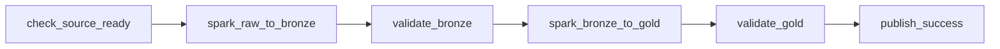

# 05 — Điều phối Airflow và governance

Airflow lập lịch, chờ nguồn, gửi `spark-submit` sang cụm Spark có sẵn, rồi ghi dấu publish. Phép biến đổi Bronze → Silver → Gold vẫn là job Phase 1. Airflow không tự tính lại fact trong worker.

Lệnh đã chạy lúc 2026-10-18 03:07:54 UTC:

```bash
make airflow-up
make airflow-it
```

`make airflow-it` gồm 4 test fingerprint nguồn và 9 case DAG. Kết quả `PASS`. Log: `docs/proof/logs/phase2_airflow_it.json`.

UI: http://localhost:18082, user `airflow`. Ảnh màn hình không chụp được vì form đăng nhập chặn điền mật khẩu tự động. Bằng chứng là log JSON và các `dag_run_id` bên dưới.

## Kiến trúc

```text
Airflow webserver :18082
Airflow scheduler (LocalExecutor, hostname airflow-scheduler)
        |  spark-submit --deploy-mode client
        v
spark-master :7077  →  spark-worker
        |                 |
        v                 v
Iceberg REST :8181    MinIO :9000
warehouse s3a://lakehouse
nguồn s3a://external-source-lake
```

Metadata Airflow nằm ở Postgres 16, volume `airflow_pg`. Log task nằm ở volume `airflow_logs`. Executor là LocalExecutor: task chạy trong scheduler, không có Celery hay Redis.

Driver Spark chạy trong container `airflow-scheduler`. Executor chạy trên `spark-worker`. Cả hai dùng Python 3.12. Cổng driver `17001` và BlockManager `17101` mở trên mạng Docker, một job tại một thời điểm.

Trong mạng Compose, catalog là `http://iceberg-rest:8181` và S3 là `http://minio:9000`. Máy host kiểm tra bằng `127.0.0.1:8181` và `127.0.0.1:9000`.

DAG mặc định trỏ namespace `bronze` / `silver` / `gold`. Task chỉ cho ghi các tên đó khi `CINESTREAM_ALLOW_PRODUCTION=true` hoặc conf có `allow_production=true`. Test ghi `it_af_*` và không cần cờ đó.

## DAG

`cinestream_daily_batch_lakehouse`



| Task | Việc | Retry | Timeout |
|---|---|---|---|
| `check_source_ready` | Liệt kê MinIO, đủ parquet cho `users`, `movies`, `ratings`, `watch_history` | 0 | 15 phút, sensor mặc định 180 giây |
| `spark_raw_to_bronze` | `spark-submit` ingest Phase 1 | 1 | 20 phút |
| `validate_bronze` | Đọc `quality_results`, fail nếu status xấu hoặc rate vượt ngưỡng | 0 | 20 phút |
| `spark_bronze_to_gold` | `spark-submit` publish Phase 1, một lần Bronze → Silver → Gold | 1 | 20 phút |
| `validate_gold` | Đếm dòng, khóa, SCD2, khóa ngoại | 0 | 20 phút |
| `publish_success` | Ghi marker JSON sau khi hai bước validate đạt | 1 | 5 phút |

`catchup=false`. `max_active_runs=1`. `start_date` 2026-01-01 UTC. DAG pause lúc tạo. Cron dự kiến là `CINESTREAM_BATCH_SCHEDULE`, mặc định `0 2 * * *`. Giá trị `none` hoặc `manual` tắt lịch. Cron chỉ được gắn vào DAG khi `CINESTREAM_ALLOW_PRODUCTION=true`. Biến này mặc định `false`, nên lịch đang chạy là `None`: scheduler không tạo run production để rồi fail ở guard. Bật biến và tạo lại scheduler là cách ủy quyền cho mọi run lịch, không sửa JSON từng lần. Run tay vào `bronze` / `silver` / `gold` vẫn cần cờ đó hoặc conf `allow_production=true`.

Callback lỗi chỉ ghi log. Callback không ghi marker. Batch chỉ được coi là đã phát hành khi có object `s3://lakehouse/_orchestration/{namespace}/{batch_id}.json` với `"published": true`.

## Vì sao dùng từng tính năng

- **LocalExecutor.** Một máy coursework, một batch tại một thời điểm. Worker riêng không thêm được gì khi job nặng đã nằm trên Spark.
- **Postgres metadata.** Scheduler và UI dùng chung trạng thái run. Restart container không mất lịch sử task.
- **Sensor.** Nguồn là các folder parquet, không phải một file đúng tên `{{ ds }}`. Sensor chờ đủ bốn folder. Thiếu thì hết hạn và không gọi Spark. Ví dụ: batch chỉ có `users/` thì dừng ở `check_source_ready`.
- **Retry của task Spark.** Worker hoặc driver có thể rớt sau khi users đã commit. Lần hai gặp cùng file thì ingest bỏ qua theo `đường dẫn|kích thước|mtime`, users không nhân đôi.
- **`catchup=false`.** Bật DAG trễ không được tự chạy lại mọi ngày từ 2026-01-01. Backfill là một lần trigger có `logical_date` chọn trước.
- **`max_active_runs=1`.** Publish ghi đè bảng Silver/Gold. Hai run cùng namespace sẽ đua writer. Một run xong rồi run sau mới vào.
- **Logical date và data interval.** `effective_ts` lấy `data_interval_start` UTC, không lấy tên folder `dt=`. Cron `0 2 * * *`, logical date `2026-01-17T04:00:00Z` nằm sau mốc 02:00 cùng ngày, nên interval bắt đầu `2026-01-16T02:00:00Z`. Đó là mốc SCD2 của lần chạy đó.
- **Backfill.** POST một `dagRun` với logical date trong quá khứ. Cùng nguồn, cùng fingerprint file, Bronze không thêm snapshot nếu file không đổi.
- **Failure callback.** Task giữa chừng lỗi thì log nêu rõ `publish_success` chưa chạy. Dấu publish không xuất hiện, nên downstream biết batch chưa phát hành.

## Nhận diện batch

`check_source_ready` băm `key|size|etag` của parquet dưới prefix được chọn. `batch_id` có dạng `batch-` cộng 32 ký tự hex. Folder lạ và file không phải parquet không vào hash. Partition `dt=` cũ không tạo id mới chừng nào file không đổi.

Bốn test `orchestration.test_batch_identity` PASS: thiếu folder, id ổn định, partition cũ không đổi id, prefix lạ bị bỏ.

Idempotency của Spark vẫn là `đường dẫn|kích thước|mtime` bên trong ingest. `run_id` Airflow chỉ ghi vào quality, không phải khóa chống trùng. Upload lại cùng nội dung thành file parquet mới (path và etag đổi) là một file mới và sẽ append. Rerun cùng object thì không append.

`effective_ts` của run thành công `it_af_ok` là `2026-10-17T02:00:00+00:00`, bằng `data_interval_start`. File nguồn nằm ở `dt=2026-01-15`. Hai mốc này khác nhau, đúng như thiết kế.

## Kết quả integration

Namespace test: `it_af_missing`, `it_af_contract`, `it_af_ok`, `it_af_retry`, `it_af_backfill`. Trước mỗi suite, test xóa bảng Iceberg của bốn namespace ghi dữ liệu để file parquet mới không append đè lần chạy cũ.

| Case | Run | Expected | Actual | Status |
|---|---|---|---|---|
| 1 Import | DagBag trong scheduler | 6 task, một chiều, catchup tắt, một run, retry 0/1/0/1/0/1 | `import_errors` rỗng, lịch `0 2 * * *` | PASS |
| 2 Thành công | `manual__2026-10-18T03:10:21.394278+00:00` | 6 task success, fact và marker | users 2, ratings 1, fact/watch/OBT 1, marker published, `batch-7119a7dc16f075d9d93cca3f992f974b` | PASS |
| 3 Thiếu nguồn | `manual__2026-10-18T03:08:40.926651+00:00` | sensor fail, không marker | `check_source_ready` failed, năm task sau `upstream_failed`, marker false | PASS |
| 4 Hợp đồng | `manual__2026-10-18T03:09:07.005084+00:00` | ngưỡng chặn Gold | `spark_raw_to_bronze` failed ở lần try 2, ratings 0, fact 0, quarantine 2, `ratings` `threshold_rejected` 2/10, marker false | PASS |
| 5 Retry | `manual__2026-10-18T03:13:40.630715+00:00` | lần hai không nhân đôi users | `bronze_try` 2, users 2, ratings 1, fact 1, marker true | PASS |
| 6 Rerun | `manual__2026-10-18T03:12:06.946874+00:00` | cùng fingerprint, Bronze không thêm snapshot | users 2, ratings 1, fact 1, `raw_users` vẫn `4268632903054355453`, `raw_ratings` vẫn `3641464245913655972` | PASS |
| 7 Backfill | `manual__2026-01-17T04:00:00+00:00` | logical date lịch sử, `effective_ts` = đầu interval | logical date `2026-01-17`, interval và `effective_ts` `2026-01-16T02:00:00+00:00`, users 2, fact 1 | PASS |
| 8 Gold | đọc `it_af_ok` sau case 2 | một current, không overlap, fact khớp Silver | stg/fact ratings 1, stg/fact watch 1, OBT 1, overlap 0, orphan 0, `rating_sk` và `session_sk` không trùng | PASS |
| 9 Bảng streaming | REST trước và sau suite | production không đổi | `silver.stg_watch_sessions` snapshot `1975472564804901513` cả hai lần. `bronze.raw_users`, `stg_playback_heartbeats`, `stg_playback_windows` vẫn HTTP 404 | PASS |

Snapshot Gold của lần thành công: `fact_ratings` `7025035437215473591`, operation `overwrite`. Rerun không thêm snapshot fact.

Case 1 ở bảng trên là DagBag lúc 03:10 UTC, khi lịch còn gắn `0 2 * * *`. Sau cổng production, DagBag lúc 05:30 UTC trả `schedule` `None`. Chi tiết ở mục sẵn sàng production.

Case 7 thử logical date `2026-01-16T04:00:00+00:00` trước. Airflow trả 409 vì run đó đã có từ lần thử trước. Lần kế `2026-01-17T04:00:00+00:00` chạy mới và đạt.

## Hợp đồng và quarantine

Nguồn contract có 8 rating hợp lệ và 2 rating ngoài `[0.5, 5.0]` (`9.0` và `0.1`), tức 2/10 = 0.20, trên ngưỡng 0.05.

Ingest ghi quarantine rồi raise `QualityThresholdExceeded` trước khi append ratings. `raw_ratings` = 0. `fact_ratings` không có. `publish_success` là `upstream_failed`, marker không có.

`quality_results` của batch đó: `ratings` = `threshold_rejected`, invalid 2, total 10. `users` và `movies` = `skipped_duplicate` ở lần try 2, vì lần try 1 đã commit hai dataset đó rồi lần retry gặp lại cùng file. Users không bị ghi thêm. Publish dùng `batch_id` dạng `{fingerprint}-publish`, nên không MERGE đè dòng quality của ingest.

## Giới hạn

- Publish đọc lại toàn bộ Bronze rồi ghi phần thay đổi. Đây không phải incremental theo từng file ở Silver.
- Dấu đã phát hành là marker trên MinIO. Nếu `spark_bronze_to_gold` xong mà `validate_gold` fail, bảng Gold có thể đã có snapshot nhưng marker không được ghi. Case hợp đồng fail sớm hơn, ở Bronze, nên không có fact.
- Fact movie join `is_current`. Fact user lấy theo khoảng thời gian. Một writer.
- Driver nằm trong scheduler. `max_active_runs=1` và cổng driver cố định, nên không chạy hai Spark job song song từ DAG này.
- Namespace `bronze`, `silver`, `gold` cần `CINESTREAM_ALLOW_PRODUCTION=true` hoặc conf `allow_production=true`. Khi biến môi trường còn `false`, DAG không có lịch nên unpause không tạo run production.
- Bật DAG không tự backfill lịch sử. Backfill là trigger tay với logical date chưa dùng.
- File parquet mới, dù cùng nội dung, là file identity mới và sẽ append. Rerun an toàn khi object MinIO không đổi.
- Không có DataHub, Feast, ClickHouse hay lớp serving. Catalog SQLite của Iceberg REST nằm trong filesystem container, không có volume riêng.
- Driver Spark trong scheduler dùng `--driver-memory 1g`. Một retry ngay sau ingest đủ nguồn thật có thể bị SIGKILL, exit `-9`. Lần chạy sau bỏ qua file đã commit theo `đường dẫn|kích thước|mtime`, không nhân đôi dòng.

## Sẵn sàng production

Lệnh thêm, sau suite fixture, lúc 2026-10-18:

```bash
PYTHONPATH=. uv run --no-project --python 3.12 --with pyspark==3.5.5 python tests/unit/test_timestamp_contract.py
PYTHONPATH=. uv run --no-project --python 3.12 --with pyspark==3.5.5 --with boto3 --with pyarrow python -m orchestration.it_real_source
```

Unit test: 4/4 OK lúc 05:32 UTC. `timestamp_ntz` được nhận rồi cast sang `timestamp` vì session Spark là UTC. `signup_ts` kiểu string, long hoặc date vẫn raise `ContractError`. Không cast mọi kiểu timestamp.

Nguồn thật là Parquet ở gốc bucket `external-source-lake`: users 5.000, movies 100, ratings 256.410, watch history 820.513. Parquet ghi `timestamp[ms]` với `isAdjustedToUTC=false`. Spark 3.5 đọc thành `TimestampNTZType`. Generator dựng các mốc từ `datetime64` UTC, nên giờ trên đồng hồ chính là instant UTC.

Suite ghi namespace `it_af_badts`, `it_af_real`, `it_af_real_retry`. Không ghi `bronze` / `silver` / `gold`. Log: `docs/proof/logs/phase2_real_source_it.json`, status `PASS`.

| Case | Run | Actual | Status |
|---|---|---|---|
| Schema string | `manual__2026-10-18T05:10:06.691941+00:00` | `spark_raw_to_bronze` failed, users 0, fact 0, quarantine 1, `users` `schema_rejected` | PASS |
| Nguồn thật | `manual__2026-10-18T05:11:11.239582+00:00` | users 5000, movies 100, ratings 256410, watches 820513, fact ratings 57665, fact watch và OBT 662830, `signup_ts`/`created_ts`/`rating_ts` là `timestamp`, marker published | PASS |
| Evolution và SCD2 | đọc `it_af_real` | phim schema cũ 44, có cột mới 56, một current, overlap 0, `rating_sk`/`session_sk` không trùng, orphan 0 | PASS |
| Rerun | `manual__2026-10-18T05:14:52.537976+00:00` | users 5000, ratings 256410, watches 820513, snapshot `raw_users` `8411045857037134195`, `raw_ratings` `8357446765918150946`, `raw_watch_history` `6281968813630650780` không thêm | PASS |
| Retry | `manual__2026-10-18T05:21:31.526109+00:00` | try 1 `SimulatedTaskFailure` sau users, try 2 users/movies/ratings `skipped_duplicate` appended 0, watch appended 820513, users 5000, ratings 256410, fact 57665, marker true | PASS |

Lần retry trước đó, `manual__2026-10-18T05:17:18.785111+00:00`, try 2 chết với exit `-9` sau khi users và ratings đã commit. Không có fact, không có marker mới. Lần 05:21 xóa marker cũ của cùng `batch_id` rồi chạy lại. File đã commit được bỏ qua, watch được ghi nốt, users không thành 10000.

Fact ratings 57665 và fact watch 662830 là grain Silver sau dedup, không bằng số dòng Bronze.

Scheduler trước 05:29 UTC vẫn giữ timetable parse lúc 02:23 vì `dags_folder` là `/opt/airflow/dags`, trong khi file DAG nằm ở `/opt/cinestream/orchestration/dags`. Compose đã đặt `AIRFLOW__CORE__DAGS_FOLDER` đúng thư mục đó và chỉ tạo lại `airflow-webserver` với `airflow-scheduler`. Không dùng `--remove-orphans`, không tạo lại `iceberg-rest`.

DagBag trong scheduler lúc 05:30 UTC: `import_errors` rỗng, `schedule` `None`, `intended_schedule` `0 2 * * *`, `allow_production` `false`, DAG paused. API `last_parsed_time` `2026-10-18T05:29:09.425932+00:00`, `schedule_interval` null, timetable `Never, external triggers only`. Không có run lịch mới.

REST sau các lần chạy cô lập, `silver.stg_watch_sessions` vẫn snapshot `1975472564804901513`, 662830 dòng, operation `append`. `stg_playback_heartbeats` và `stg_playback_windows` vẫn HTTP 404. Bốn bảng `bronze.raw_*` tồn tại từ lần trigger production lỗi trước đó, `current-snapshot-id` `-1`, không có dòng dữ liệu. `bronze.quarantine_records` snapshot `1028389829658600867`, 1 dòng. `bronze.quality_results` snapshot `8266432654358546589`, overwrite 1 dòng. Các bảng này không bị xóa.

## Kế hoạch trước lần ghi production

Chưa bật `CINESTREAM_ALLOW_PRODUCTION`. Chưa trigger namespace `bronze` / `silver` / `gold`.

Baseline lúc kiểm REST sau suite, dùng làm mốc rollback:

| Bảng | Snapshot | Dòng |
|---|---|---|
| `silver.stg_watch_sessions` | `1975472564804901513` | 662830 |
| `silver.stg_movies` | `8380250790601157578` | 100 |
| `silver.stg_ratings` | `8795824390230744395` | 57665 |
| `gold.dim_users` | `5656483342454736839` | 5005 |
| `gold.dim_movies` | `1217011260721305647` | 100 |
| `gold.fact_ratings` | `2589881817295644261` | 57665 |
| `gold.fact_watch_sessions` | `2912744574864367941` | 662830 |
| `gold.obt_movie_engagement` | `8044620820394932632` | 662830 |
| `bronze.quarantine_records` | `1028389829658600867` | 1 |
| `bronze.quality_results` | `8266432654358546589` | 1 |
| `bronze.raw_users`, `raw_movies`, `raw_ratings`, `raw_watch_history` | `-1` | chưa có snapshot dữ liệu |

`silver.stg_users` không có. Hai bảng playback Flink không có. Không tạo chúng trong bước này.

Ngay trước lần chạy được duyệt, GET lại `/v1/namespaces/{ns}/tables/{table}` và lưu `metadata-location` cùng `current-snapshot-id`. Nếu khác bảng trên thì dừng, vì baseline đã cũ.

Rollback sau một lần ghi không đạt:

- Bảng đã có snapshot: `CALL cinestream.system.rollback_to_snapshot('namespace.table', <snapshot baseline>)`.
- `bronze.raw_*` đang ở `-1`: lần append đầu không có snapshot cha. Rollback là trả bảng về `metadata-location` đã lưu, không `DROP` khi chưa đối chiếu location đó.
- Xóa marker `s3://lakehouse/_orchestration/bronze/{batch_id}.json` sau khi bảng đã về baseline. Marker còn thì lần sau coi batch đã phát hành.
- Không rollback và không tạo `stg_playback_heartbeats`, `stg_playback_windows`.

Khi được duyệt mới làm các bước sau, theo thứ tự:

1. Ghi lại baseline mới như trên.
2. Đặt `CINESTREAM_ALLOW_PRODUCTION=true`.
3. Tạo lại `airflow-scheduler` và `airflow-webserver` để DagBag gắn cron `0 2 * * *`. Run lịch khi đó không cần dán `allow_production` vào JSON.
4. Hoặc, nếu chỉ muốn một lần tay, trigger với conf `allow_production=true` khi biến môi trường vẫn `false`. Đó vẫn là ghi production.
5. `effective_ts` là `data_interval_start` UTC. Với cron 02:00, mốc này là 02:00 ngày hôm trước, không phải tên folder `dt=`.
6. Nguồn là gốc bucket. Publish đọc lại Bronze và có thể overwrite Silver/Gold khi dữ liệu khác baseline. Bronze là append.

Dừng ở đây. Lần ghi production chưa chạy.
