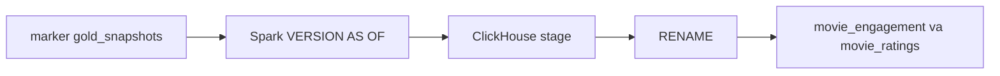

# 06 — ClickHouse serving cho Gold đã publish

**Phạm vi.** `make serving-it` lúc 2026-10-18 07:47 UTC. Log `docs/proof/logs/phase3a_clickhouse_it.json`. ClickHouse nhận Gold đã có marker `published: true` và `gold_snapshots`.

**Trong phạm vi này.** Feast và DataHub nằm ở các file sau. Dashboard đọc API ở file 07.

**Đọc tiếp.** [Tour](00_system_tour.md) · [07 — dashboard](07_analytics_dashboard.md)



ClickHouse chỉ nhận Gold đã có marker `published: true` và ba snapshot id. Job sync không gọi snapshot mới nhất của bảng khi marker không ghi id đó.

Lệnh đã chạy lúc 2026-10-18 07:47 UTC:

```bash
make serving-it:
- Chỉ kiểm tra luồng Spark đọc Iceberg → ghi vào ClickHouse an toàn.
```

Kết quả `PASS`. Log: `docs/proof/logs/phase3a_clickhouse_it.json`.

## Nguồn được dùng

PyIceberg không có trong project. Spark 3.5 đọc snapshot bằng `VERSION AS OF <snapshot_id>` trên catalog REST `cinestream`. Câu này trả đúng snapshot được chỉ, kể cả khi snapshot hiện tại của bảng đã mới hơn.

Marker Airflow nằm ở `s3://lakehouse/_orchestration/{namespace}/{batch_id}.json`. Trước phase này marker có `published`, `batch_id`, `namespaces` và quality, không có snapshot. `publish_success` giờ đọc REST và thêm `gold_snapshots` cho `dim_movies`, `fact_ratings`, `obt_movie_engagement` ngay trước khi ghi marker. Marker cũ thiếu khóa này bị sync từ chối.

Bảng Gold mà job publish thật sự ghi:

| Việc | Bảng | Cột dùng |
|---|---|---|
| Engagement theo phiên | `obt_movie_engagement` | `session_sk`, `session_date_key`, `user_id`, `subscription_tier`, `movie_id`, `title`, `content_rating`, `watch_duration_seconds`, `completion_rate`, `device_type` |
| Tóm tắt rating | `fact_ratings` join `dim_movies` theo `movie_sk` | `movie_id`, `title`, `content_rating`, `count(*)`, `avg(rating_val)` |

`feat_movie_engagement_stats_daily` không nằm trong lần ghi của `publish_silver_gold`. Spec ClickHouse có `genre`, `event_date`, `release_year` và `movie_trending_score_7d`. Các cột đó không có trên OBT đã publish, nên DDL serving không tạo chúng. Grain engagement là một dòng mỗi `session_sk`. Grain rating là một dòng mỗi `movie_id`.

## Cách phát hành

Database ClickHouse mặc định là Atomic. Sync nạp đầy đủ snapshot vào `movie_engagement_stage` và `movie_ratings_stage`, đếm dòng và khóa, rồi chạy một câu:

```sql
RENAME TABLE
    movie_engagement TO movie_engagement_old,
    movie_engagement_stage TO movie_engagement,
    movie_ratings TO movie_ratings_old,
    movie_ratings_stage TO movie_ratings
```

Người đọc chỉ truy vấn hai tên không có hậu tố `_stage`. Insert vào stage và câu `RENAME` là hai lệnh riêng. `sync_log` chỉ được insert sau `RENAME`. Cùng `batch_id` và cùng ba snapshot, với số dòng serving khớp log, lần chạy sau trả `unchanged` và không ghi thêm log.

MergeTree, `ORDER BY (movie_id, session_date_key, session_sk)` cho engagement và `ORDER BY (movie_id)` cho rating. Không dùng ReplacingMergeTree, projection hay skipping index. Xóa và sửa trên Gold được phản ánh bằng thay cả snapshot, không phải CDC.

## Kết quả

Iceberg namespace `it_ch_gold`. ClickHouse database `it_ch`. Marker dưới `_orchestration/it_ch_marker/`. Ba snapshot được ghi trước khi sync: v1, v2, rồi v3. Snapshot hiện tại của OBT khi đọc v1 là v3 `1459502348599313135`.

| Case | Expected | Actual | Status |
|---|---|---|---|
| Đọc snapshot cũ | `VERSION AS OF` v1 ra session 1, 2 trong khi current là v3 | current `1459502348599313135`, requested `652964320605388397`, dòng `[1, 2]` | PASS |
| Nạp lần đầu | Serving là v1 dù current là v3 | session 1 completion 0.5, session 2 completion 1.0. Rating movie 10 avg 4.0, movie 20 avg 5.0. Serving snapshot OBT `652964320605388397`, fact `659573280070420171`. `sync_log` 1 | PASS |
| Sync lại | Không đổi dòng, không thêm log | before và after giống nhau, log vẫn 1, status `unchanged` | PASS |
| Snapshot mới | Xóa session 2 và movie 20, sửa session 1, thêm session 3 và movie 30 | session 1 completion 0.9, session 3 completion 0.2. Rating movie 10 avg 3.0, movie 30 avg 2.0. Log 2 | PASS |
| Load lỗi rồi retry | Stage dở không lộ ra reader. Retry mới thấy session 4 | Lỗi `dừng giữa bulk load`. Reader vẫn v2, log 2, stage 1 dòng. Retry published, session `[1, 3, 4]`, log 3 | PASS |
| Marker hỏng | Thiếu file, `published` false, thiếu snapshot, snapshot 1 không tồn tại | Bốn lỗi đúng câu chữ. Reader và log giữ v3 | PASS |
| Production | Snapshot không đổi trong suite | `stg_watch_sessions` `1975472564804901513` cả hai lần. `raw_users` `7954921826504091397` cả hai lần. Hai bảng playback HTTP 404 | PASS |

Suite không ghi namespace `bronze`, `silver`, `gold`.

## Bảo đảm và giới hạn

- Đọc Iceberg theo id trong marker. Test nạp v1 khi current đã là v3 và serving nhận đúng dòng v1.
- Cùng snapshot không nhân đôi khóa. Lần hai không insert.
- Dòng bị xóa ở snapshot mới không còn trên serving. Dòng sửa đổi mang giá trị mới. Đó là hệ quả của thay cả bảng, không phải merge theo khóa.
- Insert dở nằm ở `_stage`. Hai bảng reader và `sync_log` giữ nguyên cho đến khi `RENAME` thành công.
- Không có exactly-once giữa Iceberg và ClickHouse. Nếu `RENAME` đã xong mà `sync_log` chưa ghi, lần chạy sau chỉ ghi log khi số dòng, `batch_id` và snapshot reader đã khớp marker. Nếu chưa khớp thì nạp lại. Audit `audit-20261018T082408Z` đo trường hợp này.
- Hai câu `RENAME` nối tiếp: câu đầu đưa cả hai bảng reader sang snapshot mới, câu sau trả tên `_stage`. Test không giết ClickHouse giữa hai câu đó. Nếu câu sau lỗi, reader đã ở bản mới và lần sync sau tạo lại stage.
- `publish_success` ghim snapshot REST tại thời điểm ghi marker. Một writer khác chen giữa `validate_gold` và marker có thể làm marker trỏ snapshot chưa được validate. DAG hiện `max_active_runs=1`. Phase này chưa thêm task Airflow gọi sync.
- Chưa có FastAPI, sync trending từ Flink, Feast hay DataHub.

## Phase 3B — API và task Airflow

`sync_clickhouse` đứng sau `publish_success`. Task gọi `spark-submit --master local[1]` tới `serving/clickhouse/sync_gold.py`. Đối số không có snapshot id. Id lấy từ marker. Namespace Gold `gold` ghi database `cinestream_serving`. Namespace khác ghi `it_{namespace}` để test không đè serving production. Retry của task là 1. Sync lỗi trước `RENAME` thì reader table giữ nguyên.

API `http://127.0.0.1:18083` chỉ đọc `movie_engagement`, `movie_ratings` và `sync_log`.

| Endpoint | Ý nghĩa | Tham số |
|---|---|---|
| `GET /analytics/overview` | Số phiên, tổng giây xem, số phim, số rating, trung bình có trọng số `sum(avg_rating * rating_count) / sum(rating_count)` | không |
| `GET /movies/top-rated` | `avg_rating` giảm dần, rồi `rating_count`, rồi `movie_id` | `limit` 1–100, mặc định 10. `min_rating_count` ≥ 1 |
| `GET /movies/most-watched` | `sum(watch_duration_seconds)` theo `movie_id` | `limit` 1–100, mặc định 10 |

Bảng rỗng trả 200, số 0 và `mean_rating` null. `limit=0` hoặc `limit=abc` trả 422. Hai bảng reader lệch snapshot, hoặc một bảng trộn nhiều snapshot, trả 409. ClickHouse lỗi trả 503.

Lệnh lúc 2026-10-18 08:06 UTC:

```bash
make serving-it-api:
- Kiểm tra toàn diện từ Iceberg → ClickHouse → FastAPI Endpoint (kiểm tra cả độ trễ mili-giây và khả năng phục vụ request của API).
```

Kết quả `PASS`. Log: `docs/proof/logs/phase3b_api_it.json`. Namespace `it_api_gold`, database `it_api`.

| Case | Actual | Status |
|---|---|---|
| Tham số Airflow | Production database `cinestream_serving`. Test `it_api_gold` ra `it_it_api_gold`. Không có cờ `--snapshot` | PASS |
| Rỗng và lỗi tham số | Overview session 0, rating 0, mean null. Hai list rỗng. `limit=0` và `limit=abc` là 422 | PASS |
| Publish rồi query | Current OBT là v3 `7769091751642152589`. API trả snapshot v1 `2498171074224000699` / fact `7950205731285171810`. 2 phiên, 2 rating, mean 4.5. Top rated movie 20 rồi 10. Most watched 60 giây rồi 30 giây. `published_at` `2026-10-18 08:07:06.527` | PASS |
| Độ trễ | 30 GET localhost: min 9.096 ms, p50 11.065 ms, mean 11.079 ms, max 18.679 ms | PASS |
| Sync lại | Status `unchanged`. Body API và `published_at` không đổi. `sync_log` vẫn 1 | PASS |
| Đọc trong lúc publish | 273 response, 273 mã 200 với một cặp snapshot đã publish, 0 mã 409, 0 mã 503. Sau publish, most watched là movie 10 (60 giây) và movie 30 (10 giây) | PASS |
| Sync lỗi rồi retry | Stage 1 dòng. API vẫn snapshot v2, 2 phiên. Retry trả v3, 3 phiên, khớp Iceberg | PASS |
| Marker hỏng | Bốn lỗi như phase 3A. API vẫn v3 | PASS |
| Reader bị trộn | Insert một rating snapshot lạ. Overview 409 `reader table đang trộn nhiều snapshot`. Sync lại v3 thì API về 3 phim, snapshot fact `6267605782806107594` | PASS |
| DagBag | `publish_success` → `sync_clickhouse`, retry 1, lịch `None`, không import error | PASS |
| Production | `stg_watch_sessions` `1975472564804901513` và `raw_users` `7954921826504091397` không đổi. Playback vẫn 404 | PASS |

Một lần chạy trước đó, cùng kiểu đọc song song, thấy 288 request: 287 mã 200 đúng cặp snapshot và 1 mã 503. Không có response 200 trộn hai phiên bản. `RENAME` đổi tên bảng nên một query có thể không thấy bảng trong khoảnh khắc đó.

Hai subquery của overview không nằm trong một transaction. Lần đo 273 request của Phase 3B không bắt được cửa sổ lệch. Audit sau đó bắt được một response 409 trong lúc đổi snapshot. Không có SLA. Con số ms ở trên là localhost, một process uvicorn, không phải tải production.

Scheduler đang chạy chưa được tạo lại sau khi compose thêm `CINESTREAM_CLICKHOUSE_HTTP`. Task vẫn mặc định `http://clickhouse:8123` khi biến đó trống. Tạo lại scheduler thì biến trong compose có hiệu lực. Phase này không chạy một DAG run đầy đủ và không ghi `cinestream_serving`.

## Audit Phase 3B

Lệnh lúc 2026-10-18 08:24 UTC, run `audit-20261018T082408Z`:

```bash
make serving-it-audit
```

Kết quả `PASS`. Log: `docs/proof/logs/phase3b_audit_it.json`. Namespace `it_audit_gold`, marker `it_audit_marker`, database `it_audit`. Task Airflow thực tế là `sync_clickhouse`, không có task tên `sync_gold_to_clickhouse`. Suite này không chạy một DAG run. Lần gọi lại là cùng hàm `sync_published` mà task đó sẽ chạy ở lần retry.

| Case | Actual | Status |
|---|---|---|
| Serving rỗng | `/health` 200. `/ready` 200, database `it_audit`. Overview session 0, rating 0, mean null. `/serving/status` `consistent=true`, `log_present=false`. `limit=0`, `min_rating_count=0`, `limit=abc` đều 422 | PASS |
| Marker v1, current đã là v3 | OBT yêu cầu `6572233353885733154`, fact `2754667004595226791`. Current OBT `1496508314337669748`, fact `4645742207761430257`. API trả đúng id v1. Iceberg `VERSION AS OF` và API cùng 2 phiên, 2 rating, mean 4.5. `published_at` `2026-10-18 08:24:25.460`. Sync mất 854.994 ms | PASS |
| Độ trễ API | 30 GET localhost: min 9.747 ms, p50 10.948 ms, mean 11.173 ms, max 16.295 ms | PASS |
| Stage load lỗi | Lỗi `dừng giữa bulk load`. Stage còn 1 dòng. API vẫn batch `it-audit-v1`, snapshot OBT `6572233353885733154`, 2 phiên, `published_at` không đổi | PASS |
| Reader đã đổi nhưng chưa có log | `RENAME` xong rồi lỗi `dừng trước sync_log`. `sync_log` vẫn 1 dòng. API trả v2 OBT `2395392316812492055`, fact `1948537594809302684`, batch `it-audit-v2`, 2 phiên, 70 giây, mean 2.5, `published_at` null. Status `consistent=true`, `log_present=false`. Retry status `logged` trong 604.993 ms, không thêm dòng phiên (`uniqExact(session_sk)=2`). `published_at` `2026-10-18 08:24:27.923`. Lần gọi thứ ba `unchanged`, log vẫn 2 dòng. Iceberg v2 cũng là 2 phiên và 2 rating | PASS |
| Đọc trong lúc v2 sang v3 | 258 response: 257 mã 200 đúng một cặp đã publish, 1 mã 409, 0 mã 200 trộn snapshot, 0 mã 500. Sau đó API là v3 OBT `1496508314337669748`, fact `4645742207761430257`, 3 phiên, 75 giây, mean 3.1666..., `published_at` `2026-10-18 08:24:29.507` | PASS |
| Ép hai reader lệch | Insert rating snapshot `1`, batch `torn`. Overview và top-rated 409 `reader table đang trộn nhiều snapshot`. Status 200, `consistent=false`, 3 dòng engagement và 4 dòng ratings. Sync lại v3 thì status `consistent=true`, fact `4645742207761430257`, 3 dòng ratings, `published_at` `2026-10-18 08:24:30.401` | PASS |
| ClickHouse tắt | Process API vẫn `/health` 200. `/ready`, overview, status và most-watched trả 503 `Connection refused` | PASS |
| Hợp đồng retry Airflow | DagBag: task `sync_clickhouse`, `retries=1`, đứng sau `publish_success`, lịch `None`, không import error. Biến `CINESTREAM_CLICKHOUSE_HTTP` trong scheduler đang chạy vẫn trống | PASS |
| Production | `stg_watch_sessions` `1975472564804901513` và `raw_users` `7954921826504091397` không đổi. Playback vẫn 404 | PASS |

### Bảo đảm đã đo

- Sync chỉ đọc snapshot ghi trong marker. Current v3 không được thay cho v1.
- Lỗi bulk load trước `RENAME` giữ nguyên reader và `published_at`.
- `RENAME` bốn bảng là một câu trên database Atomic. Câu đó đổi hai reader cùng lúc hoặc không đổi. Test không giết ClickHouse giữa câu `RENAME` và câu trả tên `_stage`.
- Nếu reader đã mang đúng snapshot, đúng `batch_id` và đúng số dòng nhưng log chưa có, retry chỉ `INSERT` vào `sync_log`. Không `RENAME` lần nữa và không nhân đôi `session_sk`.
- Cùng marker đã có đúng một dòng log thì lần sau là `unchanged`.
- Một response 200 của overview là một `batch_id` và mỗi reader chỉ có một snapshot. Hai subquery không phải một transaction: 1/258 request trong lúc đổi v2 sang v3 trả 409, không trả 200 trộn hai phiên bản.
- Khi một reader bị insert thêm snapshot lạ, overview trả 409. `/serving/status` vẫn 200 và đặt `consistent=false`.

### Giới hạn còn lại

- Không chứng minh exactly-once. Khoảng giữa `RENAME` và `sync_log` đã được thử: reader đã là snapshot mới, `published_at` null cho đến khi retry ghi log. Dữ liệu cũ không còn trên reader sau `RENAME` thành công.
- Không chứng minh publication nhiều bảng là atomic ở tầng API. Một request có thể 409 trong lúc đổi tên.
- Scheduler đang chạy nhận `CINESTREAM_CLICKHOUSE_HTTP` từ compose / mặc định `http://clickhouse:8123`.
- `cinestream_serving` chưa được nạp từ một DAG production. `CINESTREAM_ALLOW_PRODUCTION` vẫn tắt (`false`).
- Độ trễ là localhost, một process uvicorn. Không có SLA.
- Feast và DataHub chưa có. Sync trending Flink nằm ở Phase 3C bên dưới.

## Tích hợp E2E Airflow DAG sang ClickHouse với dữ liệu thật (Phase 3B Final)

Lệnh thực thi lúc 2026-10-18 09:17 UTC:

```bash
make airflow-it-real
```

Kết quả: **100% PASS** (6/6 test cases đạt).
Log: `docs/proof/logs/phase2_real_source_it.json`.

### 1. Chi tiết thực thi DAG Run thật

| DAG Run ID | Kịch bản / Namespace | Iceberg Gold Snapshots | ClickHouse Database & Bảng | Trạng thái DAG & Task |
|---|---|---|---|---|
| `manual__2026-10-18T09:17:33.303012+00:00` | `it_af_badts` (Schema xấu) | Không có snapshot | Không đồng bộ sang ClickHouse | DAG `failed`, `spark_raw_to_bronze` `failed`, `sync_clickhouse` `upstream_failed` |
| `manual__2026-10-18T09:18:31.564248+00:00` | `it_af_real` (Nguồn dữ liệu thật) | OBT: `8217522651042961507`<br>Fact Ratings: `1073738621869077082`<br>Dim Movies: `5980204342899361920` | Database: `it_it_af_real`<br>`movie_engagement`: 662,830 dòng<br>`movie_ratings`: 100 dòng<br>`sync_log`: 1 dòng (`published_at`: 2026-10-18 09:21:50) | DAG `success`, 7/7 tasks `success` (`check_source_ready` $\rightarrow$ `spark_raw_to_bronze` $\rightarrow$ `validate_bronze` $\rightarrow$ `spark_bronze_to_gold` $\rightarrow$ `validate_gold` $\rightarrow$ `publish_success` $\rightarrow$ `sync_clickhouse`) |
| `manual__2026-10-18T09:22:14.348085+00:00` | `it_af_real` (Rerun cùng dữ liệu) | Giữ nguyên snapshot | Số dòng không đổi, không trùng lặp | DAG `success`, Bronze không tạo thêm snapshot |
| `manual__2026-10-18T09:24:24.266744+00:00` | `it_af_real_retry` (Mô phỏng task retry) | OBT: `7125639931821595014`<br>Fact Ratings: `304604690625308369`<br>Dim Movies: `3393345693570041906` | Database: `it_it_af_real_retry`<br>`movie_engagement`: 662,830 dòng<br>`movie_ratings`: 100 dòng<br>`sync_log`: 1 dòng (`published_at`: 2026-10-18 09:28:03) | DAG `success`, `bronze_try=2`, `sync_clickhouse` `success`, không nhân đôi dữ liệu |

### 2. Xác thực tính nhất quán giữa Iceberg Marker, ClickHouse và FastAPI

- **Marker S3 (`s3://lakehouse/_orchestration/it_af_real/batch-a3f18e1ea671765052443d7ef5608212.json`)**:
  - Ghi nhận `published: true` cùng bộ 3 snapshot: `obt_movie_engagement`: 8217522651042961507, `fact_ratings`: 1073738621869077082, `dim_movies`: 5980204342899361920.
- **ClickHouse Serving (`it_it_af_real`)**:
  - Bảng `sync_log` khớp chính xác 100% các snapshot IDs và `batch_id` từ marker.
  - Số dòng engagement: 662,830; số dòng rating: 100.
- **FastAPI Endpoints (`CINESTREAM_CLICKHOUSE_DATABASE=it_it_af_real`)**:
  - `/health` $\rightarrow$ `200 OK`
  - `/ready` $\rightarrow$ `200 OK` (database `it_it_af_real`)
  - `/serving/status` $\rightarrow$ `200 OK`, `consistent: true`, `log_present: true`, `detail: null`
  - `/analytics/overview` $\rightarrow$ `200 OK`: `session_count: 662830`, `rating_count: 57665`, `watched_movie_count: 100`, `rated_movie_count: 100`, `mean_rating: 3.7678` (tính đúng trung bình có trọng số)
  - `/movies/top-rated` $\rightarrow$ `200 OK`: Top 1 movie 63 (`avg_rating`: 4.05488, 82 ratings), movie 71 (`avg_rating`: 4.05, 90 ratings)
  - `/movies/most-watched` $\rightarrow$ `200 OK`: Top 1 movie 42 (`watch_seconds`: 2,628,418,172, 504,009 sessions)
- **Bảo toàn Production**:
  - `cinestream_serving` trong ClickHouse: 0 dòng.
  - Các snapshot bảng production trong Iceberg REST: 100% không đổi (`unchanged: true`).

## Sẵn sàng cho Phase 3C

Phase 3B đã hoàn tất và được nghiệm thu toàn diện:
1. DAG Airflow tự động chạy `sync_clickhouse` ngay sau khi `publish_success` ghi marker.
2. Dữ liệu thật hơn 1 triệu bản ghi từ MinIO đã qua Lakehouse Bronze $\rightarrow$ Silver $\rightarrow$ Gold và đồng bộ thành công sang ClickHouse Serving thông qua atomic swap table.
3. FastAPI phục vụ chuẩn xác dữ liệu analytics từ ClickHouse.
4. Quá trình rerun và retry được chứng minh idempotent, an toàn, không nhân đôi bản ghi.
5. Production hoàn toàn cách ly. Phase 3C bên dưới phục vụ cửa sổ Flink. Feast và DataHub vẫn chưa làm.

## Phase 3C — trending từ cửa sổ Flink

Git HEAD lúc đo: `c5e4fda37d6abbe8417f995c38a58202a9760d9a`. Job Flink trong HEAD chỉ có tumbling 1 phút, khóa `(movie_id, window_start)`, Iceberg format v2, `write.upsert.enabled=true`. Checkpoint mặc định 10 giây, mode exactly-once trên từng sink. Bảng production `silver.stg_playback_windows` và `silver.stg_playback_heartbeats` vẫn HTTP 404. Các bảng `it_p2_*` cũ không được dùng làm nguồn serving.

ClickHouse dùng MergeTree và thay cả snapshot cửa sổ. ReplacingMergeTree không xóa một khóa đã biến mất trước khi merge. Đọc Iceberg bằng Spark `VERSION AS OF`, nên equality-delete được áp dụng. Sync Gold không đổi. Worker poll mặc định 30 giây, không giữ offset riêng.

`GET /movies/trending?window_minutes=15&limit=10` cộng các phút đã đóng tính từ `max(window_end)` trong snapshot đang phục vụ. Đó là event time, không phải đồng hồ tường. `peak_minute_unique_viewers` là `max(active_users)` của một phút.

Lệnh lúc 2026-10-18 09:57 UTC:

```bash
make serving-it-trending
```

Kết quả `PASS`. Log: `docs/proof/logs/phase3c_trending_it.json`. Job `36f9601f13edf5fe521fdb565d7ccfa8`. Topic `it.p2.trending.heartbeat`. Bảng `cinestream.silver.it_p2_trending_windows`. Database `it_trend`.

| Case | Actual | Status |
|---|---|---|
| Nguồn | Graph có `tumbling-1m`, không có sliding. Bảng chưa commit trả `source_empty`. Tên không tồn tại trả `source_absent`. Thuộc tính Flink `format-version=2`, `write.upsert.enabled=true` | PASS |
| Snapshot đầu | `966306104943318944`, overwrite, checkpoint 1. Movie 42: 4 heartbeat, 40 giây, 4 user. Movie 7: 1 / 10 / 1. Spark `VERSION AS OF`, ClickHouse và API cùng các số đó. `synced_at` `2026-10-18 09:57:32.512` | PASS |
| Late firing | Heartbeat tại 5 giây sửa cùng cửa sổ phút 0. Snapshot mới `2568675253272259454`. Movie 42 thành 5 / 50 / 5. Summary `total-equality-deletes=3`, `added-equality-deletes=1`, delete file content 2 có 3 record. Data file 3 record, đọc logic còn 2 dòng. Lần sync sau `unchanged` | PASS |
| Hai cửa sổ, lỗi rồi retry | Snapshot `1269177176000162692`, 3 khóa. Movie 42 có phút 0 (5/50/5) và phút 1 (3/30/3). `fail_after_rows=1` để stage 1 dòng, API vẫn snapshot cũ. Retry khớp Iceberg. `window_minutes=15` ra movie 42: 8 heartbeat, 80 giây, peak 5, rồi movie 7: 1/10/1. `window_minutes=1` chỉ còn phút mới 3/30/3. `limit=1` lấy movie 42. `window_minutes=0` là 422 | PASS |
| Lỗi kết nối và bảng rỗng | Poll tới cổng đóng trả `retry`. Lần sau `unchanged`. Bảng Iceberg không có snapshot trả `source_empty`, 0 dòng | PASS |
| Production | `stg_watch_sessions` `1975472564804901513`. `raw_users` `7954921826504091397`. Hai bảng streaming production vẫn 404. Offset `movie.playback.heartbeat` 208 / 229 / 163 | PASS |

### Độ tươi đã đo

Hai mẫu, từ lúc gửi heartbeat đến lúc API thấy snapshot mới. Checkpoint job là 10 giây. Không có SLA.

| Mẫu | Event → Iceberg visible | Iceberg → sync xong | Sync → API | Event → API |
|---|---|---|---|---|
| Cửa sổ đầu | 8.484 s | 0.381 s | 0.102 s | 8.967 s |
| Late firing | 6.937 s | 0.959 s | 0.023 s | 7.919 s |

`latest_window_end` trên API là cuối cửa sổ event time (`1970-01-01 00:01:00` rồi `00:02:00`), không phải giờ sync. `synced_at` là lúc ClickHouse ghi log.

### Bảo đảm

- Một dòng serving cho mỗi `(movie_id, window_start)` của snapshot đã sync. Late firing sửa dòng cũ, không thêm khóa.
- Cùng snapshot và cùng số dòng thì lần sau không insert.
- Lỗi giữa bulk load giữ reader cũ.
- Không có exactly-once từ Kafka qua Iceberg tới ClickHouse. Mỗi sink Flink commit theo checkpoint của sink đó. Sync ClickHouse là một lần đọc snapshot sau đó.

### Giới hạn

- Thay cả snapshot mỗi 30 giây. Đủ cho dữ liệu coursework. Chưa đo bảng cửa sổ lớn.
- `window_minutes` nhìn từ cửa sổ mới nhất trong ClickHouse. Bảng cũ vẫn trả các phút cuối của dữ liệu đã sync. Độ trễ tường nằm ở `synced_at` và `latest_window_end`.
- Chưa chạy worker poll 30 giây liên tục trên `stg_playback_windows` vì bảng production chưa tồn tại.
- Chưa có Feast hay DataHub.

## Phase 3D — sẵn sàng vận hành, chưa bật production

`make stream-job-run` và `make serving-trending-sync` dừng ở `stream-job-approve` / `serving-trending-approve` khi `CINESTREAM_ALLOW_STREAMING` không phải `true`. Job trong container cũng từ chối topic `movie.playback.heartbeat`, bảng `stg_playback_windows` và database `cinestream_serving` nếu thiếu cờ. `make stream-job-stop` chỉ hủy job tên `heartbeat_window_job`. Worker production là process foreground, dừng bằng Ctrl-C. Checkpoint Flink nằm ở `file:///opt/flink/checkpoints`, RocksDB incremental, barrier 10 giây, exactly-once từng sink, restart fixed-delay 10 lần, mỗi lần 5 giây.

Lệnh lúc 2026-10-18 10:37 UTC:

```bash
make serving-it-ops
```

Kết quả `PASS`. Log: `docs/proof/logs/phase3d_ops_it.json`. Job `dbeee376f0c7080047df41be959c3f48`. Topic `it.p2.ops.heartbeat`. Database `it_ops`. Không có job Flink còn chạy sau suite.

| Case | Actual | Status |
|---|---|---|
| Chặn production | `make stream-job-approve` và `make serving-trending-approve` thoát lỗi. Guard từ chối `stg_playback_windows` + `cinestream_serving` | PASS |
| Chưa có snapshot | Poll `source_empty` trong 2784.598 ms. API `freshness=empty`, `live=false`, `polled_at` `2026-10-18 10:37:31.018` | PASS |
| Restart Flink | Checkpoint 1, 72473 byte, 1089 ms, `file:/opt/flink/checkpoints/dbeee376f0c7080047df41be959c3f48/chk-1`. Kill TaskManager, checkpoint 2 fail, job restore checkpoint 1 (`restored=1`). Cửa sổ vẫn movie 42: 4 heartbeat, 40 giây, 4 user. Không trùng khóa | PASS |
| Freshness | Snapshot `4170838517602196879`, `synced_at` `2026-10-18 10:37:55.074`, `polled_at` `2026-10-18 10:37:55.459`. Event time `1970-01-01 00:01:00` nên `freshness=idle`, `live=false`. Ngưỡng 0 giây thì cùng dữ liệu là `stale`, vẫn trả item, `live=false`. `/serving/status` cùng nhãn | PASS |
| Poll 5 giây | Poll lúc 5.347 s còn snapshot cũ. Poll lúc 11.634 s publish snapshot `8285505771515738282` trong 1283.047 ms. API thấy 5 heartbeat, 50 giây, peak 4. `sync_log` 2 dòng, 2 khóa. Các poll `unchanged` không thêm dòng | PASS |
| Worker process mới | Hai lần `--once` đều `unchanged`, cùng snapshot `8285505771515738282`, 2 dòng, `elapsed_ms` 5863.389 rồi 5377.457 | PASS |
| Lỗi kết nối | Worker tới cổng đóng trả `retry` và không ghi được status. API trỏ ClickHouse tắt trả 503. Dòng status `retry` làm API `freshness=sync_failed`, `live=false`, item vẫn là snapshot `8285505771515738282` | PASS |
| Production | `stg_watch_sessions` `1975472564804901513`. Hai bảng playback vẫn 404. Offset heartbeat 208 / 229 / 163 | PASS |

Sync một dòng mất 346.784 ms. `ru_maxrss` của process test trước và sau sync đó đều `60473344` byte, khoảng 57.7 MiB trên macOS. Đây là đỉnh của cả session Spark, không phải mức tăng riêng của lần sync, và không phải sức chứa production.

Một lần chạy trước, heartbeat muộn ngay sau restore không thành snapshot mới trong 45 giây poll. Lần PASS đóng cửa sổ phút kế tiếp sau restore. Restart giữ cửa sổ đã commit. Phép đo 11.634 giây là cửa sổ phút mới, gồm một nhịp poll 5 giây.

### Bảo đảm

- Production không được submit hoặc poll nếu thiếu `CINESTREAM_ALLOW_STREAMING=true`.
- `live=true` chỉ khi poll và `latest_window_end` đều nằm trong `CINESTREAM_TRENDING_STALE_SECONDS` (mặc định 180). Dữ liệu cũ là `idle` hoặc `stale`, không phải trending sống.
- `empty` là chưa có cửa sổ. `sync_failed` là poll cuối `retry` hoặc bảng nguồn vắng. ClickHouse tắt thì API 503.
- Cùng snapshot thì restart worker không thêm khóa và không thêm `sync_log`.

### Giới hạn

- Không có SLA. Mẫu poll 5 giây cho 11.634 giây tới API. Mặc định production là 30 giây và chưa được bật.
- Không có exactly-once từ Kafka tới ClickHouse.
- `ru_maxrss` không tách được bộ nhớ của một lần đọc snapshot khỏi phần còn lại của process.
- Late firing ngay sau restore được giải thích ở Phase 3E: event còn trong allowed lateness nhưng chưa thành snapshot cho đến khi watermark được dựng lại.

## Phase 3E — độ bền checkpoint và poll 30 giây

Lệnh đã chạy lúc 2026-10-18 11:30 UTC:

```bash
make serving-it-reliability
```

Kết quả `PASS`. Log: `docs/proof/logs/phase3e_reliability_it.json`. Topic `it.p2.e2e.heartbeat`, bảng `cinestream.silver.it_p2_e2e_windows`, database `it_e2e`. `CINESTREAM_ALLOW_STREAMING` không được bật.

Checkpoint nằm ở `file:///opt/flink/checkpoints` trên volume `flink_checkpoints`. Retention là `RETAIN_ON_CANCELLATION`. `make stream-down` là `docker compose down` không có `-v`, nên volume còn. `make stream-checkpoints` liệt kê thư mục đó.

| Case | Quan sát | Kết quả |
|---|---|---|
| TaskManager chết | Job `04924e51e1e915c95ab8c67273dc88b6`, chk-1 `73564` byte, `1208` ms, path `file:/opt/flink/checkpoints/04924e51e1e915c95ab8c67273dc88b6/chk-1`. `docker kill` rồi `docker start` cùng container `ec8bbb52aaa6`. Checkpoint 2 fail, `state_size` 0. Restore từ chk-1, cửa sổ vẫn `(42, 0, 4, 40, 4)` | PASS |
| Tạo lại container TaskManager | Container mới `a7e0313b8a6b`. Thư mục chk-1 còn trên volume. Job tự restore, `restored` tăng lên 2. Cửa sổ không đổi | PASS |
| Tạo lại JobManager và TaskManager | Sau late correction, checkpoint giữ là chk-10. Hai container mới `e8f3db940052` và `56fd20bd6e32`. Resume `flink run -s file:///opt/flink/checkpoints/04924e51e1e915c95ab8c67273dc88b6/chk-10`, job `a05b000ebab04ad39c863f10e033c9fb`. Sau 20 giây snapshot vẫn `5011724867583439986`, dòng vẫn `(42, 0, 5, 50, 5)` | PASS |
| Late event sau restore | Snapshot `8356761271653026126` không đổi từ 0.116 s đến 45.121 s. DLQ không có heartbeat 6. Event 75 s dựng watermark `59999`. Sau 9.963 s Iceberg thành `(42, 0, 5, 50, 5)` | PASS |
| Poll cùng snapshot | Worker không truyền `--interval-seconds`. Default là 30. Kỳ start-to-start `29.996` s. Publish snapshot `5011724867583439986` trong `6703.009` ms, lần sau `unchanged` trong `1146.964` ms. 1 khóa, 1 dòng, 1 `sync_log` | PASS |
| Snapshot mới | Event → Iceberg `7.237` s. Iceberg → poll `21.958` s. Poll → API `0.166` s. Event → API `29.361` s. Snapshot `4517552679501749559`, sync `408.046` ms. API `idle`, `live=false`, 2 khóa, 2 `sync_log` | PASS |
| Restart và ClickHouse tắt | Process mới `unchanged` trong `5624.311` ms, `sync_log` vẫn 2. `docker compose stop clickhouse` làm poll `retry` với `Connection refused`. API 503. Sau `start`, poll `unchanged` trong `379.929` ms, không sync tay, vẫn 2 khóa và 2 `sync_log` | PASS |
| Production | `stg_watch_sessions` `1975472564804901513`. Hai bảng playback vẫn 404. Offset heartbeat 208 / 229 / 163, deadletter 0 / 0 / 0 | PASS |

Job resume đã bị cancel sau suite. Không còn job Flink đang chạy.

### Late event sau restore

Closer tại 80 s cho watermark `80000 - 15000 - 1 = 64999`. Cửa sổ `[0, 60s)` đóng vì `64999 >= 59999`. Cleanup là `74999`, nên event tại 5 s vẫn trong allowed lateness. Cổng recovery không đưa nó vào DLQ. Generator watermark không giữ max timestamp trong checkpoint, nên sau restore watermark sống không còn đủ để phát lại cửa sổ. Event nằm trong state. Nó chỉ thành snapshot khi event 75 s đưa watermark về `59999`. Đây là cửa sổ chưa phát, không phải event bị rơi. Kích thước cửa sổ và allowed lateness không đổi.

### Độ trễ đã đo

Ba mẫu event → Iceberg, mỗi mẫu là cận trên vì vòng đọc Spark 3 giây: `14.190`, `9.963`, `7.237` giây. Một mẫu đường đầy đủ, worker đang ngủ theo interval 30 giây: Iceberg → ClickHouse `21.958` s, ClickHouse → API `0.166` s, event → API `29.361` s. `n` của đường đầy đủ là 1. Không dùng các số này làm SLA.

`elapsed_ms` của các lần sync sau khi Spark đã lên: `6703.009`, `1146.964`, `408.046`, `5624.311`, `379.929`. `ps` RSS của process Python worker là `26544`, `26784` và `34880` KB. Số này không gồm JVM Spark con, nên không phải bộ nhớ của một lần đọc snapshot.

### Lệnh vận hành

```bash
make stream-up
make stream-checkpoints
make stream-down
make stream-job-stop
make serving-trending-sync
```

`stream-down` giữ volume. `stream-job-stop` hủy job heartbeat và không đổi offset Kafka. JobManager tạo lại thì job đang chạy mất; checkpoint còn trên volume và resume bằng `flink run -s file:///opt/flink/checkpoints/<job>/chk-N` với cùng tham số job. Mục tiêu production vẫn phải qua `make stream-job-approve` và `make serving-trending-approve`. Poll production dùng interval mặc định 30 giây khi không đặt `CINESTREAM_TRENDING_INTERVAL_SECONDS`.

### Rủi ro còn lại trước khi bật production

- Checkpoint chỉ bền trên volume Docker local. `docker compose down -v` hoặc xóa volume làm mất checkpoint. Không có bản sao trên S3.
- JobManager không giữ job trong volume. Tạo lại JobManager cần resume tường minh từ checkpoint đã giữ.
- Restart strategy là 10 lần, mỗi lần 5 giây. TaskManager mất lâu hơn khoảng đó thì job fail dù file checkpoint còn.
- Event còn trong allowed lateness sau restore không thành snapshot Iceberg cho đến khi một event sau dựng lại watermark. Nếu không có event mới, correction nằm trong state và ClickHouse không thấy.
- Một nhịp poll 30 giây cộng checkpoint khoảng 10 giây là độ trễ lịch, không phải thời gian ghi ClickHouse. Mẫu đầy đủ chỉ có một lần, `29.361` giây.
- Chưa có exactly-once từ Kafka tới Iceberg rồi tới ClickHouse.
- Suite này ngắt ClickHouse. Catalog Iceberg REST không bị pause vì sqlite nằm trong container.
- Volume đang chứa checkpoint của nhiều job cũ. `stream-down` không dọn các thư mục đó.
- Cửa sổ epoch 1970 là `idle` so với đồng hồ tường. `live=true` chưa được thấy trên dữ liệu này, và đó là nhãn đúng.

## Dừng trước streaming production

`CINESTREAM_ALLOW_STREAMING` vẫn tắt. `make stream-job-run` và `make serving-trending-sync` không chạy mục tiêu production trong suite này. Feast, DataHub và Redis không được thêm.
