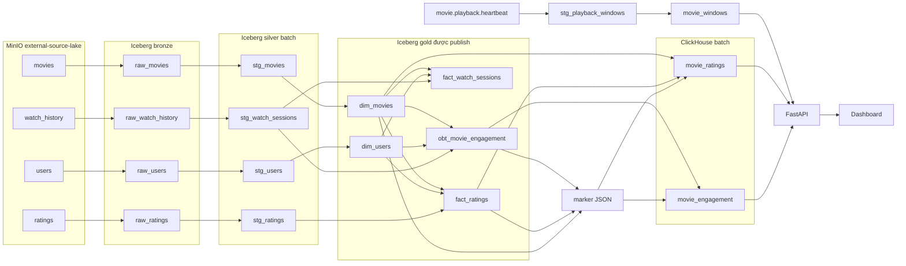

# 08 — Data governance và lineage

**Phạm vi.** Đọc code tại Git `4e90eda`. Lệnh `make governance-check` và `python -m governance.audit_readonly`. Không ghi Iceberg, Kafka hay ClickHouse.

**Trong phạm vi này.** Câu không có DataHub đúng với commit `4e90eda`. Bản chiếu DataHub nằm ở file 20. Inventory trong `governance/inventory.py` vẫn là catalog gốc.

**Đọc tiếp.** [Tour](00_system_tour.md) · [09 — quan sát](09_governance_observability.md)

Inventory này đọc code tại Git `4e90eda` và đối chiếu bằng lệnh chỉ đọc. Câu “không có DataHub” đúng với commit đó. Source hiện có `governance/datahub/emit.py` và `infra/compose/docker-compose.datahub.yml`. Catalog gốc vẫn là `governance/inventory.py`. DataHub chỉ là bản chiếu, ghi ở [20_datahub_lineage.md](20_datahub_lineage.md). Lần đọc này không ghi Iceberg, Kafka hay ClickHouse.

```bash
make governance-check
PYTHONPATH=. uv run python -m governance.audit_readonly
```

`make governance-check` chạy `tests/governance/test_lineage.py`. Kết quả: 6 test, OK. Audit REST và ClickHouse ghi ở `docs/proof/logs/phase5a_governance_audit.json`.

Ba lớp trạng thái được tách riêng:

- **Đã kiểm từ code.** Có writer hoặc reader trong job hiện tại, và test bắt file evidence phải chứa token đó.
- **Mới khai báo.** DDL có bảng, `publish()` không ghi.
- **Writer bị chặn.** Code Flink và poll trending có writer, nhưng `CINESTREAM_ALLOW_STREAMING` chưa bật và bảng production chưa tồn tại.
- **Integration.** Namespace `it_*`, bảng tên `it_*`, database ClickHouse `it_*`, topic `it.*`. Inventory không nối chúng vào endpoint production.

## Lineage đã kiểm



`obt_movie_engagement` được chiếu từ cùng join đã dựng `fact_watch_sessions`. Sync không đọc lại bảng fact watch. `dim_users` không bị `sync_gold` đọc trực tiếp. `subscription_tier` trên OBT là bản SCD đúng thời điểm phiên xem. Movie trên fact và OBT là bản `is_current`.

Nhánh streaming dừng ở code: topic heartbeat cũng append `stg_playback_heartbeats` và JSON quá cleanup sang `movie.playback.deadletter`. Poll ClickHouse chỉ đọc `stg_playback_windows`. Bảng heartbeat không có consumer serving.

`feat_user_movie_stats_daily` và `feat_movie_engagement_stats_daily` không có cạnh. DAG `cinestream_daily_batch_lakehouse` gọi `sync_clickhouse`, không gọi `sync_windows`.

## Sở hữu

| Dataset | Owner trong code | Cách ghi |
|---|---|---|
| Parquet `users`, `movies`, `ratings`, `watch_history` | `generator.offline_generator` | append file |
| `raw_*` | `ingest_to_bronze`, task `spark_raw_to_bronze` | append file mới theo `_file_id` |
| `quarantine_records` | `validators.replace_quarantine` | xóa đúng dataset và batch_id rồi ghi lại |
| `quality_results` | `validators.upsert_quality` | MERGE theo dataset, batch_id |
| `stg_*` batch, `dim_*`, `fact_*`, `obt_movie_engagement` | `publish_silver_gold`, task `spark_bronze_to_gold` | thay cả snapshot khi dòng khác |
| Marker `s3a://lakehouse/_orchestration/...` | task `publish_success` | overwrite JSON của batch |
| `movie_engagement`, `movie_ratings`, `sync_log` | `sync_gold`, task `sync_clickhouse` | stage rồi RENAME; log thì append |
| Topic heartbeat và hai bảng `stg_playback_*` | `heartbeat_window_job` | append heartbeat, upsert cửa sổ |
| `movie.playback.deadletter` | cùng job Flink | append JSON |
| `movie_windows`, `trending_sync_log`, `trending_worker_status` | `sync_windows` | thay snapshot cửa sổ; log và status thì append |
| Bảy route FastAPI | `serving.api.app` | read |
| Dashboard | `serving.dashboard` | read FastAPI |

Chưa có owner là một người. Owner ở đây là component.

## Hợp đồng và độ tươi

Khóa nghiệp vụ lấy từ `DatasetContract` và từ grain của job, không lấy từ comment DDL khi hai bên khác nhau.

| Lớp | Khóa | Quy tắc đang chạy | Độ tươi |
|---|---|---|---|
| Users, movies | `user_id`, `movie_id` | Thiếu cột bắt buộc thì reject cả file | Sensor chờ đủ bốn folder. Không có SLA giờ |
| Ratings Bronze | `rating_id` | `rating_val` trong [0.5, 5.0], khóa ngoại user và movie, ngưỡng lỗi dòng 5% | Append file mới |
| Ratings Silver | `(user_id, movie_id, rating_val)` | Giữ `rating_ts` mới nhất | Khác khóa Bronze. Hai rating khác `rating_id` vẫn có thể bị gộp |
| Watch Bronze | `session_id` | duration không âm, completion trong [0, 1] | Append file mới |
| Watch Silver | `(user_id, movie_id, watch_duration_seconds)` | Giữ `start_ts` mới nhất | Khác khóa `session_id` |
| `dim_users` | `user_id` cộng khoảng hiệu lực | Đúng một bản hiện tại, khoảng không chồng | Fact user lấy bản chứa thời điểm sự kiện |
| `dim_movies` | `movie_id` cộng khoảng hiệu lực | Fact chỉ join `is_current` | Lịch sử phim không đi vào fact |
| Fact | `rating_sk` = `rating_id`, `session_sk` = `session_id` | Số dòng fact bằng Silver | Cùng lần publish |
| ClickHouse batch | `session_sk`, `movie_id` | Một snapshot mỗi reader, hai reader cùng batch, nếu không thì API 409 | `published_at` là lúc sync |
| Heartbeat | `heartbeat_id` | Dedup TTL processing time 1 giờ | Trần state, không phải SLA |
| Cửa sổ | `(movie_id, window_start)` | Tumbling 1 phút, trễ cho phép 15 giây | `live` chỉ khi poll và event time cùng trong 180 giây |
| Dashboard | không có khóa riêng | Không tự tính metric | Refresh 30 giây là lịch UI |

Producer heartbeat còn gửi `bitrate_kbps` và `playback_speed`. Job không ghi hai field đó. `watch_duration_seconds` trên bảng heartbeat là delta của một nhịp, không phải vị trí seek.

## Những gì đang có trên cụm

Đọc REST `127.0.0.1:8181` và ClickHouse `127.0.0.1:18123` lúc audit. Chỉ SELECT và GET.

Bronze, Silver batch và Gold publish đều có snapshot. Hai bảng feature có snapshot `-1`. `silver.stg_playback_heartbeats` và `silver.stg_playback_windows` trả HTTP 404.

`cinestream_serving` không có part active. Bản batch đã sync của nguồn thật nằm ở database integration `it_it_af_real`: `movie_engagement` 662830 dòng, `movie_ratings` 100, `sync_log` 1. Cửa sổ demo nằm ở `it_e2e`: `movie_windows` 2 dòng. Đó không phải production serving.

Ngoài `bronze`, `silver`, `gold` còn 10 namespace `it_*`. Bên trong chính namespace `silver` có 65 bảng tên `it_*`.

## Lệch schema đã thấy

Parser so cột DDL cộng cột writer với schema REST:

- `silver.stg_ratings` và `silver.stg_watch_sessions` có thêm cột `dt`. `stg_tables.sql` và `publish()` hiện không ghi cột này. `dt=` trên MinIO chỉ là thư mục ngày của file nguồn.
- Bronze có thêm `_batch_id` và `_file_id` so với `raw_tables.sql`. Hai cột này có trong `ingest_to_bronze.py`, nên không tính là cột lạ.

## Khoảng trống

1. Hai bảng feature được `execute_zone` tạo ra nhưng không có writer. `movie_trending_score_7d` và các cột Feast chưa phải metric của dashboard. Feast không được cài.
2. Streaming production chưa được submit. Lineage Kafka tới Iceberg tới ClickHouse là code, chưa phải bảng production.
3. DAG batch không poll cửa sổ. Trending và batch là hai lịch khác nhau.
4. Bảng integration nằm chung namespace `silver` với bảng production. Catalog không tách vật lý.
5. Cột `dt` trên hai bảng Silver là drift so với code hiện tại. Lần overwrite sau có thể đổi schema vật lý.
6. Lịch sử SCD của `dim_users` không được phục vụ ngoài `subscription_tier` đã gắn vào OBT.
7. Quarantine và quality không có route. Dashboard không thấy dòng bị loại.
8. Checkpoint Flink là exactly-once từng sink. Kafka, Iceberg và ClickHouse không chung một transaction.
9. `cinestream_serving` vẫn trống. Không được copy `it_it_af_real` hay `it_e2e` vào đó để làm cho dashboard production có số.

## Bước tiếp theo

Giữ inventory này làm nguồn lineage cho đến khi có writer thật cho feature. Trước DataHub, nên xử lý cột `dt`, đưa bảng `it_*` ra khỏi namespace `silver`, và quyết định poll trending có vào DAG hay vẫn là lệnh riêng sau khi bật streaming. Chưa bật `CINESTREAM_ALLOW_PRODUCTION` hay `CINESTREAM_ALLOW_STREAMING` từ báo cáo này.
