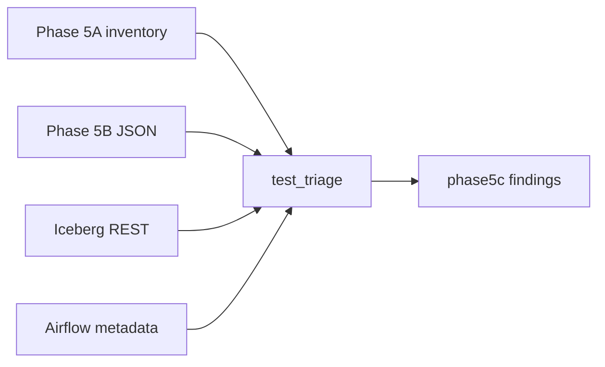

# 10 — Phân loại finding governance

**Phạm vi.** Phase 5C, cùng Git `4e90eda`. Unittest lineage, observe, triage. Log `docs/proof/logs/phase5c_triage.json`. Run production `manual__2026-10-18T06:26:38+00:00`.

**Trong phạm vi này.** Không ALTER, không DROP, không sync production, không bật streaming, không điền snapshot id.

**Đọc tiếp.** [Tour](00_system_tour.md) · [11 — hợp đồng schema](11_schema_contract_validation.md)



Phase 5C đọc Git `4e90eda009a4498c198fa399f9c75c47919eee86`, inventory Phase 5A, báo cáo Phase 5B, REST Iceberg và metadata DAG Airflow. Không ALTER, không DROP, không sync production, không bật streaming, không điền snapshot id.

```bash
PYTHONPATH=. uv run python -m unittest tests.governance.test_lineage tests.governance.test_observe tests.governance.test_triage
```

33 test, OK. Bằng chứng live rút gọn ở `docs/proof/logs/phase5c_triage.json`.

Inventory chỉ sửa một câu freshness của `minio.orchestration_marker`: sync đọc `gold_snapshots` và từ chối marker thiếu khóa này. Không thêm hoặc xóa cạnh lineage.

## Cách đọc tám lệch schema

Tám bảng đều một schema-id `0`. Không có lần đổi schema.

`writeTo().create()` ngày 16/10 ghi schema của DataFrame, cột optional. `execute_zone()` chạy `CREATE TABLE IF NOT EXISTS`, nên DDL `NOT NULL` và `PARTITIONED BY` không sửa bảng đã có.

`same_rows()` so `spark.table(table).select(*frame.columns)`. Cột chỉ có trên bảng vật lý, như `dt`, không làm hai phía khác nhau. Overwrite ngày 18/10 của `dim_users`, `fact_ratings`, `fact_watch_sessions` và `obt_movie_engagement` giữ schema-id `0`: snapshot đầu `append`, snapshot sau `overwrite`. Kiểu cột không đổi theo frame mới.

## Từng lệch

### `dt` trên `stg_ratings` và `stg_watch_sessions`

Cột `dt DATE`, field id cuối, spec partition rỗng. `stg_movies` và `stg_users` không có cột này. Bronze `raw_ratings` cũng không có. `build_gold_layer.run()` đọc thư mục `ratings/` và `watch_history/`. Spark thêm cột partition thư mục khi đọc Parquet. `_store()` ghi nguyên frame đó. Publish hiện tại chiếu danh sách cột và không có `dt`. Bảng vẫn một snapshot `append` ngày 16/10, nên cột chưa bị ghi đè.

Reader serving chọn `movie_id`, `rating_val`, `session_sk`. Chúng không đọc `dt`. Đây là cột lịch sử, không phải vi phạm khóa nghiệp vụ. Không DROP.

### `DOUBLE` và `DECIMAL`

`stg_ratings.rating_val` là `double` từ schema tạo ngày 16/10. Ingest Bronze cố ý cast `rating_val` sang double. `_project_ratings()` hiện cast `decimal(2,1)`, nhưng bảng không bị overwrite. `gold.fact_ratings.rating_val` đã là `decimal(2, 1)` từ schema-id 0, và snapshot overwrite ngày 18/10 không đổi kiểu.

Giá trị nửa sao biểu diễn đúng trong double. ClickHouse batch đọc fact Gold, không đọc Silver. Lệch này là hợp đồng DDL Silver chưa được vật lý hóa. Nó không làm reader Gold thấy double. Không ALTER. Một migration sau này phải đổi schema có chủ đích. Overwrite dữ liệu đơn thuần đã giữ schema cũ trên fact.

### Nullability

Mọi field đang `required=false`, kể cả `dim_users` sau overwrite ngày 18/10. `_dim_schema()` đặt `nullable=False` cho khóa, nhưng Iceberg vẫn optional. DDL `NOT NULL` không được áp lên bảng tạo bằng DataFrame.

Chưa có lần đếm NULL trong các cột đó. Finding này là khoảng trống ràng buộc lưu trữ, không phải bằng chứng dòng hỏng. Không `SET REQUIRED`.

### Timestamp và timestamptz

Bronze `raw_ratings.rating_ts` và `raw_watch_history.start_ts` là `timestamptz` sau ingest ngày 18/10. `start_spark()` khóa session UTC.

Silver `rating_ts`, `start_ts`, `end_ts`, `created_ts` và `dim_movies.valid_from_ts` là `timestamp` không timezone, đóng trong schema ngày 16/10. `dim_movies.valid_to_ts` và `dim_users.valid_from_ts` là `timestamptz` vì frame dùng `TimestampType()`. Fact `created_ts` vẫn `timestamp` sau overwrite ngày 18/10 vì schema-id không đổi.

Khi session là UTC, mốc đồng hồ của `timestamp_ntz` từ Parquet nguồn được giữ. Chưa đo lệch instant. Không ép cột sang `timestamptz` trong phase này.

### Partition

DDL Silver partition `event_date`, Gold partition `rating_date_key` hoặc `session_date_key`. Spec của tám bảng lệch đều rỗng. Bronze `raw_ratings` và `raw_watch_history` có partition identity trên `event_date`, vì bảng đó đi qua DDL trước khi append. Silver và Gold được `writeTo().create()` nên không nhận mệnh đề partition của file SQL. Không tạo lại bảng.

## Marker production

Run `manual__2026-10-18T06:26:38+00:00` ghi marker `batch-a3f18e1ea671765052443d7ef5608212`. Các khóa trên file khớp `publish_success` của commit `c5e4fda` (`2026-10-18T14:36:05+07:00`): có `published`, quality và namespace, không có `gold_snapshots`, không có task `sync_clickhouse`.

`gold_snapshots` và `sync_clickhouse` vào repo ở `4e90eda` lúc `2026-10-18T21:17:56+07:00`, sau run production. Airflow đang parse file `/opt/cinestream/orchestration/dags/cinestream_daily_batch_lakehouse.py`, `last_parsed_time` `2026-10-19T03:34:37Z`, danh sách task đã có `sync_clickhouse`. Run mới nhất của DAG là `2026-10-18T09:24:25Z`, trước commit đó. Chưa có run nào thực thi format marker hiện tại.

`sync_gold._require_marker()` từ chối marker thiếu `gold_snapshots`. Marker cũ là di sản của code đã chạy, không phải lỗi file DAG đang được scheduler nạp. Không suy ra ba snapshot id từ snapshot hiện tại của bảng. Không sửa object MinIO.

## 65 bảng `silver.it_*`

Phase 5B đã đếm 36 `cleanup_candidate` và 29 `keep_referenced`. Phase này không xóa.

| Nhóm | Việc sau này | Vì sao chưa xóa |
|---|---|---|
| 36 tên không còn chuỗi literal trong source | `future_drop_after_dry_run` | Một số prefix `it_p2_rec*` vẫn được test tạo bằng f-string. Dry-run phải tách tên chết và tên sẽ được tạo lại. |
| 29 tên còn literal | `keep_until_test_leaves_silver` | `streaming/flink/it_phase2.py`, `it_phase1.py`, `it_phase25.py`, `it_validate_gate.py`, `it_tumbling.py`, `serving/clickhouse/it_phase3c.py`, `it_phase3d.py`, `it_phase3e.py` vẫn ghi `cinestream.silver.it_*`. |

Test mới dùng namespace Iceberg `it_*` và database ClickHouse `it_*`, không tạo bảng trong `silver`. Giữ bảng `keep_referenced` cho đến khi các file đó đổi đích. Ứng viên chỉ được xem lại trong một đợt có danh sách metadata, không xóa từ báo cáo này.

## Lineage

`fact_watch_sessions` có 0 hậu duệ. `assemble_facts()` chiếu OBT từ cùng frame `fact_watch` trong bộ nhớ, rồi ghi hai bảng. `validate.py` từ chối cạnh `fact_watch_sessions` → `obt_movie_engagement`. `sync_gold` đọc `obt_movie_engagement`, `fact_ratings` và `dim_movies`. `validate_lakehouse` chỉ đếm dòng. Không thêm cạnh.

Hai bảng `feat_*` là `declared_only`, 0 cạnh. `execute_zone()` tạo bảng rỗng. `publish()` không ghi. Không cài Feast.

`stg_playback_windows` vẫn `writer_gated` và có hậu duệ tới `movie_windows` cùng route trending. `stg_playback_heartbeats` không có consumer serving. REST 404 khi `CINESTREAM_ALLOW_STREAMING` tắt là `expected_absent`. Cạnh code được giữ vì job và poll có đọc/ghi khi cổng mở.

## Sổ finding

| ID | Mức | Bằng chứng | Nguyên nhân | Tác động | Việc làm | Đổi code/dữ liệu | Test |
|---|---|---|---|---|---|---|---|
| F-07 | medium | Marker production không có `gold_snapshots`. Commit `c5e4fda` không ghi khóa đó. `4e90eda` mới ghi. Airflow đã parse DAG mới, chưa có run sau commit. | Run lịch sử dùng publisher cũ. | Sync marker này bị từ chối. DAG hiện tại không thiếu task. | Giữ marker. Không điền id. Không chạy sync. | Không | `test_current_dag_pins_three_tables_and_legacy_payload_is_rejected` |
| F-05 | medium | `stg_movies`, `stg_ratings`, `stg_watch_sessions`, `dim_movies`: 1 snapshot, commit 16/10. Bốn bảng Gold kia: overwrite 18/10, schema-id vẫn 0. | `same_rows` chỉ so cột của frame mới. | Success ngày 18/10 không làm mới schema bốn bảng. | Không buộc overwrite. | Không | `test_same_rows_compares_only_the_new_frame_columns` |
| F-01 | low | `dt` chỉ trên hai bảng đọc từ thư mục `dt=`. Bronze không có. Spec partition rỗng. | Parquet partition discovery ngày 16/10, rồi schema dính. | Reader theo tên không đụng `dt`. Không tới `movie_windows`. | Không DROP. | Không | `test_extra_dt_is_historical_and_not_a_named_reader_break` |
| F-02 | low | Silver `rating_val` double. Bronze double. Gold fact `decimal(2, 1)`. | Schema tạo từ Parquet. Overwrite không đổi kiểu. | Serving Gold vẫn decimal. Hợp đồng DDL Silver chưa khớp vật lý. | Không ALTER. | Không trong 5C. Migration schema là việc riêng. | `test_double_rating_is_a_sticky_contract_gap_without_a_5c_migration` |
| F-04 | low | Cột `*_ts` của schema 16/10 là `timestamp`. `dim_users.valid_from_ts` là `timestamptz`. Session UTC. | `timestamp_ntz` của Parquet được ghi thành Iceberg `timestamp`. Overwrite giữ schema-id. | Chưa đo lệch instant ở UTC. | Không ép kiểu. | Không | `test_timestamp_without_zone_stays_semantic_review` |
| F-06 | low | Tám bảng spec rỗng. Bronze ratings/watch partition `event_date`. | `writeTo().create()` không lấy `PARTITIONED BY`. | Không có partition pruning theo DDL. | Không tạo lại bảng. | Không | Quan sát REST trong `phase5c_triage.json` |
| F-03 | low | `required=false` sau cả lần overwrite dùng `nullable=False`. | DataFrame create không ghi Iceberg required. | Chưa biết có NULL hay không. | Không `SET REQUIRED`. | Không | `test_nullability_is_a_storage_gap_not_a_measured_value_violation` |
| F-08 | low | 65 bảng, 36 không còn literal, 29 còn trong test streaming/serving. | Test cũ tạo bảng trong `silver`. | Catalog production lẫn bảng test. | Dry-run sau. Test mới dùng namespace `it_*`. | Không trong 5C | `test_register_covers_the_triage_and_forbids_production_mutation` |
| F-09 | info | 0 hậu duệ của `fact_watch_sessions`. | OBT không đọc bảng fact. | Drift nullability của fact watch không tới ClickHouse. | Không thêm cạnh. | Không | `test_fact_watch_feature_and_streaming_gaps_match_source_behavior` |
| F-10 | info | Snapshot `-1`, `declared_only`. | Chỉ có DDL. | Không có consumer. | Không thêm writer. | Không | cùng test lineage |
| F-11 | info | Playback 404, cổng streaming tắt, cạnh code còn. | Chủ đích chưa submit job production. | Đường trending là `disabled_path`. | Không bật streaming. | Không | cùng test lineage |

Không có finding mức high. Không có cột kỳ vọng bị thiếu trên tám bảng, nên không có `contract_break` trong dữ liệu live.

## Giới hạn

Chưa đếm NULL và chưa so từng giá trị `timestamp` với `timestamptz`. Chưa chạy overwrite thử để xem Iceberg có đổi kiểu hay không. Bằng chứng kiểu dính lấy từ fact: hai snapshot, một schema-id.

Chưa mở log task `spark_bronze_to_gold` để đọc chữ `unchanged`. Số snapshot và `summary.operation` là bằng chứng bảng nào được ghi lại.

`keep_referenced` vẫn là tìm chuỗi. Prefix tạo bằng f-string không giữ tên cụ thể, nên một số bảng `it_p2_rec*` nằm ở ứng viên dù test còn có thể tạo lại đúng tên đó.

Phase 5C dừng ở phân loại này.
