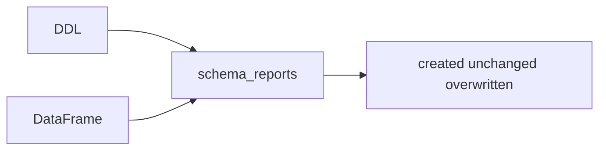

# 11 — Kiểm tra hợp đồng schema

**Phạm vi.** Phase 5D. Warehouse test `file://`, namespace `it_schema5d` và `it_schema5d_ddl`. Không ALTER, DROP hay overwrite bảng production.

**Trong phạm vi này.** Fingerprint production trước và sau giống nhau. DataHub và Feast không thuộc bài này.

**Đọc tiếp.** [Tour](00_system_tour.md) · [12 — dashboard governance](12_governance_dashboard.md)



Phase 5D không ALTER, DROP hay overwrite bảng production. Warehouse của test mới là `file://` trong thư mục tạm, namespace `it_schema5d` và `it_schema5d_ddl`.

```bash
PYTHONPATH=. uv run python -m unittest tests.governance.test_lineage tests.governance.test_observe tests.governance.test_triage tests.governance.test_schema_contract
PYTHONPATH=. uv run --no-project --python 3.12 --with pyspark==3.5.5 python -m transformation.batch.it_schema_contract
PYTHONPATH=. uv run --no-project --python 3.12 --with pyspark==3.5.5 python -m transformation.batch.it_phase1
PYTHONPATH=. uv run --no-project --python 3.12 --with pyspark==3.5.5 --with boto3 python -m serving.clickhouse.it_phase3a
```

Lần chạy trong phase này dùng Python 3.12 đã có PySpark 3.5.5. Worker phải cùng bản Python đó qua `PYSPARK_PYTHON`.

## Việc đã đổi

`create_or_overwrite()` vẫn trả `created`, `unchanged` hoặc `overwritten`. Overwrite chỉ xảy ra khi các cột chung có dòng khác nhau. Lệch cột, kiểu, nullability hoặc partition không mở snapshot mới.

`publish()` thêm `schema_reports`. Mỗi báo cáo có `rows_equal`, `schema_equal`, `differences`, `partition_fields` và `repartition: false`. Cột `NOT NULL` trong DDL Silver/Gold được đếm NULL trên frame. Có NULL thì báo `null_value`, không ghi đè chỉ vì phát hiện đó.

`dt` thừa được đánh dấu `origin=source_folder`. Nó không bị tính là field partition Iceberg.

## Kết quả test cách ly

`docs/proof/logs/phase5d_schema_contract.json`: 6 case, PASS. Fingerprint production trước và sau giống nhau.

| Case | Expected | Actual |
|---|---|---|
| Bảng `double` + `timestamp_ntz` + `dt`, frame `decimal(2,1)` + `timestamp` | Dòng bằng nhau, snapshot giữ, báo lệch | `status=unchanged`, `rows_equal=true`, `schema_equal=false`, `overwrite=false`. Có `type` cho `rating_val` và `rating_ts`, `extra_on_table` cho `dt`, `dt_origin=source_folder`, `dt_is_partition=false`, partition spec rỗng |
| Frame thiếu `review_text`, rồi frame thêm `note` | Báo extra và missing, không ghi | `extra_on_table review_text`, `missing_on_table note`, cả hai `unchanged` |
| Cùng schema, `4.0` rồi `4.5` | Overwrite vì dòng đổi | `overwritten`, snapshot đổi, `schema_equal=true` |
| `2026-01-15 12:00:00` ghi `timestamp_ntz` và `timestamp`, session UTC | Cùng giờ đồng hồ | Ba lần đọc đều `2026-01-15 12:00:00` |
| Bảng chứa `rating_id` NULL, hợp đồng `not_null` | Báo từ giá trị thật | `nulls=1`, `overwrite=false`, snapshot giữ |
| DDL và `writeTo().create()` | DDL partition và decimal. DataFrame create thì không | DDL `decimal(2,1)` partition `event_date`. DataFrame `double`, spec rỗng, `repartition=false` |

41 test governance, gồm các ca quyết định thuần, OK.

`transformation.batch.it_phase1`: `failed` rỗng, PASS. `serving.clickhouse.it_phase3a`: PASS, kể cả case marker thiếu `gold_snapshots` vẫn bị từ chối. Snapshot production `stg_watch_sessions` `1975472564804901513` và `raw_users` `7954921826504091397` không đổi.

## Drift production còn nguyên

Các bảng sau vẫn là schema-id `0` và snapshot đã ghi ở Phase 5C. Phase này chỉ đọc chúng để đối chiếu fingerprint.

| Bảng | Snapshot còn | Việc chưa làm |
|---|---|---|
| `silver.stg_ratings` | `8795824390230744395` | Vẫn `double`, `timestamp` không timezone, cột `dt`, spec partition rỗng. DDL muốn `DECIMAL(2,1)`, `TIMESTAMP`, không có `dt`, partition `event_date` |
| `silver.stg_watch_sessions` | `1975472564804901513` | Vẫn có `dt` và spec rỗng. DDL partition `event_date` |
| `silver.stg_movies`, `gold.dim_movies` | snapshot 16/10 | `timestamp` không timezone và cột optional vẫn nằm trên schema cũ |
| `gold.fact_ratings` | `1324146680817977793` | `rating_val` đã là `decimal(2,1)`. `created_ts` vẫn `timestamp`. Overwrite ngày 18/10 không đổi schema-id |

Lần `publish()` sau, nếu dòng các cột chung không đổi, job trả `unchanged` và đưa các lệch này vào `schema_reports`. Nó không DROP `dt`, không đổi `double` sang `decimal`, không `SET REQUIRED` và không repartition. `execute_zone()` dùng `CREATE TABLE IF NOT EXISTS`, nên DDL không sửa bảng đã có. `writeTo().create()` chỉ áp schema DataFrame khi bảng chưa tồn tại. Bảng production đã tồn tại từ 16/10.

NULL trên production chưa được đếm trong phase này. Hàm mới chỉ chạy khi có một lần publish. Chưa có lần publish production mới.

`timestamp_ntz` và `timestamp` giữ cùng giờ đồng hồ khi session là UTC, như test cách ly. Chưa đo lại từng giá trị trên bảng production.

## Giới hạn

Báo cáo schema không sửa kiểu vật lý. Overwrite khi dòng đổi vẫn ghi vào schema Iceberg đang có. Muốn hết drift cần một migration riêng, không nằm trong phase này.

Phase 5D dừng ở validator và test.
