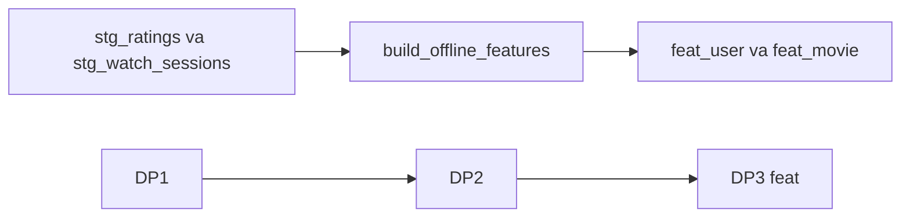

# Feature offline và ba pipeline Airflow

**Phạm vi.** HEAD `51b22ba`, phần này chưa commit. `make spark-features-it`, warehouse `file://`, namespace `it_a1`. Mốc fixture `T = 2026-06-01`.

**Trong phạm vi này.** Mục “Chưa làm” liệt kê Feast, Redis, DataHub và ảnh UI của lần viết này. Ảnh UI và run Airflow nằm ở file 14. DataHub ở file 20. Feast ở file 15–17. Bảng `feat_*` production vẫn snapshot `-1`.

**Đọc tiếp.** [Tour](00_system_tour.md) · [04 — Flink](04_streaming_flink_proof.md)

HEAD lúc bắt đầu phase là `51b22ba`. Phần này chưa commit. Không có ảnh Airflow, không có benchmark model.

## Bài toán

Định nghĩa nằm ở `docs/ml/01_offline_prediction.md`. Nhãn là rating `>= 4.0` trong một ngày sau mốc `T`. Feature chỉ dùng sự kiện trước `T`.

## Job đã chạy được

`transformation/batch/jobs/build_offline_features.py` đọc `stg_ratings` và `stg_watch_sessions`, ghi hai bảng `feat_*` trong namespace được chỉ định. Namespace `gold` bị từ chối nếu không có `allow_production`. Lần ghi cùng input trả `unchanged` và không thêm snapshot.

`make spark-features-it` dùng warehouse `file://` và namespace `it_a1`. Log: `docs/proof/logs/phase_a1_offline_features.json`.

Fixture tại `T = 2026-06-01`:

- User 1 có 1 rating trước `T`, điểm trung bình 5.0, genre `Action` vì hòa số phiếu với `Drama` thì lấy tên đứng trước, 1.0 giờ xem trong 30 ngày.
- User 2 không có rating trong cửa sổ, average null, 2.0 giờ xem.
- Movie 10 có 1 rating, completion 0.5, trending 7 ngày là 1.0 giờ. Lượt xem ngày 3 tháng 6 không đi vào feature.
- Movie 12 chỉ có rating đúng lúc `T`, nên không có dòng feature.

Snapshot production sau lần chạy vẫn là:

| Bảng | Snapshot |
| --- | --- |
| `fact_ratings` | `1324146680817977793` |
| `fact_watch_sessions` | `4699535929651689042` |
| `feat_user_movie_stats_daily` | `-1` |
| `feat_movie_engagement_stats_daily` | `-1` |
| `stg_ratings` | `8795824390230744395` |

Bảng `feat_*` production vẫn rỗng. Chỉ namespace cách ly có dòng.

## Airflow

Ba file mới gọi lại hàm của DAG `cinestream_daily_batch_lakehouse`. DAG cũ vẫn còn và vẫn là danh sách task trong inventory.

| DAG | Việc làm | Phụ thuộc |
| --- | --- | --- |
| `cinestream_dp1_raw_to_bronze` | sensor, ingest Bronze, validate Bronze | nguồn MinIO |
| `cinestream_dp2_bronze_to_gold` | publish Silver/Gold, validate Gold, marker, sync ClickHouse | DP1 `validate_bronze` cùng logical date |
| `cinestream_dp3_offline_features` | tính `feat_*`, kiểm tra khóa và count | DP2 `publish_success` cùng logical date |

Cả ba để `is_paused_upon_creation=True`. Schedule vẫn `None` khi `CINESTREAM_ALLOW_PRODUCTION` chưa bật. Chưa có lần chạy trên UI Airflow.

DP2 cần `batch_id` trong conf khi không lấy được XCom của sensor. DP3 cần `as_of` và `created_timestamp`, hoặc dùng `data_interval_start`.

## Chưa làm

- Feast, Redis, Kubeflow, MLflow, KServe.
- Ghi `feat_*` vào namespace `gold` production.
- Genre trong Silver production. `user_favorite_genre` sẽ null nếu không có `stg_movie_genres`.
- Feature từ `stg_playback_windows`.
- Ảnh UI của DP1, DP2, DP3 và DataHub.
- Train, metric, hoặc ảnh model.

Module 1 chưa đủ rubric. R22–R27 là code đã có, chưa có bằng chứng UI. R36 vẫn đúng ở mức cột `event_timestamp` và `created_timestamp`.
