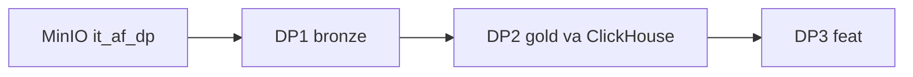

# 14 — Airflow DP1, DP2, DP3 trên Spark và Iceberg

**Phạm vi.** Chạy lúc 2026-10-23. `make airflow-dp-it`, PASS. Namespace `it_af_dp`, ClickHouse `it_af_dp_ch`, logical date `2026-05-01`. Không ghi `bronze` / `silver` / `gold` và không ghi `cinestream_serving`.

**Trong phạm vi này.** “Không cài Feast” đúng với phase A2. Feast nằm ở file 15–17. DataHub của cùng ba DAG nằm ở file 18 và 20.

**Đọc tiếp.** [Tour](00_system_tour.md) · [08 — governance](08_data_governance_lineage.md)

Chạy lúc 2026-10-23. Lệnh `make airflow-dp-it` kết thúc PASS. Log đầy đủ: `docs/proof/logs/phase_a2_airflow_e2e.json`. Ba DAG vẫn paused, schedule là None. Không ghi namespace `bronze`, `silver`, `gold`. Không ghi database `cinestream_serving`. Không bật streaming. Không cài Feast, Kubeflow, MLflow hay KServe.

HEAD git vẫn `51b22ba`. Phần A2 nằm trên working tree, chưa commit.

## Ba pipeline

Ảnh danh sách: `docs/proof/images/airflow-dp-list.png`. Cả bốn DAG đang paused. Schedule là None.

| DAG | Việc của từng task | Run đã chứng minh |
| --- | --- | --- |
| `cinestream_dp1_raw_to_bronze` | `check_source_ready` chờ đủ bốn folder Parquet. `spark_raw_to_bronze` gọi ingest có sẵn. `validate_bronze` kiểm hợp đồng Bronze. | `manual__2026-05-01T00:00:00+00:00`, success. Ảnh `docs/proof/images/airflow-dp1-grid.png`. |
| `cinestream_dp2_bronze_to_gold` | `wait_for_dp1` chỉ đi tiếp khi `validate_bronze` của cùng logical date thành công. `spark_bronze_to_gold` và `validate_gold` dùng job có sẵn. `publish_success` ghim snapshot. `sync_clickhouse` nạp đúng snapshot đó. | Cùng logical date, success. Ảnh `docs/proof/images/airflow-dp2-grid.png`. |
| `cinestream_dp3_offline_features` | `wait_for_dp2` chờ `publish_success`. `spark_offline_features` đối chiếu snapshot rồi tính feature. `validate_features` kiểm khóa và số dòng. | Cùng logical date, success. Ảnh `docs/proof/images/airflow-dp3-grid.png`. |

Namespace của lần chạy thành công là `it_af_dp`. `batch_id` là `batch-ad6a69a535ee5297ad2c73b10942813a`. ClickHouse nhận database `it_af_dp_ch`, một dòng `movie_ratings`. `cinestream_serving.movie_ratings` và `movie_engagement` vẫn 0 dòng trước và sau.

## Snapshot không trộn batch

Marker do DP2 ghi mang `dag_id` `cinestream_dp2_bronze_to_gold`. Snapshot lúc publish trùng snapshot đang current:

| Bảng | Snapshot |
| --- | --- |
| `dim_movies` | `3540580631009244625` |
| `fact_ratings` | `4090265516428251804` |
| `obt_movie_engagement` | `8949984926501596463` |
| `stg_ratings` | `366732757528609377` |
| `stg_watch_sessions` | `3278621357883113687` |

DP3 đọc XCom `publish_success` và từ chối chạy nếu `batch_id` hoặc snapshot Gold/Silver hiện tại khác marker. Phép tính feature vẫn đọc Silver. `fact_ratings` không có `user_id`, và mốc thời gian của watch chỉ còn trên `stg_watch_sessions`. Công thức feature không đổi.

Sau DP3, hai bảng feature có snapshot `1992904055192348575` và `1720343794407991313`.

## Feature

`as_of` là `2026-01-20T00:00:00+00:00`. `created_timestamp` là `2026-01-21T03:00:00+00:00`. Cả hai bảng có một dòng. Khóa và hai mốc thời gian không null.

| Bảng | Dòng | Giá trị khớp nguồn |
| --- | --- | --- |
| `feat_user_movie_stats_daily` | user 7 | 1 rating, điểm trung bình 4.0, 0.166667 giờ xem, genre null |
| `feat_movie_engagement_stats_daily` | movie 11 | 1 rating, điểm trung bình 4.0, completion 0.5, trending 0.166667 |

Nguồn có đúng một rating của user 7 lúc 2026-01-15 12:00 và một phiên xem 600 giây. Không có rating nào tại hoặc sau `as_of`. Genre null vì Silver không có `stg_movie_genres`.

Lần DP3 với `as_of` `2026-01-15T00:00:00+00:00` thất bại: sự kiện 12:00 cùng ngày nằm ngoài cửa sổ `[T - lookback, T)`. Snapshot feature không đổi. Chạy lại đúng `as_of` và `created_timestamp` ban đầu thì `user_write` và `movie_write` đều `unchanged`, snapshot vẫn nguyên.

## Upstream hỏng và retry

Logical date `2026-05-02`, namespace `it_af_dp_fail`, nguồn không có file. DP1 dừng ở `check_source_ready`. `validate_bronze` là `upstream_failed`. DP2 `wait_for_dp1` failed, các task sau là `upstream_failed`. DP3 `wait_for_dp2` failed, `spark_offline_features` không chạy. Namespace này không có bảng `feat_*`. Ảnh: `docs/proof/images/airflow-dp2-upstream-failed.png`.

Logical date `2026-05-03`, namespace `it_af_dp_retry`, `fail_once` true. `spark_raw_to_bronze` lần 1 thoát lỗi sau khi ghi users, lần 2 success. `try_number` là 2. DAG DP1 success.

Logical date `2026-05-04` trigger DP1 với namespace `bronze`/`silver`/`gold` và `allow_production` true. Task dừng trước spark-submit vì entry mặc định là DAG cũ. DAG cũ `cinestream_daily_batch_lakehouse` giữ paused suốt bài test, không có run mới.

## Bảng production không đổi

| Bảng | Snapshot sau bài test |
| --- | --- |
| `gold.fact_ratings` | `1324146680817977793` |
| `gold.fact_watch_sessions` | `4699535929651689042` |
| `silver.stg_ratings` | `8795824390230744395` |
| `gold.feat_user_movie_stats_daily` | `-1` |
| `gold.feat_movie_engagement_stats_daily` | `-1` |

