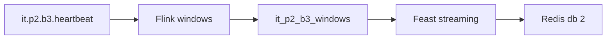

# 17 — Cửa sổ Flink sang Feast offline và Redis

**Phạm vi.** Chạy lúc 2026-10-25. Redis database `2`, cổng `16379`. Topic `it.p2.b3.heartbeat`. Bảng `cinestream.silver.it_p2_b3_windows`. Job `eb8f2f890e868020ffdabf28b6ad5a97`. Lệnh `make feast-streaming-it`.

**Trong phạm vi này.** Không submit `movie.playback.heartbeat`. Offset và snapshot production ghi trong file được giữ nguyên. Không có Kubeflow, MLflow, KServe.

**Đọc tiếp.** [Tour](00_system_tour.md) · [05 — Airflow](05_orchestration_governance_proof.md)



Chạy lúc 2026-10-25. Feast `0.67.0`. Redis database `2` trên cổng host `16379`. Job Flink `eb8f2f890e868020ffdabf28b6ad5a97`, tên `it_p2_b3_windows`. Log `docs/proof/logs/phase_b3_streaming_features.json`, status PASS. HEAD git vẫn `51b22ba`. Phần B3 nằm trên working tree, chưa commit.

Topic là `it.p2.b3.heartbeat`. Bảng là `cinestream.silver.it_p2_b3_windows`. Không submit `movie.playback.heartbeat`. Offset production của topic đó giữ `469 / 513 / 519`. Snapshot `stg_playback_heartbeats` giữ `2913439599822163993`. Snapshot `stg_playback_windows` giữ `4894481358013256565`. Không có Kubeflow, MLflow, KServe.

## View và thứ tự cập nhật

Feature View `movie_minute_playback` có entity `movie_id`. `event_timestamp` là `window_end`. Ba cột là `heartbeat_count`, `total_watch_seconds`, `active_users`. `active_users` là số `user_id` khác nhau trong phút tumbling, không phải số người xem đồng thời.

`created_timestamp` bằng `window_end` cộng sequence của lần sync, tính bằng millisecond. Bản late firing cùng `window_end` có created lớn hơn. Online lấy `window_end` lớn nhất, rồi created lớn nhất. Redis bật `skip_dedup` để bản sửa cùng `window_end` ghi đè được.

DP4 chỉ materialize `user_movie_stats` và `movie_engagement_stats` vào Redis database 1. Sync streaming từ chối database khác 2, và materialize batch từ chối database 2. Hai project Feast tách nhau: `cinestream_offline` và `cinestream_streaming`.

## Job và snapshot

Graph có operator `tumbling-1m` và sink `IcebergSink cinestream.silver.it_p2_b3_windows`. Watermark và allowed lateness giữ mặc định của job. Image Flink đang chạy được build trước khi repo có `--job-name`, nên lần này tên job đi qua `-Dpipeline.name`.

| Bước | Snapshot | Logic movie 42 | Sync |
| --- | --- | --- | --- |
| Cửa sổ phút 0 | `5088493782630165949` | 4 / 40 / 4, `window_end` `1970-01-01T00:01:00` | `materialized`, 4596.630 ms |
| Late firing cùng cửa sổ | `6355621532166202131`, parent snapshot trên | 5 / 50 / 5, cùng `window_end` | `materialized`, 3301.314 ms |
| Thêm phút đã đóng `00:02:00` | `6499007111653214070` | phút 0 vẫn 5 / 50 / 5, phút 1 là 1 / 10 / 1 | `materialized`, 2739.781 ms |

Thời gian Flink đến khi Iceberg hiện đúng dòng, gồm cả checkpoint: phút đầu 17611.825 ms, late firing 3635.679 ms, cửa sổ thứ hai 13273.438 ms. Đó là số đo của lần chạy này.

Snapshot late là `overwrite`. `added-equality-deletes` của snapshot đó là 1, tổng 2. `delete_files` content `2` có 2 record. `data_records` là 2. `VERSION AS OF` trả một dòng logic 5 / 50 / 5. Dòng 4 / 40 / 4 không còn trong snapshot logic.

`get_historical_features` tại `1970-01-01T00:01:00.001` ra 4 / 40 / 4. Tại `.002` ra 5 / 50 / 5. Tại `1970-01-01T00:02:00.003` ra 1 / 10 / 1. `get_online_features` sau cửa sổ thứ hai là 1 / 10 / 1. Movie 99 trả null.

## Retry, snapshot cũ, restart

Lần sync cửa sổ thứ hai bị chặn sau khi ghi Redis và trước `committed.json`. File commit giữ snapshot late. Chạy lại cùng snapshot thì commit, online là 1 / 10 / 1.

Chạy lại đúng snapshot đã commit trả `unchanged`. `FLUSHDB` database 2 rồi chạy lại trả `reloaded`, giá trị online trở lại. Snapshot phút đầu bị từ chối với `snapshot 5088493782630165949 cũ hơn 6499007111653214070`. Bảng `it_p2_b3_missing` không có và không làm tiến state.

TaskManager bị kill rồi start lại. Checkpoint 7 fail. Job restore checkpoint 6, `counts.restored` thành 1. Tập dòng logic sau restore trùng tập dòng trước kill. Sync sau đó là `unchanged`.

Sentinel trên Redis database 1 giữ nguyên.

## Bảo đảm

- Online và offline chỉ nhận dòng `VERSION AS OF` của một snapshot Iceberg. Equality-delete nằm trong lần đọc đó.
- Snapshot có `committed_at` không mới hơn bản đã commit không ghi Redis.
- Cùng cửa sổ, late firing đổi 4 / 40 / 4 thành 5 / 50 / 5 trên online và vẫn để bản cũ trong offline theo `created_timestamp`.
- Cửa sổ đóng muộn hơn thay giá trị online. Cửa sổ cũ còn trong lịch sử offline.
- DP4 không mở Redis database 2. Sync streaming không mở database 1.
- Lỗi trước commit không đổi `committed.json`. Retry cùng snapshot mới commit.

## Giới hạn

Kafka, Iceberg và Redis không nằm trong một giao dịch. Checkpoint Flink là exactly-once từng sink. Redis là bước sau, khi snapshot đã hiện. Retry cùng snapshot ghi lại Redis rồi mới commit.

`active_users` không phải concurrent viewers. Job production không được submit. Image Flink hiện tại chưa chứa cờ `--job-name` mới thêm trong repo. Module 2 R12 là VERIFIED, 2.0 điểm. Verified của Module 2 là 6.0 / 100. Module 1 giữ 73%.

Lệnh:

```bash
make feast-streaming-it
```

Dừng tại Phase B3.
