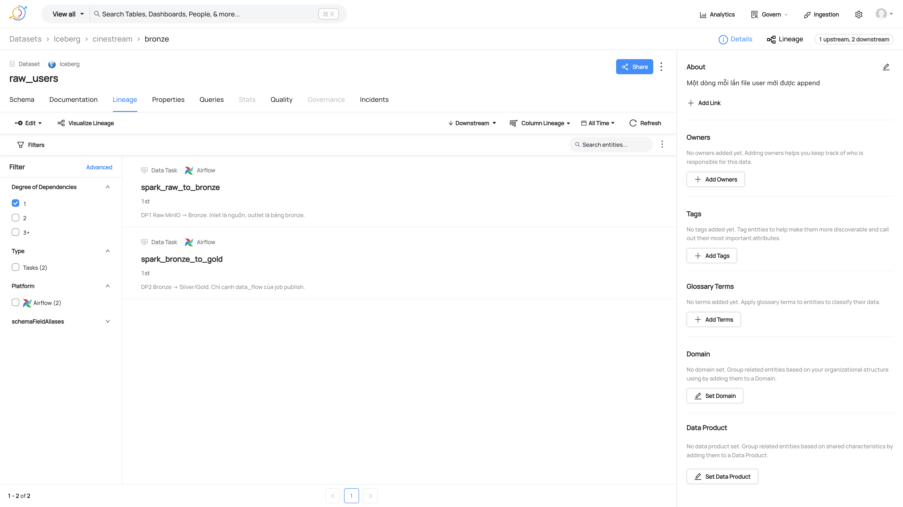
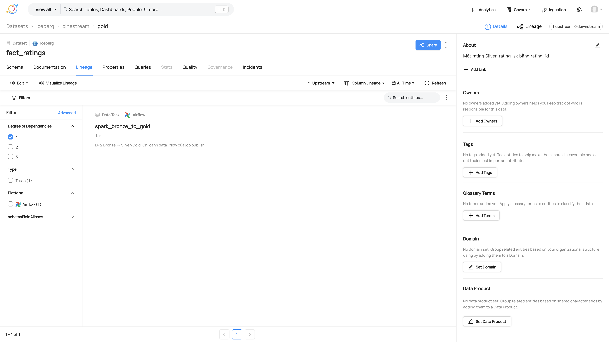
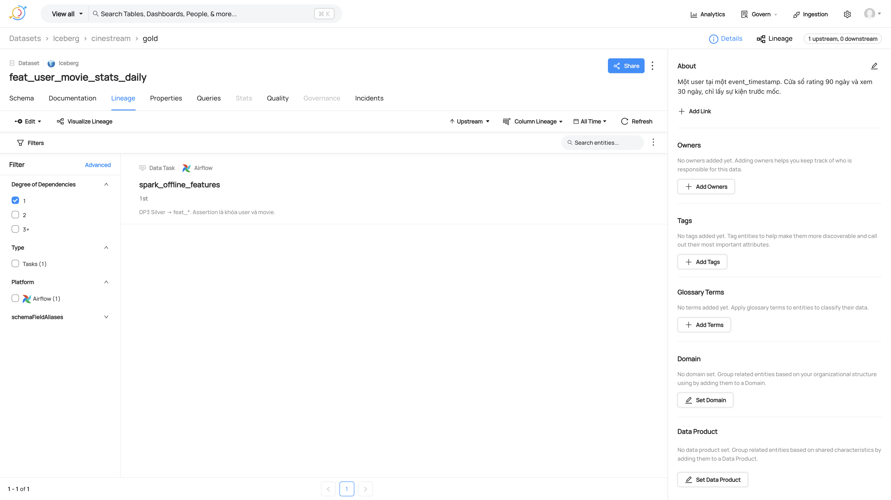
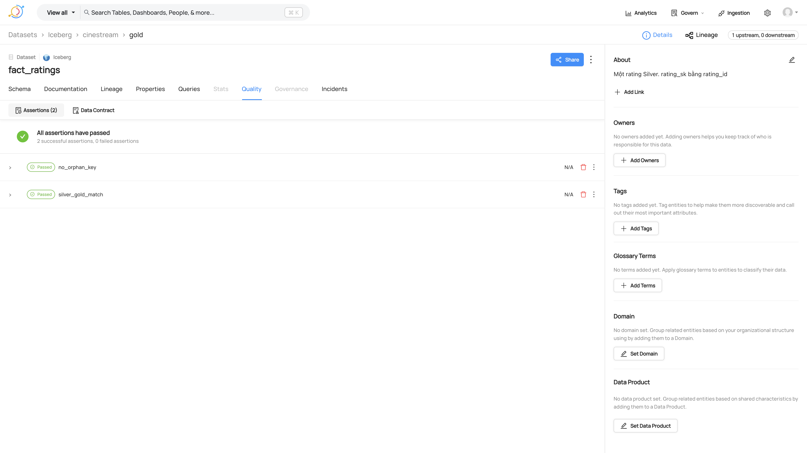
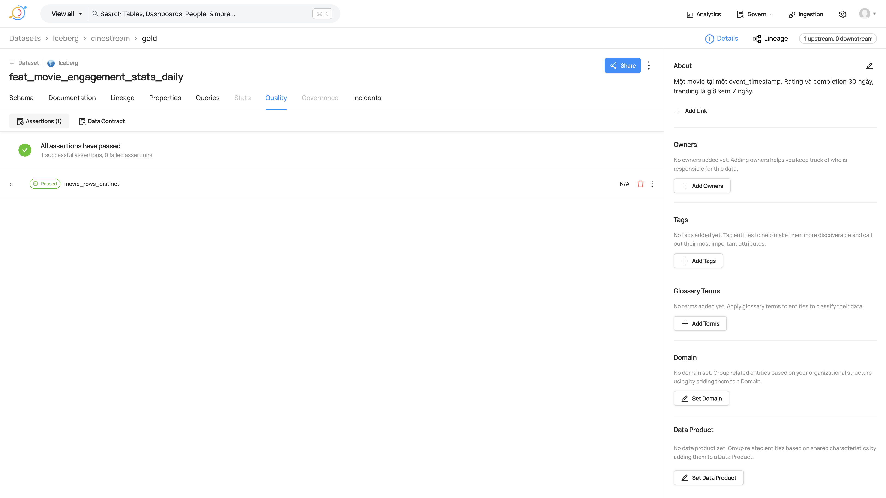

# 18 — DataHub chiếu DP1, DP2, DP3

Catalog trong `governance/inventory.py` vẫn là nguồn sự thật. DataHub chỉ nhận cạnh `data_flow` của job DP1–DP3 và dict mà `validate_*` đã trả. `validate.py`, triage, drift và dashboard không đọc GMS.

GMS: `http://localhost:18083`. UI: `http://localhost:9002` (datahub / datahub). Compose: `infra/compose/docker-compose.datahub.yml`, mạng `cinestream_default`. Kafka metadata là broker quickstart riêng, không dùng Kafka heartbeat.

Lệnh chiếu payload của lần DP IT (`ready`, counts khớp, orphan bằng 0, `user_rows == user_distinct`):

```bash
python -m governance.datahub.emit \
  --dag-id cinestream_dp1_raw_to_bronze \
  --run-id manual__2026-05-01T00:00:00+00:00 \
  --gms-url http://127.0.0.1:18083 \
  --result-json '{"ready": true, "datasets": [{"dataset": "users", "error_rate": 0.0}, {"dataset": "movies", "error_rate": 0.0}, {"dataset": "ratings", "error_rate": 0.0}, {"dataset": "watch", "error_rate": 0.0}], "violations": [], "reason": "bronze đạt hợp đồng"}'
```

DP2 và DP3 dùng cùng `--run-id` với dict `validate_gold` và `validate_features`. Namespace `it_af_dp` đổi tên dataset thành `cinestream.it_af_dp.*` để không đè tên production. Ảnh dưới đây là fabric `PROD` và tên bảng trong inventory.

## Lineage

`raw_users` có task `spark_raw_to_bronze` (DP1) và `spark_bronze_to_gold` (DP2).



`fact_ratings` upstream là `spark_bronze_to_gold`.



`feat_user_movie_stats_daily` upstream là `spark_offline_features`.



## Assertion

Mỗi kết quả gắn dataset outlet. Run event của `manual__2026-05-01T00:00:00+00:00` là SUCCESS.







`bronze_ready` và `bronze_error_threshold` ở bảng bronze. `silver_gold_match` và `no_orphan_key` ở `fact_ratings`. `user_rows_distinct` ở `feat_user_movie_stats_daily`. `movie_rows_distinct` ở `feat_movie_engagement_stats_daily`.

Task Airflow `publish_datahub` đứng sau task validate, `trigger_rule=all_done`. Lỗi GMS không xóa batch Iceberg đã ghi.
