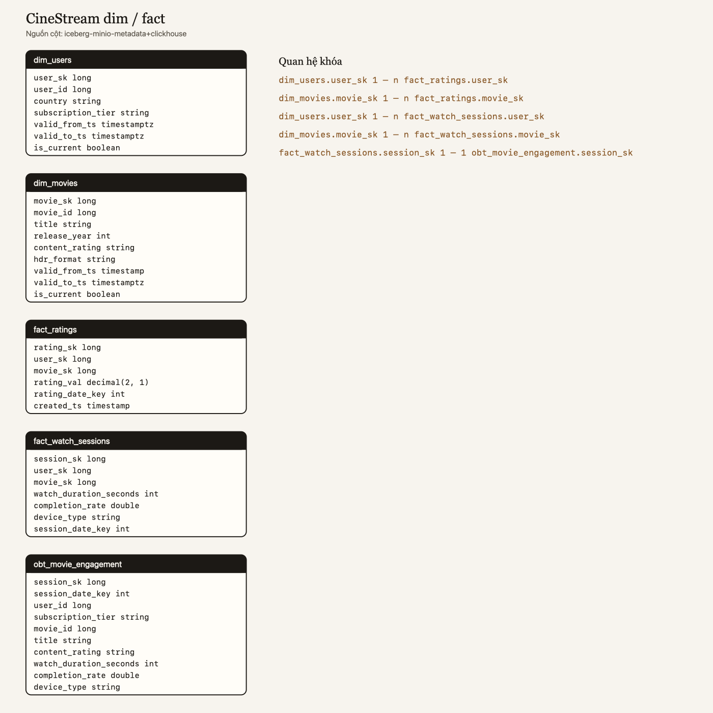

# 19 — Quan hệ dim và fact

Ảnh xuất từ metadata Iceberg đang nằm trên MinIO, không phải sơ đồ Mermaid vẽ tay. Lệnh:

```bash
python -m storage.lakehouse.export_erd
```

Nguồn cột của lần chạy này là metadata bảng Gold (`iceberg-minio-metadata`). REST catalog không còn namespace `gold` sau khi container Iceberg REST được tạo lại, nên script đọc schema trong file metadata của warehouse. ClickHouse `cinestream_serving` chỉ có bản phẳng `movie_ratings` và `movie_engagement`, không giữ `dim_*` / `fact_*`.



## Từng bảng

| Bảng | Việc của bảng | Khóa |
|---|---|---|
| `dim_users` | SCD2 của user. Một `user_id` có nhiều phiên bản, đúng một bản `is_current`. | `user_sk` |
| `dim_movies` | SCD2 của phim. Fact phim chỉ join bản `is_current`. | `movie_sk` |
| `fact_ratings` | Một rating Silver. `rating_sk` bằng `rating_id`. | `rating_sk`, FK `user_sk`, FK `movie_sk` |
| `fact_watch_sessions` | Một phiên xem Silver. `session_sk` bằng `session_id`. | `session_sk`, FK `user_sk`, FK `movie_sk` |
| `obt_movie_engagement` | Một phiên đã gắn user đúng thời điểm và phim hiện tại. Nguồn batch của ClickHouse. | `session_sk` trỏ về `fact_watch_sessions` |

Quan hệ trên ảnh:

- `dim_users.user_sk` 1 — n `fact_ratings.user_sk`
- `dim_movies.movie_sk` 1 — n `fact_ratings.movie_sk`
- `dim_users.user_sk` 1 — n `fact_watch_sessions.user_sk`
- `dim_movies.movie_sk` 1 — n `fact_watch_sessions.movie_sk`
- `fact_watch_sessions.session_sk` 1 — 1 `obt_movie_engagement.session_sk`

Iceberg không khai báo foreign key. Các cạnh này là khóa surrogate mà `build_gold_layer` ghi khi publish.
