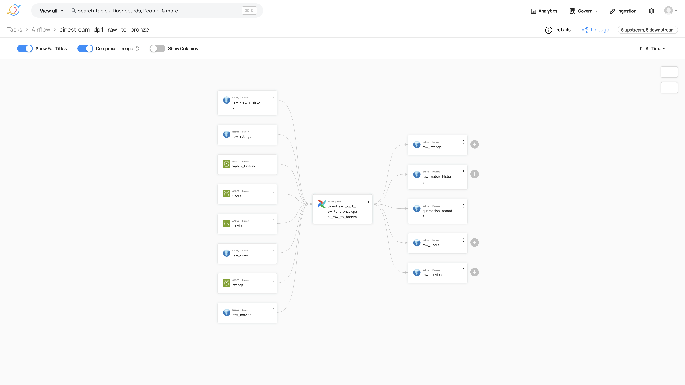
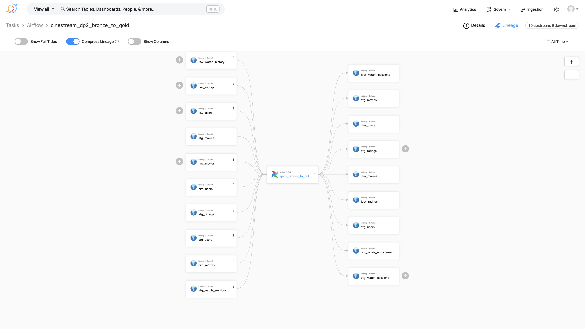
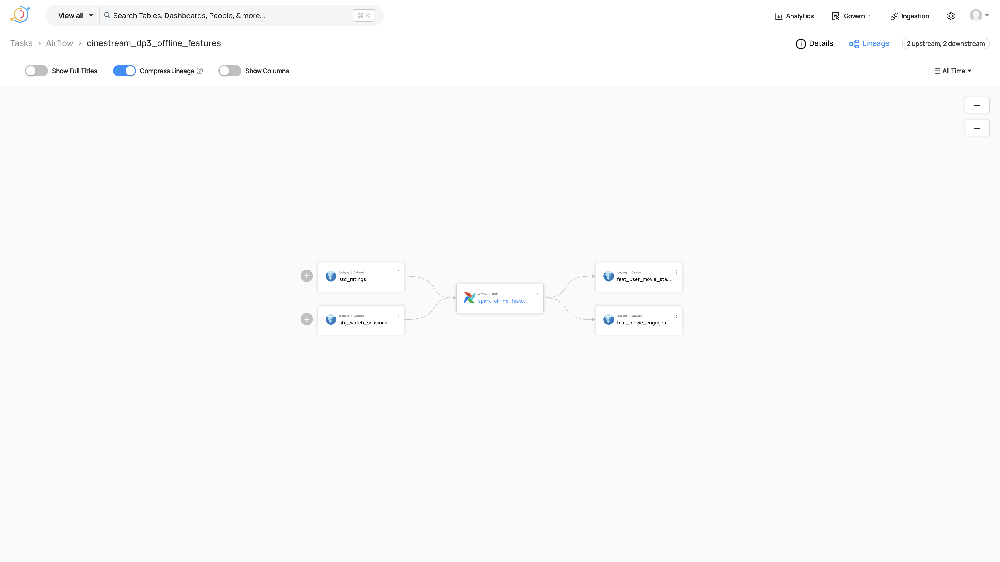
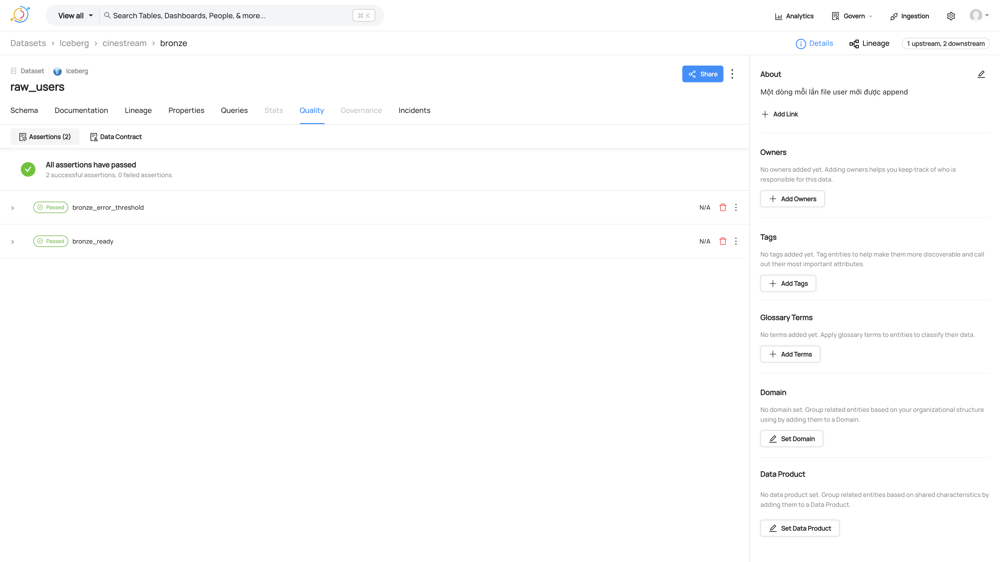
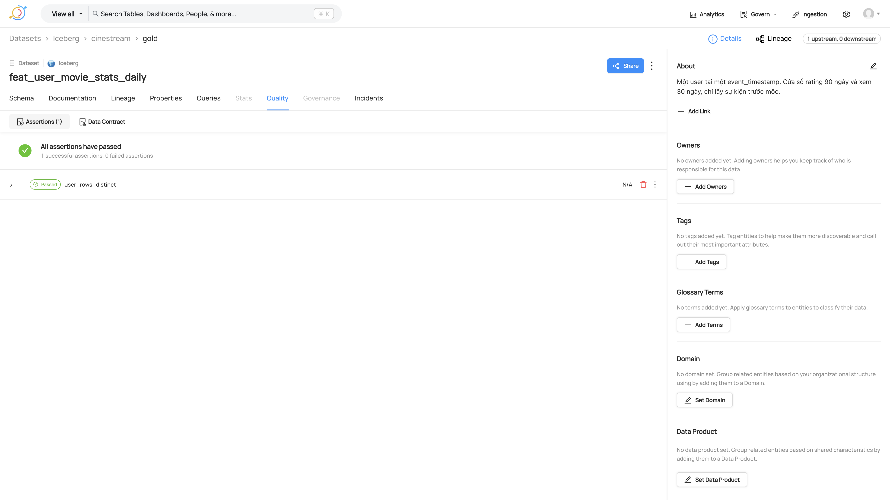

# 20 — DataHub chiếu DP1–DP3

Catalog trong `governance/` vẫn là nguồn sự thật. DataHub chỉ nhận cạnh `data_flow` của ba DAG và kết quả `validate_*` đã có. `control_dependency`, `observability`, `api_consumption`, drift và triage không được đẩy lên GMS. Dashboard và Lakehouse UI không đọc DataHub.

Compose: `infra/compose/docker-compose.datahub.yml` trên mạng `cinestream_default`. GMS `http://localhost:18083`, UI `http://localhost:9002`. Kafka metadata là broker riêng của quickstart, không phải Kafka heartbeat.

Lệnh chiếu một lần, namespace production:

```bash
PYTHONPATH=. python -m governance.datahub.emit \
  --dag-id cinestream_dp1_raw_to_bronze --run-id proof-dp1 \
  --gms-url http://localhost:18083 \
  --result-json '{"ready": true, "datasets": [{"error_rate": 0}], "violations": []}'
```

DP2 và DP3 dùng cùng module, với dict mà `validate_gold` và `validate_offline_features` đã trả. Task Airflow `publish_datahub` đứng sau task validate, `trigger_rule=all_done`. Emit lỗi không xóa snapshot Iceberg.

## Lineage

DP1, task `spark_raw_to_bronze`: MinIO `users`, `movies`, `ratings`, `watch_history` và bảng bronze `raw_*` vào job; outlet là `raw_users`, `raw_movies`, `raw_ratings`, `raw_watch_history`, `quarantine_records`.



DP2, task `spark_bronze_to_gold`: bronze và silver vào, dim/fact và `obt_movie_engagement` ra. 10 upstream, 9 downstream trên UI.



DP3, task `spark_offline_features`: `stg_ratings` và `stg_watch_sessions` vào hai bảng feature.



## Assertion

Mỗi check gắn dataset outlet, run `proof-dp1` / `proof-dp2` / `proof-dp3`, kết quả SUCCESS.

| Pipeline | Dataset | Assertion |
|---|---|---|
| DP1 | `raw_users` | `bronze_ready`, `bronze_error_threshold` |
| DP2 | `fact_ratings` | `silver_gold_match`, `no_orphan_key` |
| DP3 | `feat_user_movie_stats_daily` | `user_rows_distinct` |
| DP3 | `feat_movie_engagement_stats_daily` | `movie_rows_distinct` |







