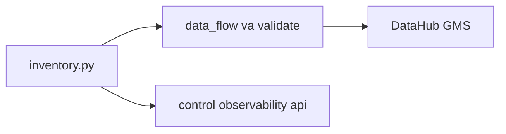

# 20 — DataHub chiếu DP1–DP3

**Phạm vi.** Hai lần emit lên GMS `http://localhost:18083`, UI `http://localhost:9002`. Lần rút gọn dùng run `proof-dp1`, `proof-dp2`, `proof-dp3` và tên production. Lần IT dùng run `manual__2026-05-01T00:00:00+00:00` và namespace `it_af_dp`. Compose `infra/compose/docker-compose.datahub.yml` trên mạng `cinestream_default`.

**Trong phạm vi này.** Catalog gốc là `governance/inventory.py`. Emit chỉ gửi `data_flow` và dict `validate_*`. Đây là file đọc cho DataHub. Lệnh payload IT còn được giữ ở [18_datahub_lineage.md](18_datahub_lineage.md).

**Đọc tiếp.** [Tour](00_system_tour.md) · [20 — image, lần đo cột docker](20_docker_multistage.md)



## Catalog gốc

`governance/inventory.py` vẫn là nguồn sự thật. `governance/datahub/emit.py` chỉ POST proposal. `pipeline_edges` giữ cạnh `data_flow` có evidence trỏ tới job của pipeline đó. Ba kind `control_dependency`, `observability` và `api_consumption` ở lại inventory. Drift, triage và dashboard không đọc GMS. `validate.py` không đọc GMS. Dashboard và Lakehouse UI không đọc DataHub.

Kafka metadata là broker quickstart riêng, không dùng Kafka heartbeat.

## Task `publish_datahub`

Task đứng sau task validate trên DP1, DP2 và DP3, `trigger_rule=all_done`. Emit lỗi không xóa snapshot Iceberg và không ghi lại batch.

Namespace khác `bronze` / `silver` / `gold` được `run_prefix` đặt trước tên dataset. Lần IT dùng `it_af_dp`, nên tên Iceberg thành `cinestream.it_af_dp.*` và không đè catalog production. Ảnh IT bên dưới là fabric `PROD` và tên bảng trong inventory.

## Lần emit rút gọn, tên production

```bash
PYTHONPATH=. python -m governance.datahub.emit \
  --dag-id cinestream_dp1_raw_to_bronze --run-id proof-dp1 \
  --gms-url http://localhost:18083 \
  --result-json '{"ready": true, "datasets": [{"error_rate": 0}], "violations": []}'
```

DP2 và DP3 dùng cùng module, với dict mà `validate_gold` và `validate_offline_features` đã trả. Run `proof-dp1` / `proof-dp2` / `proof-dp3` là SUCCESS.

DP1, task `spark_raw_to_bronze`: MinIO `users`, `movies`, `ratings`, `watch_history` và bảng bronze `raw_*` vào job; outlet là `raw_users`, `raw_movies`, `raw_ratings`, `raw_watch_history`, `quarantine_records`.


DP2, task `spark_bronze_to_gold`: bronze và silver vào, dim/fact và `obt_movie_engagement` ra. 10 upstream, 9 downstream trên UI.


DP3, task `spark_offline_features`: `stg_ratings` và `stg_watch_sessions` vào hai bảng feature.


| Pipeline | Dataset | Assertion |
|---|---|---|
| DP1 | `raw_users` | `bronze_ready`, `bronze_error_threshold` |
| DP2 | `fact_ratings` | `silver_gold_match`, `no_orphan_key` |
| DP3 | `feat_user_movie_stats_daily` | `user_rows_distinct` |
| DP3 | `feat_movie_engagement_stats_daily` | `movie_rows_distinct` |


## Lần emit IT, prefix `it_af_dp`

Payload đầy đủ và cùng `--run-id` cho DP2, DP3 nằm ở [18_datahub_lineage.md](18_datahub_lineage.md). Run event của `manual__2026-05-01T00:00:00+00:00` là SUCCESS. Ảnh lần này dùng tiền tố `datahub_dp`, khác bộ `datahub-dp` ở trên.

`raw_users` có task `spark_raw_to_bronze` (DP1) và `spark_bronze_to_gold` (DP2).


`fact_ratings` upstream là `spark_bronze_to_gold`.


`feat_user_movie_stats_daily` upstream là `spark_offline_features`.


Mỗi kết quả gắn dataset outlet.


`bronze_ready` và `bronze_error_threshold` ở bảng bronze. `silver_gold_match` và `no_orphan_key` ở `fact_ratings`. `user_rows_distinct` ở `feat_user_movie_stats_daily`. `movie_rows_distinct` ở `feat_movie_engagement_stats_daily`.
