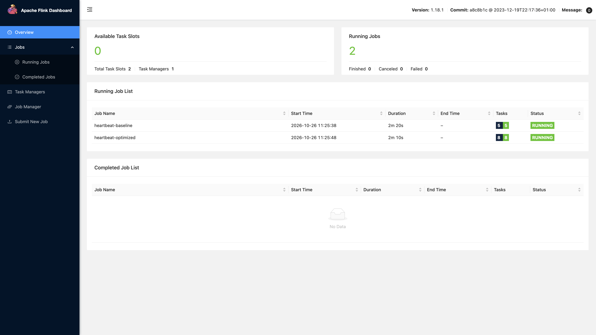
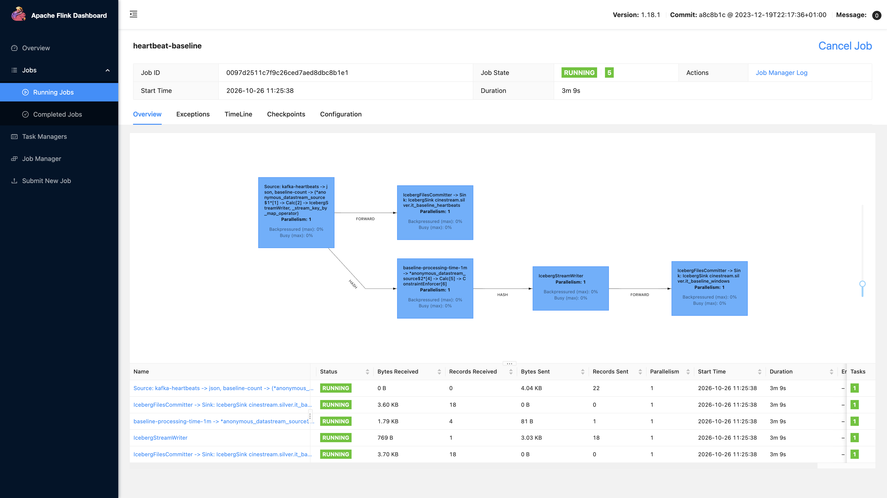
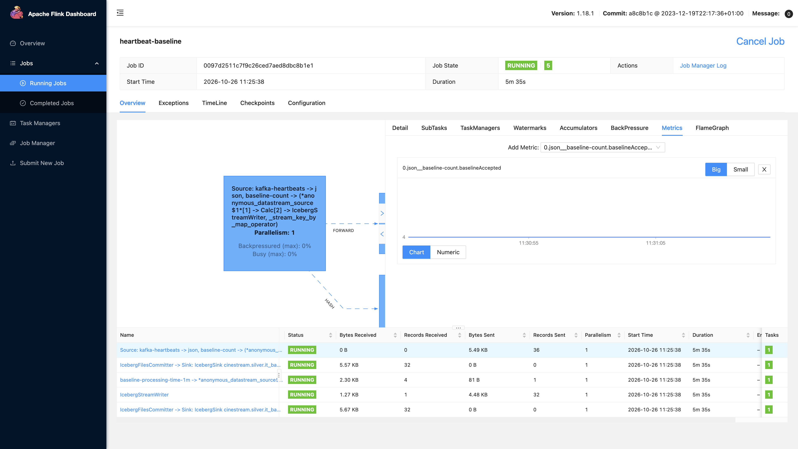
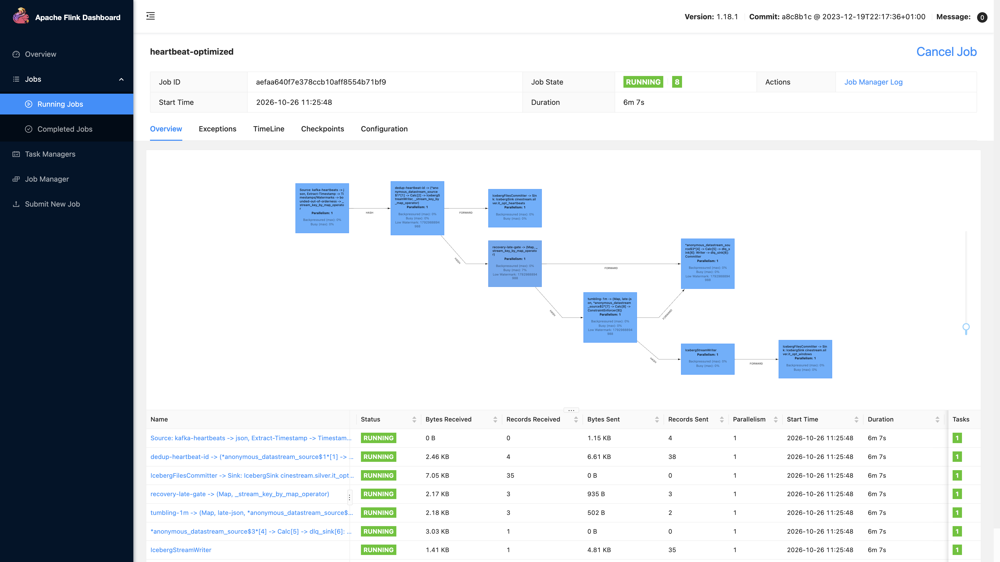
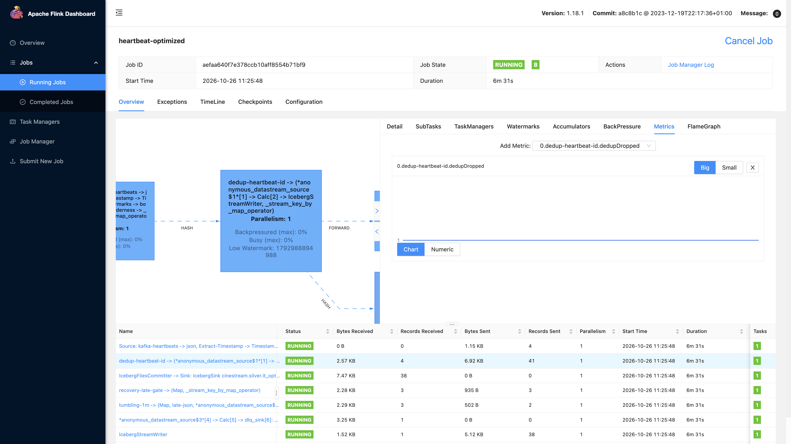
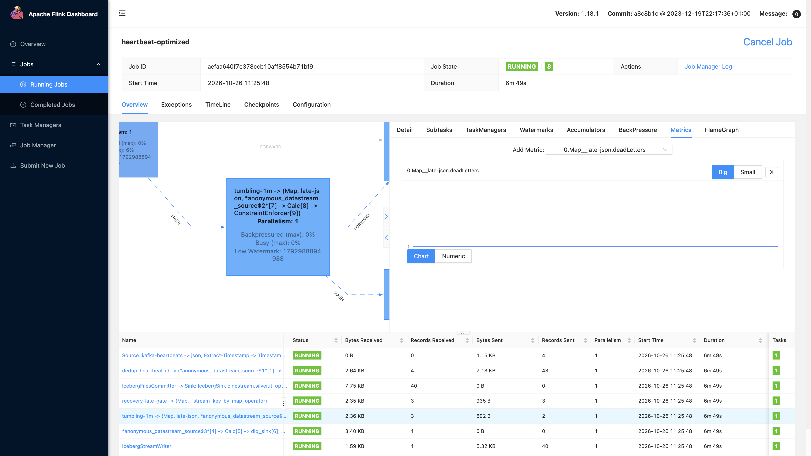

# 21 — Flink baseline và job đã tối ưu trên cùng JobManager

Cụm là image multi-stage `cinestream-flink:1.18.1`. UI: `http://localhost:18081`. Hai job đọc cùng topic `it.module1.heartbeat`, không đụng topic production `movie.playback.heartbeat`.

| Job | ID | Sink |
|---|---|---|
| `heartbeat-baseline` | `0097d2511c7f9c26ced7aed8dbc8b1e1` | `cinestream.silver.it_baseline_heartbeats`, `it_baseline_windows` |
| `heartbeat-optimized` | `aefaa640f7e378ccb10aff8554b71bf9` | `cinestream.silver.it_opt_heartbeats`, `it_opt_windows`, DLQ `it.module1.deadletter` |

Bốn message: heartbeat 101 đúng giờ, bản trùng 101, heartbeat 102 muộn hơn 120 giây để đẩy watermark, rồi heartbeat 103 có `event_ts` lùi 10 phút.

## Baseline

Processing time, `WatermarkStrategy.no_watermarks()`, không dedup, không side output. Cửa sổ là `baseline-processing-time-1m`.

Counter `baselineAccepted` bằng 4. Cả bản trùng và event muộn đều được nhận. Operator cửa sổ nhận 4 record.

## Từng bước trên job tối ưu

Cùng bốn message, graph có các operator mà baseline không có.

1. `bounded-out-of-orderness` gán event time và watermark `max(event_ts) - 15s`. Baseline không có watermark nên event 103 vẫn vào cửa sổ đang mở.
2. `dedup-heartbeat-id` giữ state `heartbeat_id` trên RocksDB, TTL 1 giờ. `dedupDropped` bằng 1 (id 101 lần hai). `dedupEmitted` bằng 3. Bảng task nhận 4 record và gửi 3.

3. `tumbling-1m` là cửa sổ event time 1 phút, allowed lateness 15 giây, side output `late-json`. Event 103 tới sau khi watermark đã qua cửa sổ của nó cộng lateness, nên `deadLetters` bằng 1. Baseline không có side output này.

4. Side output ghi Kafka `it.module1.deadletter`. Message đọc lại có `reason=window_past_cleanup` và `heartbeat_id=103`.

Job baseline vẫn đếm event đó. Job tối ưu đưa nó ra DLQ và không đếm bản trùng.
