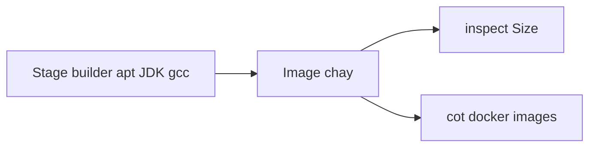

# 22 — Kích thước image trước và sau multi-stage

**Phạm vi.** Lần inspect này đọc `docker image inspect` trường `Size`. Flink sau multi-stage là 1,271,104,760 byte. Bốn Dockerfile: `Dockerfile.spark`, `Dockerfile.flink`, `Dockerfile.airflow`, `Dockerfile.lakehouse-ui`.

**Trong phạm vi này.** Lần inspect trước giữ cột `docker images` ở [20_docker_multistage.md](20_docker_multistage.md). Flink sau multi-stage của lần đó là 1,271,375,322 byte, cột `docker images` 3.15GB. Spark, Airflow và Lakehouse UI có cùng `Size` ở cả hai lần. Hai lần inspect, không phải một kết quả.

**Đọc tiếp.** [Tour](00_system_tour.md)

`Size` là tổng byte các layer. Cột `docker images` gộp layer dùng chung, nên hai cột không đọc thành một số. Không dùng mức giảm 88% đã viết trong README trước đó, vì Dockerfile lúc ấy không tương ứng với hai lần đo này.

Image một stage được giữ bằng tag `single-stage` trước khi build lại. Image nhiều stage là tag `multi-stage`. Spark master và spark worker dùng cùng `Dockerfile.spark`. Hai tag một stage có cùng số byte.

## Lần inspect này

| Image | Trước (byte) | Sau (byte) | Trước | Sau |
|---|---:|---:|---:|---:|
| Spark (`Dockerfile.spark`) | 842808888 | 841453810 | 803.8 MiB | 802.5 MiB |
| Flink (`Dockerfile.flink`) | 1814918517 | 1271104760 | 1730.8 MiB | 1212.2 MiB |
| Airflow (`Dockerfile.airflow`) | 1195486812 | 1202369880 | 1140.1 MiB | 1146.7 MiB |
| Lakehouse UI (`Dockerfile.lakehouse-ui`) | 43551511 | 43551518 | 41.5 MiB | 41.5 MiB |

Flink giảm 543813757 byte trên lần này. Builder giữ JDK, gcc, curl và apt cache. Image chạy chỉ thêm `python3` và `python3-pkg-resources`. JAR Iceberg/Hadoop, plugin RocksDB và `apache-flink` được copy từ builder bằng `COPY --chown`, không có layer `chown -R` thứ hai. `gcc`, JDK và `curl` ở lại builder.

Spark giảm 1355078 byte. Builder tải JAR và Python standalone rồi xóa apt list. Runtime không còn `curl` và cache apt. Phần lớn image là base `apache/spark:3.5.3`.

Lakehouse UI lệch 7 byte. Cả hai stage đều từ `python:3.12-slim`, và stage chạy chỉ copy thư mục `storage`. Stage builder không bỏ thêm gói nào.

Airflow tăng 6883068 byte. Stage `spark-fetch` tải Spark và JAR. Image chạy cài JRE và copy `/opt/spark`. Phần tăng thêm là `acryl-datahub==0.14.1` cho task `publish_datahub`. Gói đó chưa có trên image một stage. Runtime bỏ `curl`.

## Lần inspect trước

Bảng đủ bốn image và cột `docker images` nằm ở [20_docker_multistage.md](20_docker_multistage.md). `Size` trước và sau của Spark, Airflow và Lakehouse UI trùng lần này. Flink trước cũng trùng: 1,814,918,517 byte. Flink sau là 1,271,375,322 byte, giảm 543,543,195 byte, và cột `docker images` in 3.15GB. Lần này Flink sau là 1,271,104,760 byte. Lệch nhau 270,562 byte. Cột 3.15GB thuộc lần đo trước. 1212.2 MiB thuộc `Size` của lần này.
