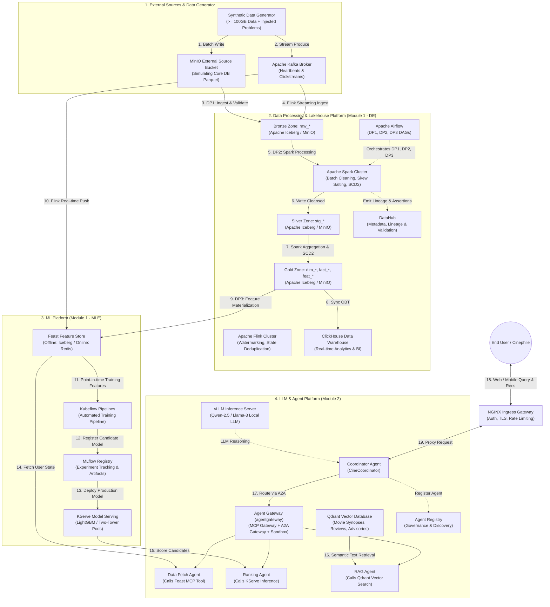

# Movie Recommendation - End-to-End System Architecture Design

## 1. Bản đồ kiến trúc hệ thống tổng thể (End-to-End Architecture)

Kiến trúc hệ thống được thiết kế theo mô hình **Modern Data + AI Stack**, chia thành các khối đơn vị có thể triển khai độc lập (**Deployable Units**) trên hạ tầng Kubernetes và Docker Compose:

---

## 2. Chi tiết các đơn vị triển khai (Deployable Units)

Tất cả các thành phần trong hệ thống đều là các dịch vụ có thể triển khai thực tế bằng container (Docker / Kubernetes):

| Tên thành phần | Công nghệ sử dụng | Chức năng trong hệ thống | Phương thức triển khai |
|---|---|---|---|
| **Data Generator** | Python Generator Service | Tự động sinh $\ge 100\text{ GB}$ dữ liệu, tiêm skew, schema evolution, duplicates, late arrivals. | Docker Container / K8s Job |
| **Object Storage (Data Lake)** | MinIO (S3 Compatible) | Lưu trữ các tầng Lakehouse (Bronze, Silver, Gold) dưới định dạng Apache Iceberg Parquet. | Helm Chart / MinIO Operator |
| **Event Streaming Bus** | Apache Kafka + Zookeeper/KRaft | Tiếp nhận và xếp hàng luồng sự kiện nhịp tim phát phim và nhật ký clickstream. | Helm Chart (Strimzi Operator) |
| **Batch Processing Engine** | Apache Spark 3.5 on K8s | Thực hiện các tác vụ ETL hàng loạt, xử lý skew bằng Salting, xử lý schema evolution, cập nhật SCD Type 2. | Spark Operator on K8s |
| **Stream Processing Engine**| Apache Flink 1.18 | Xử lý sự kiện theo Event-Time, xử lý dữ liệu đến muộn với Watermarks, khử trùng lặp qua RocksDB State. | Flink Kubernetes Operator |
| **Workflow Orchestration** | Apache Airflow 2.8+ | Quản lý lịch biểu và quan hệ phụ thuộc cho 3 Data Pipelines (DP1, DP2, DP3). | Helm Chart (Official Airflow) |
| **Data Governance Catalog** | DataHub (GMS + Frontend) | Quản lý siêu dữ liệu tập trung, tự động vẽ Data Lineage từ Airflow và kiểm tra Data Quality assertions. | DataHub Helm Chart |
| **Analytical Data Warehouse**| ClickHouse Cluster | Lưu trữ bảng OBT (`obt_movie_engagement`) phục vụ truy vấn phân tích tức thời của ban quản trị. | ClickHouse Operator |
| **Feature Store** | Feast + Redis Cluster | Lưu trữ và phục vụ đồng bộ đặc trưng Offline (Iceberg) và Online (Redis độ trễ $<5\text{ms}$). | Feast Service + Redis Helm |
| **ML Training Pipeline** | Kubeflow Pipelines | Đóng gói toàn bộ quy trình huấn luyện mô hình xếp hạng đề xuất từ dữ liệu Feast đến kiểm thử. | Kubeflow K8s Deployment |
| **Model Registry & Tracking**| MLflow Tracking Server | Quản lý tham số mô hình, siêu tham số huấn luyện, và quản lý các phiên bản mô hình đề xuất. | Docker / K8s Deployment |
| **Model Serving** | KServe on Knative/Istio | Cung cấp endpoint suy luận thời gian thực cho mô hình xếp hạng (LightGBM/Two-Tower). | KServe Operator |
| **Vector Database** | Qdrant | Lưu trữ vector embeddings tóm tắt cốt truyện phim, bài phê bình và cảnh báo phụ huynh cho RAG. | Qdrant Helm Chart |
| **LLM Inference Server** | vLLM Engine | Chạy mô hình ngôn ngữ lớn nguồn mở (Qwen-2.5-7B-Instruct) tối ưu hóa PagedAttention. | GPU K8s Deployment |
| **Agent Gateway** | agentgateway | Cổng kiểm soát bảo mật, rate limiting, và môi trường sandbox cho các công cụ MCP và giao tiếp A2A. | Helm Deployment |
| **Coordinator Agent** | CineCoordinator Container | Tác tử trung tâm giao tiếp với người dùng, lập kế hoạch suy luận (ReAct/Plan-and-Solve). | K8s Deployment with HPA |
| **Observability & Security** | Prometheus, Grafana, Vault | Giám sát toàn diện hệ thống (metrics, logs, traces) và quản lý tập trung toàn bộ mật khẩu/API keys. | Prometheus Stack + Vault |

---

## 3. Luồng dữ liệu hoàn chỉnh từ đầu đến cuối (End-to-End Data Flow)

Hệ thống hoạt động qua 6 giai đoạn liên kết chặt chẽ:

### Giai đoạn 1: Sinh dữ liệu và nạp nguồn (Ingestion & Simulation)
1. **[Data Generator]** sinh ra hơn 100GB dữ liệu phim, người dùng, đánh giá và lịch sử xem, chủ động tiêm Skew (phim bom tấn chiếm 80%), Schema Evolution (thêm cột cảnh báo độ tuổi sau ngày 90), và Duplicate (2.5%). Dữ liệu được ghi vào **MinIO External Source Bucket**.
2. Đồng thời, **[Data Generator]** liên tục bắn luồng nhịp tim xem phim (`movie.playback.heartbeat`) và click chuột vào **Kafka**, trong đó 6% sự kiện bị trễ từ 10 - 35 phút và 1.8% sự kiện bị lặp lại.

### Giai đoạn 2: Xử lý dữ liệu Hồ Dữ Liệu (Lakehouse Ingestion & Cleaning)
3. **[Airflow DP1 DAG]** kích hoạt kéo dữ liệu từ MinIO nguồn vào tầng **Bronze Zone (`raw_*`)** trên Lakehouse và chạy kiểm tra tính toàn vẹn (Great Expectations).
4. **[Flink Streaming Job]** tiêu thụ dữ liệu từ Kafka, áp dụng Watermark dung sai 15 phút để gom dữ liệu đến muộn, khử trùng lặp qua RocksDB State TTL 2 giờ, sau đó nạp các sự kiện đã làm sạch vào Bronze Lakehouse và đẩy trực tiếp streaming features vào **Feast Redis Online Store**.
5. **[Airflow DP2 DAG]** kích hoạt cụm **Apache Spark**:
   - Đọc dữ liệu Bronze với cấu hình `mergeSchema = true` để tự động dung hợp các cột mới của Schema Evolution.
   - Áp dụng Window Function để loại bỏ hoàn toàn các bản ghi duplicate 2.5%, lưu vào **Silver Zone (`stg_*`)**.
   - Khử Skew bằng kỹ thuật **Salting Key** kết hợp **Adaptive Query Execution (AQE)** khi join bảng `watch_history` với `ratings`.
   - Cập nhật bảng chiều **`dim_users` theo chuẩn SCD Type 2** để lưu vết thay đổi gói thuê bao.
   - Tạo các bảng Fact và bảng phẳng OBT nạp vào **ClickHouse Data Warehouse**.

### Giai đoạn 3: Tính toán và phục vụ đặc trưng (Feature Engineering via Feast)
6. **[Airflow DP3 DAG]** chạy Spark Job để tính toán các đặc trưng thống kê dài hạn (ví dụ điểm trung bình 90 ngày của user, tỷ lệ xem hết phim 30 ngày) và lưu vào bảng Gold **`feat_*`** trên Lakehouse kèm `event_timestamp` và `created_timestamp`.
7. DAG gọi lệnh `feast materialize` để đồng bộ snapshot đặc trưng mới nhất vào **Redis Cluster**.

### Giai đoạn 4: Huấn luyện và đóng gói mô hình (ML Pipeline)
8. **[Kubeflow Pipelines]** được kích hoạt tự động theo chu kỳ tuần. Pipeline gọi Feast SDK để thực hiện Point-in-time Join giữa bảng nhãn `will_watch_and_like_7d` và các bảng đặc trưng lịch sử (đảm bảo không bị rò rỉ dữ liệu tương lai).
9. Huấn luyện mô hình xếp hạng đề xuất (LightGBM Ranker).
10. Đánh giá chất lượng trên tập kiểm thử độc lập (kiểm tra chỉ số `NDCG@10 > 0.78`).
11. Đăng ký mô hình mới vào **MLflow Model Registry** và tự động cập nhật pod **KServe InferenceService** bằng cơ chế Rolling Update.

### Giai đoạn 5: Vận hành cơ sở tri thức RAG (Knowledge Pipeline)
12. Dữ liệu tóm tắt cốt truyện, diễn viên, bài phê bình và hướng dẫn phụ huynh được phân đoạn thành các chunk 512 tokens, mã hóa thành vector embeddings và nạp vào **Qdrant Vector Database**.

### Giai đoạn 6: Tương tác người dùng thông minh (Agent Reasoning & Recommendation)
13. Người dùng gửi câu hỏi tự nhiên qua Web/App tới **NGINX Ingress** (đã qua lớp bảo mật xác thực và giới hạn tần suất truy cập).
14. **Coordinator Agent (CineCoordinator)** tiếp nhận truy vấn, kích hoạt chuỗi ReAct:
    - Gọi **Tool 1 (MCP Data Fetch)** truy xuất lịch sử xem và các thể loại vừa xem trong 1 giờ từ Feast.
    - Gọi **Tool 3 (RAG Vector Search)** tìm kiếm các phim có cốt truyện phù hợp với mô tả của người dùng trên Qdrant.
    - Gọi **Tool 2 (KServe ML Inference)** gửi danh sách phim vừa tìm được để mô hình ML xếp hạng mức độ yêu thích cá nhân hóa cho người dùng này.
15. Coordinator Agent kết hợp thông tin điểm số, tóm tắt nội dung và cảnh báo độ tuổi để sinh ra câu trả lời tự nhiên, thân thiện và giàu sức thuyết phục gửi về cho người dùng.
